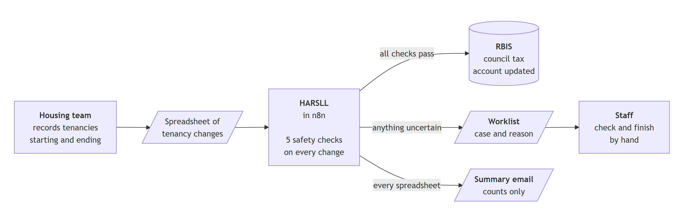
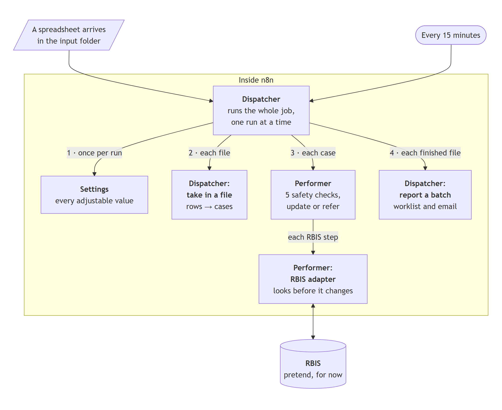
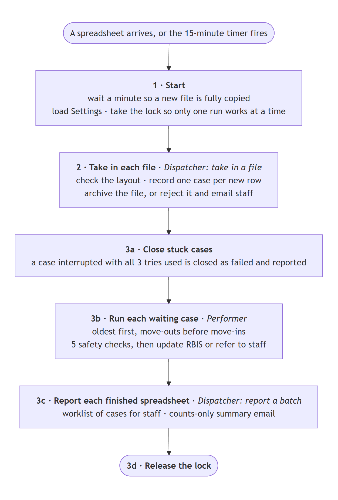
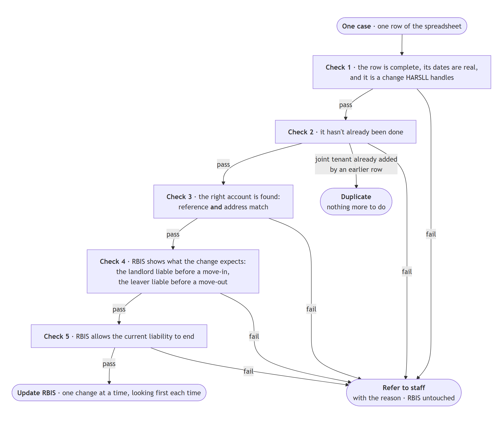
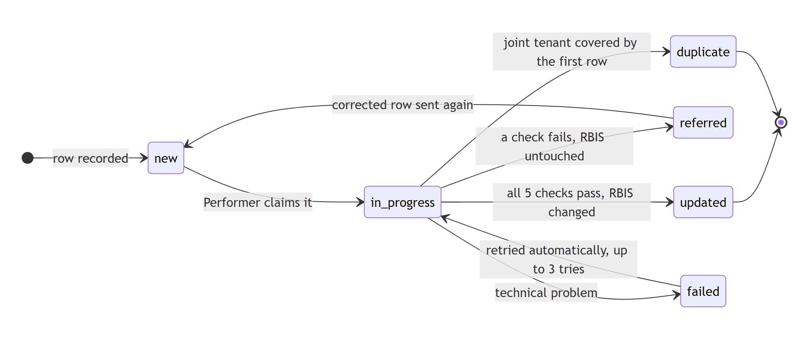
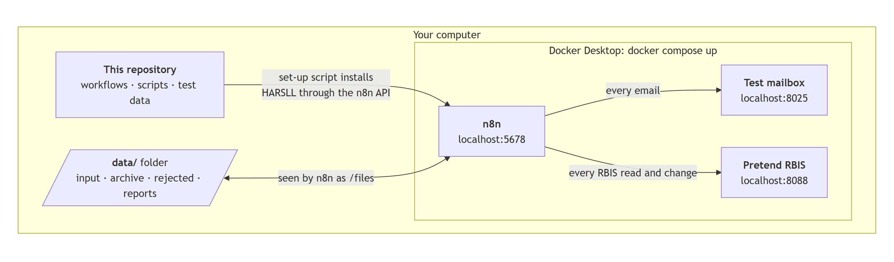
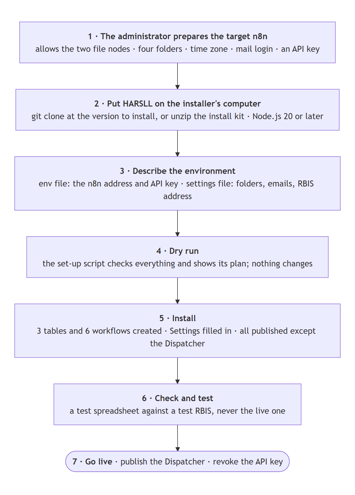

# HARSLL on n8n

**HARSLL keeps council tax accounts in step with tenancy changes.** When a council tenancy starts or ends, the right person must be billed from the right date in **RBIS**, the council tax system. Today two UiPath robots do this. This repository rebuilds the process as **six n8n workflows**, with documentation, made-up test data, a pretend RBIS and 37 automated test scenarios.

HARSLL is cautious by design: it changes an account only when **five safety checks** pass. Anything uncertain is left untouched and passed to staff with the reason.

> **Where things stand.** HARSLL is built and fully tested on a laptop, against a **pretend RBIS** and **made-up data**. It has not been connected to the real RBIS or used with real tenancy data. That waits on the process owner confirming how RBIS can be reached and several business rules ([open questions](docs/design/HARSLL-n8n-design.md#open-questions)).

| If you want to… | Start here |
| --- | --- |
| Understand what HARSLL is for | [Business overview](docs/business/HARSLL-business-overview.md), then [How HARSLL works](docs/guides/how-harsll-works.md) |
| See it working in a few minutes | [Run it on your computer](#run-it-on-your-computer), then [Try HARSLL with sample data](docs/guides/try-harsll-with-sample-data.md) |
| Know what staff do with its results | [Using HARSLL day to day](docs/guides/using-harsll.md) |
| Install it in another environment | [Move it to another environment](#move-it-to-another-environment) |
| Change it | [The design](docs/design/HARSLL-n8n-design.md), [the interfaces](docs/design/interfaces.md), [testing](docs/testing.md), [the workflows](workflows/README.md) |
| Find anything else | [Documentation index](docs/README.md) |

## The big picture



<!-- Diagram source: docs/diagrams/readme-big-picture.mmd. Edit it, then redraw the image: see docs/diagrams/README.md -->

1. The housing team records tenancies starting and ending, and a **spreadsheet** of those changes is saved into a folder.
2. HARSLL picks it up within about a minute and treats each row as a **case**.
3. For each case it runs **five safety checks**. If all pass, it updates the **RBIS** account: it ends the old liability and starts the new one, and saves contact details or a forwarding address.
4. If any check fails, RBIS is left untouched and the case goes on a **worklist** for staff, with the reason.
5. When every case from the spreadsheet is finished, a **summary email** reports the counts. It contains no names, so it can go to a shared inbox.

## How it works

### The six workflows



<!-- Diagram source: docs/diagrams/readme-the-six-workflows.mmd. Edit it, then redraw the image: see docs/diagrams/README.md -->

| Workflow | What it does | Runs |
| --- | --- | --- |
| **HARSLL – Dispatcher** | Runs the whole job, in order, one run at a time: takes in new spreadsheets, runs each waiting case, reports each finished spreadsheet | When a spreadsheet arrives, and every 15 minutes |
| **HARSLL – Settings** | Holds every adjustable value: business rules, limits, folders, email addresses, the RBIS address, table and workflow IDs | At the start of every run |
| **HARSLL – Dispatcher: take in a file** | Checks one spreadsheet's layout, records one case per new row, and archives the file. A file it can't use is rejected and staff are emailed | Once per spreadsheet |
| **HARSLL – Performer** | Claims one case, runs the five safety checks, then updates RBIS or refers the case to staff | Once per case |
| **HARSLL – Performer: RBIS adapter** | The only workflow that talks to RBIS. It looks before every change, so a repeated request never changes RBIS twice | Once per RBIS read or change |
| **HARSLL – Dispatcher: report a batch** | When every case from a spreadsheet is finished, saves the staff worklist and sends the counts-only summary email | Once per spreadsheet |

**Only the Dispatcher starts by itself.** It calls the others, and none of them needs starting by hand. Names follow one rule, **`HARSLL – <who calls it>: <what it does>`**, so the n8n list shows who calls whom. Each workflow is described step by step in [How HARSLL works](docs/guides/how-harsll-works.md).

### One run, step by step



<!-- Diagram source: docs/diagrams/readme-one-run-step-by-step.mmd. Edit it, then redraw the image: see docs/diagrams/README.md -->

The **lock** makes sure only one run works at a time. If a run is cut off, for example by a restart, its lock expires and a later run takes over. Nothing is lost: an unfinished case is simply picked up again.

### The five safety checks



<!-- Diagram source: docs/diagrams/readme-five-checks.mmd. Edit it, then redraw the image: see docs/diagrams/README.md -->

Checks 1 and 2 look only at the spreadsheet row. Checks 3 to 5 read RBIS but change nothing. RBIS is changed only after all five pass, one change at a time, and each change is checked first so it is never made twice. Rules not yet confirmed by the process owner, such as how deaths and joint tenants are handled, are **settings** with cautious defaults.

### What can happen to a case



<!-- Diagram source: docs/diagrams/readme-what-can-happen-to-a-case.mmd. Edit it, then redraw the image: see docs/diagrams/README.md -->

A case that stops after RBIS was **partly** changed is marked **urgent** and goes to the top of the staff worklist.

### Where the results go

| Result | Where | Who uses it |
| --- | --- | --- |
| **Worklist**: every case that needs a person, with the reason, urgent first | A spreadsheet in the reports folder, one per input spreadsheet | Staff, to finish referred cases by hand |
| **Summary email**: counts only, no names | The team's inbox | Staff and managers, to see each batch was handled |
| **Changes to accounts** | RBIS | Everyone, as normal |
| **The original spreadsheet** | The archive folder, with the date and time added to its name | Audit |
| **Every case and batch, in full** | Two n8n **Data tables**: `harsll_cases` and `harsll_batches` | Support and audit |

## Run it on your computer

Everything runs on one computer in **Docker**. Nothing connects to a real council system, and every email is caught by a test mailbox.



<!-- Diagram source: docs/diagrams/readme-local-setup.mmd. Edit it, then redraw the image: see docs/diagrams/README.md -->

**New to this?** Follow [Set up HARSLL on your computer](docs/setup/01-run-n8n-locally.md). It starts from a bare Windows or Mac computer, takes 30 to 45 minutes the first time, and covers installing the tools, each step's expected result and troubleshooting. The steps below are the short version.

**You need:** **Docker Desktop**, installed and running (on Windows it uses WSL 2), plus **Git** and **Node.js 20 or later**. The first start downloads about 2 GB.

**1. Get the code.** The repository is private: accept the GitHub invitation first, then download it into a local folder, not OneDrive.

```bash
git clone https://github.com/sgshaji/n8n-builder.git
cd n8n-builder
```

**2. Create your settings file, with a new encryption key, and the data folders.** `.env` holds your local settings and keys. Git ignores it, so it never leaves your computer.

```powershell
# Windows (PowerShell)
Copy-Item .env.example .env
$bytes = [byte[]]::new(32); [Security.Cryptography.RandomNumberGenerator]::Fill($bytes)
$key = -join ($bytes | ForEach-Object { $_.ToString('x2') })
(Get-Content .env) -replace '^N8N_ENCRYPTION_KEY=$', "N8N_ENCRYPTION_KEY=$key" | Set-Content .env
New-Item -ItemType Directory -Force data/input, data/archive, data/rejected, data/reports
```

```bash
# macOS or Linux
cp .env.example .env
sed -i.bak "s/^N8N_ENCRYPTION_KEY=$/N8N_ENCRYPTION_KEY=$(openssl rand -hex 32)/" .env && rm .env.bak
mkdir -p data/input data/archive data/rejected data/reports
```

**3. Start the stack**

```bash
docker compose up -d --wait
```

✔ You should see three containers reported as **Healthy**: n8n, the test mailbox and the pretend RBIS.

**4. Create your n8n account and an API key.** Open http://localhost:5678 and create the owner account. It exists only on your computer. Then go to **Settings → n8n API → Create an API key**, and paste the key into `.env` after `N8N_API_KEY=`.

**5. Install HARSLL into your n8n**

```bash
node scripts/setup-harsll.mjs --create-mailpit-credential
```

This creates the three Data tables, installs the six workflows, fills in **HARSLL – Settings** with the new IDs, connects the emails to the test mailbox and publishes everything. You can run it again at any time: it updates what has changed and leaves the rest alone. Add `--dry-run` to see the plan first.

✔ n8n's **Overview** lists six **HARSLL** workflows, all **Published**.

**6. See it work**

```bash
node scripts/try-sample.mjs
```

This clears the local test data, drops a 10-row sample spreadsheet into `data/input`, waits for HARSLL (about 70 seconds) and shows what happened to each row.

✔ It ends with **10 of 10 rows ended as expected** (3 accounts updated, 6 cases referred, 1 duplicate).

Then look around:

| Look at | Where |
| --- | --- |
| The summary email | Test mailbox, http://localhost:8025 |
| The worklist and the archived spreadsheet | `data/reports/` and `data/archive/` |
| Every case | n8n → **Overview → Data tables → `harsll_cases`** |
| What changed in "RBIS" | http://localhost:8088/changes |
| The workflows | n8n → **Overview → Workflows**. Open **HARSLL – Dispatcher** first |

To try it by hand, copy `test-data/sample/harsll-sample.xlsx` into `data/input` and wait a couple of minutes. More to try: [Try HARSLL with sample data](docs/guides/try-harsll-with-sample-data.md).

**7. Run the tests** (optional)

```bash
node --test scripts/ mock-rbis/   # quick checks, a few seconds
node scripts/run-tests.mjs        # all 37 scenarios end to end, about 15 to 20 minutes
```

**Day to day:** `docker compose up -d --wait` to start, `docker compose down` to stop (your data is kept), `docker compose ps` to check. To get a newer version: `git pull`, then run the step 5 command again.

## Move it to another environment

The same set-up script installs HARSLL into any n8n, such as a BCC test or live system. It works through n8n's API, and the installer gives it that environment's address, key and settings. A plain import of the workflow files is not enough: they would not be connected to each other or to their tables.



<!-- Diagram source: docs/diagrams/readme-move-to-another-environment.mmd. Edit it, then redraw the image: see docs/diagrams/README.md -->

> **Not for live use yet.** The RBIS adapter installed today talks to the pretend RBIS. A test or trial install is possible now, with the pretend RBIS running where that n8n can reach it. A live install needs the real RBIS adapter, which replaces that one workflow once it is known how RBIS can be reached.

### What the target n8n's administrator must provide

| Requirement | Why |
| --- | --- |
| **The Local File Trigger and Execute Command nodes allowed**. n8n 2.x switches both off by default | HARSLL uses them to notice and move spreadsheets. **Ask this first**: without them, file handling must be redesigned |
| **n8n 2.48 or later**, with the public API on | HARSLL was built and tested on 2.48.5. The set-up script uses the API |
| **Four folders** n8n can read and write: input, archive, rejected, reports | Where spreadsheets arrive and go |
| **Time zone** `Europe/London`, and failed-run history deleted after 7 days | Dates and timers depend on it. Failed runs can hold personal data |
| **A mail server**, and an **SMTP login** created in n8n for HARSLL | The summary and rejection emails |
| **An API key** for the install, from an owner or admin, ideally with an expiry | The set-up script uses it. Revoke it afterwards |

### Getting HARSLL onto the installer's computer

Either clone this repository at the version to install, or build an **install kit**, a single zip, and hand that over:

```bash
node scripts/make-install-kit.mjs
# → dist/harsll-install-kit-<date>-<commit>.zip
```

The kit contains the six workflows, the set-up script, the settings template, all the documentation and the pretend RBIS for a trial, with an `INSTALL.md` on top. It is built only from committed files, and the build refuses to include env files, keys, tokens or original process documents.

### The install

Run from the repository or kit folder. The guide has every detail: [Move HARSLL to another environment](docs/setup/03-move-to-another-environment.md).

1. **Env file** for the target, for example `.env.bcc-test`. Git ignores it. Never share it:

   ```ini
   N8N_API_URL=https://n8n.bcc-test.example
   N8N_API_KEY=paste-the-key-here
   ```

2. **Settings file:** copy `config/settings.example.json` to `config/bcc-test.local.json`. Fill in the four folders as n8n sees them, the email addresses, the RBIS address and the landlord's name. Add only business rules the process owner has confirmed; anything left out keeps its cautious default.
3. **Dry run.** This checks everything and shows the plan, without changing anything:

   ```bash
   node scripts/setup-harsll.mjs --env-file .env.bcc-test --settings config/bcc-test.local.json \
     --email-credential "HARSLL mail (BCC test)" --without-run-now --leave-dispatcher-off --dry-run
   ```

4. **Install:** run the same command without `--dry-run`. Everything is installed and published **except the Dispatcher**, so nothing starts yet. `--without-run-now` switches off the test-only **Run now** web address.
5. **Check and test** with a test spreadsheet against a test RBIS ([what test data is needed](docs/guides/try-harsll-with-sample-data.md#testing-in-another-environment)).
6. **Go live:** publish **HARSLL – Dispatcher**, watch the first batches, and revoke the API key.

**To stop HARSLL at any time,** unpublish the Dispatcher. **To update an installed copy,** run the same command from a newer version: workflows are updated in place, and tables keep their data. **To roll back,** run it from the earlier version.

### Keys and secrets

| Secret | Where it lives | Notes |
| --- | --- | --- |
| n8n encryption key | The target n8n's own configuration | Set by its administrator. Never copy the local one |
| n8n API key | The env file on the installer's computer | Only for installing and updating. Revoke it afterwards |
| Email (SMTP) login | An n8n credential, entered directly in n8n | Never in a file |
| RBIS login | An n8n credential | Needed only once the real RBIS adapter exists |

None of these is ever in the repository or the install kit.

## Repository layout

```text
n8n-builder/
├── README.md              This file
├── compose.yaml           Local stack: n8n, test mailbox, pretend RBIS (Docker)
├── .env.example           Settings template: copy to .env (ignored by Git)
├── config/                Example settings for another environment
├── data/                  Spreadsheets in and out (contents ignored by Git)
├── docs/                  All documentation: start at docs/README.md
│   ├── business/          Business overview, plain English
│   ├── guides/            How HARSLL works, using it, trying it with sample data
│   ├── setup/             Setting up on your computer, moving to another environment
│   ├── design/            The design and the exact interfaces
│   ├── process/           How the current UiPath robots work
│   ├── diagrams/          Every diagram: Mermaid source and image
│   ├── history/           How it was built: trials and build notes
│   └── source/            Original flowcharts (local only, never committed)
├── mock-rbis/             Pretend RBIS: a stand-in for the council tax system
├── scripts/               Set-up, install kit, sample run, test runner, spreadsheet generator
├── test-data/             Made-up accounts, the sample, the 37 scenarios and their spreadsheets
└── workflows/             The six exported n8n workflows (JSON)
```

## Design choices

- **Redesigned for n8n, not copied.** The business behaviour (five checks, cautious outcomes) is the same as the UiPath robots'; the structure suits n8n. See [the design](docs/design/HARSLL-n8n-design.md#what-stays-the-same-what-changes).
- **One route to RBIS.** Only the RBIS adapter talks to RBIS. Once it is known how the real RBIS can be reached (an API, a database, or its screens only), only that workflow changes.
- **Settings, not hard-coded rules.** Business rules not yet confirmed by the process owner are settings with cautious defaults, each recorded as an assumption.
- **Safe to repeat.** The same file twice, a crash halfway, RBIS failing mid-update: nothing is ever changed twice, and nothing is silently lost.
- **Personal data kept to a minimum.** Successful runs are not kept in n8n's history, failed runs are deleted after 7 days, and the summary email holds counts only.

## Project status

| Phase | What | Status |
| --- | --- | --- |
| 0 | Repository setup | ✅ Done |
| 1 | Run n8n locally with Docker | ✅ Done: [set-up guide](docs/setup/01-run-n8n-locally.md) |
| 2 | Developer tooling for building and checking workflows | ✅ Done |
| 3 | Design the n8n workflows | ✅ Done: [design](docs/design/HARSLL-n8n-design.md), revision 3 approved |
| 4 | Build and test, against a pretend RBIS | ✅ Done: six workflows; all 37 test scenarios pass ([testing](docs/testing.md)); guides, sample run, set-up script and install kit |
| 5 | Move to the real environment | Not started. Waits on the process owner's answers, above all [how RBIS can be reached](docs/design/HARSLL-n8n-design.md#open-questions) |

## Ground rules

- **No real data in the repo.** Only made-up data in `test-data/`. Spreadsheets anywhere else are blocked by `.gitignore`.
- **No secrets in the repo.** Keys and passwords live in `.env` files (ignored) or in n8n's encrypted credentials. `.env.example` lists what is needed.
- **Original process documents stay local.** `docs/source/` is ignored except its README.
- **Docs change with the work.** When a workflow changes, its documentation changes in the same commit.
