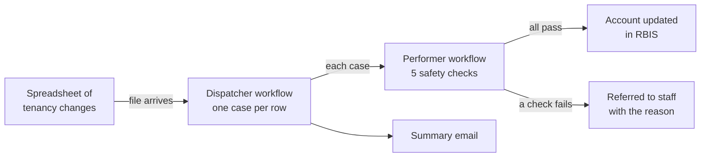

# n8n-builder: HARSLL automation

Rebuilding the **HARSLL** process, today run by two UiPath robots, as **n8n** workflows.

HARSLL keeps council tax accounts in step with council tenancy changes: when a tenancy starts or ends, the right person is made liable from the right date. An account is changed only when five safety checks pass; anything uncertain goes to staff. See the [business overview](docs/business/HARSLL-business-overview.md) for the full picture.

## Status

| Phase | What | Status |
| --- | --- | --- |
| 0 | Repository setup | ✅ Done |
| 1 | Run n8n locally with Docker | ✅ Done |
| 2 | Connect the n8n MCP servers to Claude Code | ✅ Done |
| 3 | Design the n8n workflows (for approval) | ⏳ Next |
| 4 | Build and test, against a pretend RBIS | Not started |
| 5 | Move to the real environment | Not started |

## How the rebuild works



- **Built locally first.** Workflows are developed on a local n8n in Docker and exported to [`workflows/`](workflows/) as JSON. Moving to the real environment is an import plus new connection settings.
- **Redesigned for n8n, not copied.** The business behaviour (5 checks, 3 outcomes, caution first) stays the same; the structure suits n8n.
- **A pretend RBIS** stands in for the real council tax system until we know how it can be reached (API, database or screens only).

## Repository layout

```text
n8n-builder/
├── README.md              This file
├── CLAUDE.md              Working rules for Claude Code sessions in this repo
├── compose.yaml           Local n8n + test mailbox (Docker)
├── .env.example           Settings template: copy to .env (ignored by Git)
├── .mcp.json              MCP servers for Claude Code (no secrets)
├── data/                  Spreadsheets in and out (contents ignored by Git)
├── docs/                  All documentation (start at docs/README.md)
│   ├── business/          Business overview, plain English
│   ├── process/           How the current UiPath robots work
│   ├── setup/             Step-by-step setup guides
│   └── source/            Original flowcharts (local only, not committed)
├── scripts/               Helpers that start the MCP servers, reading secrets from .env
└── workflows/             Exported n8n workflows (JSON)
```

Folders for test data and the pretend RBIS are added in later phases.

## Getting started

You need **Docker Desktop** (running), **Git**, and from Phase 2 **Claude Code**.

```bash
git clone https://github.com/sgshaji/n8n-builder.git
cd n8n-builder
```

Then follow **[Run n8n locally with Docker](docs/setup/01-run-n8n-locally.md)**. In short:

1. Copy `.env.example` to `.env` and set a random `N8N_ENCRYPTION_KEY`.
2. Run `docker compose up -d --wait`.
3. Open http://localhost:5678 and create your owner account.

To let Claude Code build workflows, follow **[Connect the n8n MCP servers](docs/setup/02-connect-mcp-servers.md)**.

| Service | Address |
| --- | --- |
| n8n editor | http://localhost:5678 |
| Test mailbox (Mailpit) | http://localhost:8025 |

## Ground rules

- **No real data in the repo.** Only made-up test data in `test-data/`. Spreadsheets and CSVs anywhere else are blocked by `.gitignore`.
- **No secrets in the repo.** API keys and passwords live in a local `.env` file, which is ignored. A `.env.example` lists what is needed.
- **Original process documents stay local.** `docs/source/` is ignored except its README.
- **Docs change with the work.** When a workflow changes, update its documentation in the same commit.

## Documentation

See [docs/README.md](docs/README.md) for the full index.
