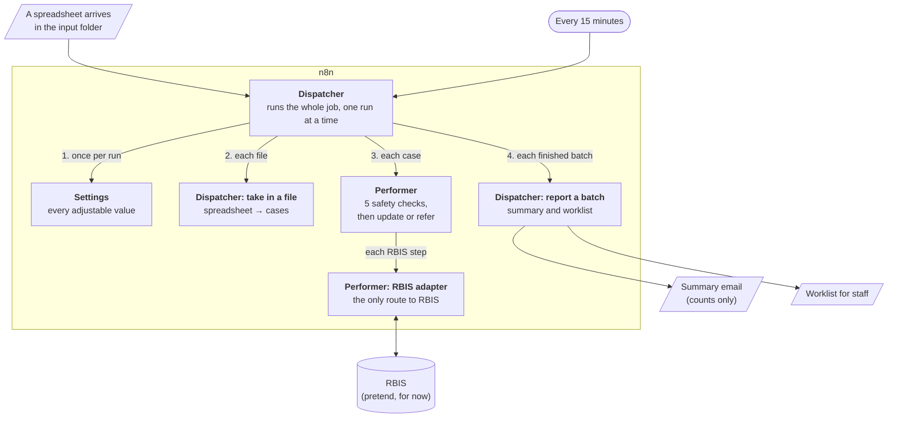
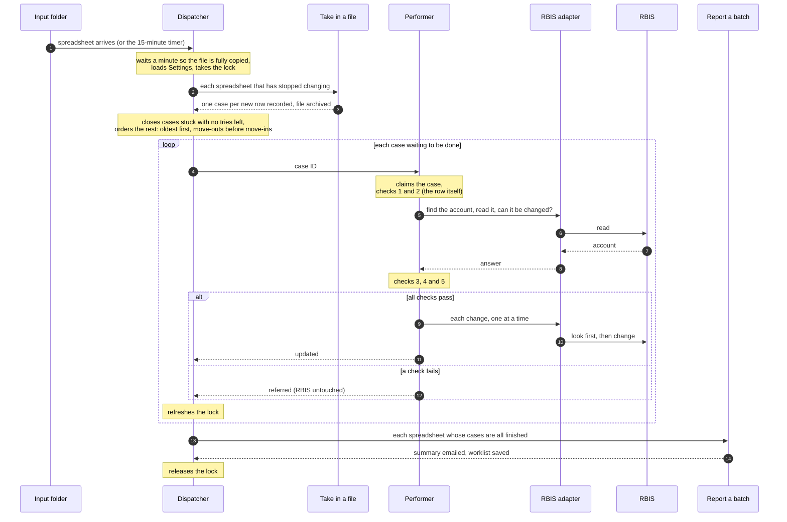
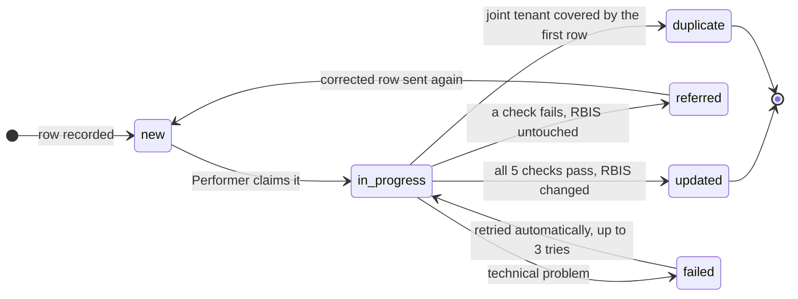

# HARSLL on n8n

**HARSLL** keeps council tax accounts in step with tenancy changes. When a tenancy starts or ends, it makes the right person liable from the right date in **RBIS**, the council tax system. Today two UiPath robots do this. This repository rebuilds the process as **six n8n workflows**, with documentation, made-up test data, a pretend RBIS and 37 automated test scenarios.

HARSLL is cautious by design. An account is changed only when **five safety checks** pass. Anything uncertain is left untouched and passed to staff, with the reason.

| | |
| --- | --- |
| **New here?** | Read the [business overview](docs/business/HARSLL-business-overview.md), then [How HARSLL works](docs/guides/how-harsll-works.md) |
| **Want to see it run?** | [Try HARSLL with sample data](docs/guides/try-harsll-with-sample-data.md): one command, about 3 minutes |
| **Using it day to day?** | [Using HARSLL day to day](docs/guides/using-harsll.md) |
| **Installing it somewhere else?** | [Move HARSLL to another environment](docs/setup/03-move-to-another-environment.md) |
| **Everything else** | [Documentation index](docs/README.md) |

## Status

| Phase | What | Status |
| --- | --- | --- |
| 0 | Repository setup | ✅ Done |
| 1 | Run n8n locally with Docker | ✅ Done |
| 2 | Connect the n8n MCP servers to Claude Code | ✅ Done |
| 3 | Design the n8n workflows | ✅ Done: [design](docs/design/HARSLL-n8n-design.md), revision 3 approved |
| 4 | Build and test, against a pretend RBIS | ✅ Done: six workflows; all 37 test scenarios pass ([testing](docs/testing.md)); guides, sample run and set-up script added |
| 5 | Move to the real environment | Not started. Waits on the process owner's answers, above all [how RBIS can be reached](docs/design/HARSLL-n8n-design.md#open-questions) |

## How it works

### The six workflows



| Workflow | Job | Runs |
| --- | --- | --- |
| **HARSLL – Dispatcher** | Runs the whole job in order: take in files, process cases, report, one run at a time | When a spreadsheet arrives, and every 15 minutes |
| **HARSLL – Dispatcher: take in a file** | Checks a spreadsheet, records one case per row, archives the file (or rejects it and emails staff) | Once per spreadsheet |
| **HARSLL – Performer** | Runs the five safety checks on one case, then updates RBIS or refers the case to staff | Once per case |
| **HARSLL – Performer: RBIS adapter** | The only workflow that talks to RBIS. Looks before every change, so nothing is changed twice | Once per RBIS read or change |
| **HARSLL – Dispatcher: report a batch** | When every case from a spreadsheet is finished: emails a counts-only summary and saves a worklist of cases needing a person | Once per spreadsheet |
| **HARSLL – Settings** | Holds every adjustable value: business rules, limits, folders, email addresses, the RBIS address, IDs | At the start of every run |

Every case, batch and the run lock are recorded in three n8n **Data tables**: Cases, Batches and Lock. Names follow one rule: **HARSLL – <who starts it>: <what it does>**. Each workflow is described step by step in [How HARSLL works](docs/guides/how-harsll-works.md).

### One run, step by step



### What can happen to a case



A case that stops after RBIS was partly changed is marked **urgent** and goes to the top of the staff worklist.

### The five safety checks

| # | Check | If it fails |
| --- | --- | --- |
| 1 | The change is complete and of a type HARSLL handles: real dates in order, an accepted change, deaths go to staff | Referred |
| 2 | It hasn't already been done: a joint tenant's second row follows the first | Covered by the first row, or referred |
| 3 | The right account is found: reference **and** address match | Referred |
| 4 | RBIS shows what the change expects: the landlord liable before a move-in, the leaver liable before a move-out | Referred |
| 5 | RBIS will allow the current liability to be ended | Referred |

## Getting started

You need **Docker Desktop** (running), **Git** and **Node.js** 20 or later. Full guide: [Run n8n locally with Docker](docs/setup/01-run-n8n-locally.md).

```bash
git clone https://github.com/sgshaji/n8n-builder.git
cd n8n-builder
```

1. **Settings file.** Copy `.env.example` to `.env` and set a random `N8N_ENCRYPTION_KEY` ([how](docs/setup/01-run-n8n-locally.md#1-create-your-settings-file)).
2. **Start the stack:** `docker compose up -d --wait`.
3. **n8n account and API key.** Open http://localhost:5678, create your owner account, then create an API key under **Settings → n8n API** and paste it into `.env` as `N8N_API_KEY`.
4. **Install HARSLL into your n8n:** tables, the six workflows, settings, publishing:

   ```bash
   node scripts/setup-harsll.mjs --create-mailpit-credential
   ```

5. **See it work** with 10 made-up tenancy changes:

   ```bash
   node scripts/try-sample.mjs
   ```

6. **Run the tests** (about 11 minutes):

   ```bash
   node --test scripts/ mock-rbis/
   node scripts/run-tests.mjs
   ```

| Service | Address | What it is |
| --- | --- | --- |
| n8n editor | http://localhost:5678 | Where the workflows live and run |
| Test mailbox (Mailpit) | http://localhost:8025 | Catches every email, so nothing reaches a real person |
| Pretend RBIS | http://localhost:8088 | A stand-in for the council tax system, with made-up accounts |

To let Claude Code read and change the workflows, see [Connect the n8n MCP servers](docs/setup/02-connect-mcp-servers.md).

## Repository layout

```text
n8n-builder/
├── README.md              This file
├── CLAUDE.md              Working rules for Claude Code sessions in this repo
├── compose.yaml           Local stack: n8n, test mailbox, pretend RBIS (Docker)
├── .env.example           Settings template: copy to .env (ignored by Git)
├── .mcp.json              MCP servers for Claude Code (no secrets)
├── config/                Example settings for another environment
├── data/                  Spreadsheets in and out (contents ignored by Git)
├── docs/                  All documentation: start at docs/README.md
│   ├── business/          Business overview, plain English
│   ├── guides/            How HARSLL works, using it, trying it with sample data
│   ├── setup/             Running locally, MCP servers, moving to another environment
│   ├── design/            The design and the exact interfaces
│   ├── process/           How the current UiPath robots work
│   ├── history/           How it was built: trials and build notes
│   └── source/            Original flowcharts (local only, never committed)
├── mock-rbis/             Pretend RBIS: a stand-in for the council tax system
├── scripts/               Set-up, sample run, test runner, spreadsheet generator, MCP launchers
├── test-data/             Made-up accounts, the sample, the 37 scenarios and their spreadsheets
└── workflows/             The six exported n8n workflows (JSON)
```

## Design choices

- **Redesigned for n8n, not copied.** The business behaviour (five checks, cautious outcomes) is the same as the UiPath robots'; the structure suits n8n. See [the design](docs/design/HARSLL-n8n-design.md#what-stays-the-same-what-changes).
- **One route to RBIS.** Only the RBIS adapter talks to RBIS. When we know how the real RBIS can be reached (an API, a database, or its screens only), that one workflow changes.
- **Settings, not hard-coded rules.** Business rules not yet confirmed by the process owner are settings with cautious defaults, each recorded as an assumption.
- **Safe to repeat.** The same file twice, a crash halfway, RBIS failing mid-update: nothing is ever changed twice, and nothing is silently lost.
- **Built locally, moved later.** Everything runs on a laptop in Docker. Moving to another n8n is a set-up script plus that environment's settings and logins.

## Ground rules

- **No real data in the repo.** Only made-up data in `test-data/`. Spreadsheets anywhere else are blocked by `.gitignore`.
- **No secrets in the repo.** Keys and passwords live in `.env` (ignored) or in n8n's encrypted credentials. `.env.example` lists what is needed.
- **Original process documents stay local.** `docs/source/` is ignored except its README.
- **Docs change with the work.** When a workflow changes, its documentation changes in the same commit.
