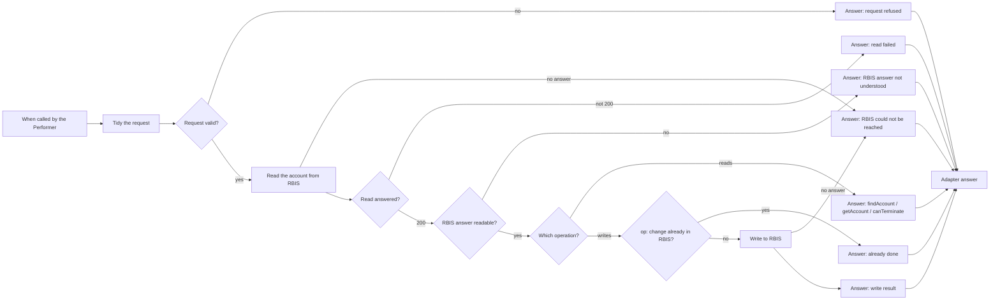
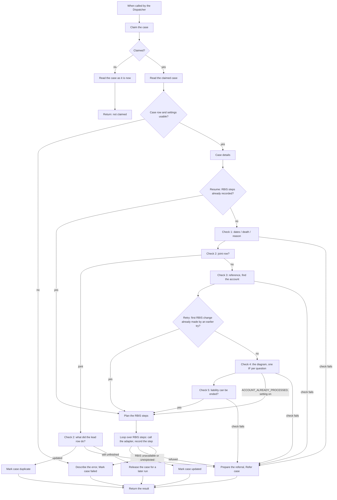

# Track A build notes: RBIS adapter and Performer

**Stage:** parallel build, track A, 19 November 2026.
**Built against:** [design revision 3](../design/HARSLL-n8n-design.md) and [interfaces](../design/interfaces.md), n8n 2.48.5, the pretend RBIS copy `mock-rbis-a` and the table `trackA_cases`.
**Result:** both workflows are built, published and tested. The full test suite passed twice in a row: **96 of 96 tests, 1,713 checks**.

## What was built

| Workflow | ID | Published | Export | Nodes |
| --- | --- | --- | --- | --- |
| **HARSLL – RBIS adapter** | `UEa9ahhsExQ8SXfb` | Yes, draft = published | [`workflows/harsll-rbis-adapter.json`](../../workflows/harsll-rbis-adapter.json) | 24 |
| **HARSLL – Performer** | `Bxb1mMwb4TOFuP8j` | Yes, draft = published | [`workflows/harsll-performer.json`](../../workflows/harsll-performer.json) | 70 |
| **Track A – test harness** (test only) | `Q2EM7lajNcwWV5qJ` | Yes | [`tests/performer/track-a-test-harness.json`](../../tests/performer/track-a-test-harness.json) | 3 |

- Both HARSLL workflows: `executionOrder: v1`, `timezone: Europe/London`, **Available in MCP** on, run-history settings left at their defaults (the reconcile stage sets them).
- Both were checked with the n8n-mcp validator (`n8n_validate_workflow`) after every change: no errors. The Performer has 16 warnings, all the same note that "Execute Once" is on, which is deliberate (each case has one item).
- After each change both were deactivated and activated again; the published version was confirmed to equal the draft (`activeVersionId = versionId`, same node count).
- The exports were made with `n8n export:workflow`, then the `shared` block (the n8n owner's name and email) was removed. No credentials are used.
- One Code node in total: **Plan the RBIS steps** in the Performer, with a `Why Code:` note.

### HARSLL – RBIS adapter

Input `{ operation, rbisBaseUrl, ref, params }`; output always exactly `{ ok, operation, ref, alreadyDone, data, error }`. Every operation reads first; every write looks before it writes.



| Node | Type | What it does |
| --- | --- | --- |
| When called by the Performer | Execute Workflow Trigger 1.3 | Accept all data |
| Tidy the request | Set | Trims the four inputs; works out the RBIS call for a write (method, path, body); `requestError` for an unknown operation, no `ref`, no `rbisBaseUrl`, or `endLiability` without `parties` |
| Request valid? | IF | No request error |
| Answer: request refused | Set | `ok: false`, the request error, `transient: false` |
| Read the account from RBIS | HTTP Request 4.2 | `GET /accounts/{ref}` (or `/termination-options` for `canTerminate`). `fullResponse` and `neverError` on, timeout 10 s, error output on |
| Answer: RBIS could not be reached | Set | Error output of either HTTP node: `RBIS_UNREACHABLE` (or `RBIS_TIMEOUT`), `transient: true` |
| Read answered? | IF | Status 200 |
| Answer: read failed | Set | `findAccount` + `404 ACCOUNT_NOT_FOUND` = `ok: true, found: false, reason: NOT_FOUND`. Otherwise an error with RBIS's code; 5xx, 408, 429 transient |
| RBIS answer readable? | IF | The body has the expected shape (see departure 12) |
| Answer: RBIS answer not understood | Set | `UNEXPECTED_RBIS_ANSWER`, nothing written |
| Which operation? | Switch | One output per operation |
| Answer: findAccount | Set | `found` only if `normalise(address)` and `normalise(postcode)` both match; otherwise `ADDRESS_MISMATCH` |
| Answer: getAccount, Answer: canTerminate | Set | `{ account }`, `{ canTerminate, reason }` |
| *op*: change already in RBIS? (×5) | IF | The look-first test from interfaces.md, one per write |
| Answer: already done | Set | `ok: true, alreadyDone: true`, nothing written |
| Write to RBIS | HTTP Request 4.2 | The write worked out in Tidy the request. Never retried by the node |
| Answer: write result | Set | 2xx ok; `409 ALREADY_LIABLE` / `409 DETAIL_EXISTS` = already done; 5xx, 408, 429 transient; other answers are business errors with RBIS's code |
| Answer: adapter error | Set | Error output of any node: `ADAPTER_ERROR`, `transient: false` |
| Adapter answer | Set | Every path ends here, so the output always has exactly the six fields |

### HARSLL – Performer

Input `{ caseId, expectedStatus, expectedAttempts, settings }`; output always one item `{ caseId, caseKey, claimed, status, reasonCode, outcome, urgent }`, taken from the case row as written.



| Part | Nodes | Notes |
| --- | --- | --- |
| **Claim** | Claim the case (Data table Update, filters `id`, `status`, `attempts` all must match; sets `in_progress`, `attempts + 1`, `lastAttemptAt`; Always Output Data; an error is treated as "not claimed"), Claimed?, Read the case as it is now, Return: not claimed | Not claimed returns `claimed: false` with the case's current values and changes nothing |
| **Guard** | Read the claimed case, Case row and settings usable?, Error: case row or settings unusable | Parses `stepsDone` and `jointTenants`; stops (failed) if either is not valid JSON or a needed setting is missing. See departure 11 |
| **Case details** | Case details | `kind` (moveIn, moveOut, other; a death is moveOut under `processAsEnd`), `rowDate`, `landlordEndDate`, `landlordStartDate`, normalised landlord names, `maxAttempts`, `isRetry` |
| **Resume** | Resume: RBIS steps already recorded?, Path: carry on from the recorded steps | Non-empty `stepsDone` skips the checks |
| **Check 1** | Check 1: dates real and in order?, Check 1: a death?, Check 1: deaths processed as move-outs?, Check 1: change reason allowed?, Reason: DATES_INVALID / DEATH_REFERRED / CHANGE_REASON_NOT_VALID | Order (a), (b), (c) as designed |
| **Check 2** | Check 2: joint row?, Check 2: find the lead row (by `coveredByCaseKey`), Check 2: what did the lead row do? (Switch), Mark case duplicate, Reason: EARLIER_ROW_NOT_COMPLETED, Release the case for a later run | Design's check 2 table; see departures 2 and 3 |
| **Check 3** | Check 3: account reference given?, Check 3: ask RBIS for the account, Check 3: find the account (RBIS adapter), Check 3: account found?, Reason: NO_ACCOUNT_REF / ADDRESS_NOT_FOUND | Adapter error goes to failed |
| **Retry after a lost reply** | Retry: first RBIS change already made by an earlier try?, Retry: record the first change as done, Path: carry on after the earlier try's first change | Departure 1 |
| **Check 4** | Check 4: who is liable in RBIS now? (Set: `landlordLiable`, `rowPersonLiable`, `hasStartDate`, `startDateMatches`), Check 4: moving in?, Check 4: landlord liable? (moving in), Check 4: landlord liable? (moving out), Check 4: leaver is one of the liable people?, Check 4: RBIS has a start date?, Check 4: RBIS start date equals the row's date?, Reason: LEAVER_NOT_LIABLE / NO_START_DATE / ACCOUNT_ALREADY_PROCESSED / CHECK_DATES | One IF per box of the design's diagram |
| **Add a person** | Add the person to an existing tenancy?, Path: add the person to the existing tenancy | Only when `addPersonToExistingTenancy` is on |
| **Check 5** | Check 5: ask RBIS if the liability can be ended, Check 5: termination options (RBIS adapter), Check 5: liability can be ended?, Reason: NO_OPTION_TO_TERMINATE, Path: full update | |
| **Update** | Plan the RBIS steps (Code), Any RBIS steps left?, Loop over RBIS steps (batch 1), Current RBIS step, Build the adapter request, Call the RBIS adapter, RBIS step done? (Switch: done / RBIS unavailable / refused), Record the step, Reason: RBIS refused the step, Refusal goes to staff? | Each successful or already-done call is written to `stepsDone` before the next call. A failed call leaves the loop |
| **Results** | Mark case updated, Prepare the referral, Read the case before referring, Refer case, Describe the error, Read the case before marking it failed, Mark case failed, Return the result, Return: result could not be recorded | Every referral and every failure goes through one node. `urgent` is worked out from the row as stored: referred with steps done, or failed with no tries left and steps done |

**Never fails as a whole.** Every node after the claim that can fail has "On Error: Continue (using error output)", wired to **Describe the error**, which marks the case `failed` (`RBIS_ERROR`, `errorDetail`, `stepsDone` kept). If even that cannot be written, **Return: result could not be recorded** still answers `failed`. Tests E01 to E05 check this.

### Track A – test harness

`POST http://localhost:5678/webhook/track-a-harness` with `{ "workflowId": "...", "input": { ... } }` runs that workflow with one input item and answers with all its output items. If the workflow fails as a whole, the answer is `{ "error": ... }`.

## How to run the tests

Needs: the local stack running with `mock-rbis-a` (http://localhost:8089), `.env` with `N8N_API_KEY`, and the three workflows above published.

```bash
node tests/performer/run-performer-tests.mjs              # everything, about 40 seconds
node tests/performer/run-performer-tests.mjs --adapter    # adapter only
node tests/performer/run-performer-tests.mjs --performer  # Performer only
node tests/performer/run-performer-tests.mjs --only S25   # tests whose name contains S25
node tests/performer/run-performer-tests.mjs --verbose    # print outputs, rows and changes
```

Before each test the script resets `mock-rbis-a` and empties `trackA_cases`; it empties both again at the end. Performer tests insert case rows exactly as the Dispatcher would (keys, `relevantDate`, `isFlat`, `isLeadRow`, `jointTenants`, `coveredByCaseKey`, `status: new`, `attempts: 0`, `stepsDone: "[]"`), call the Performer through the harness with the production settings plus the track A overrides, and check the output item, the case row (every result field, including `reasonText` against the design's exact texts) and `GET /changes`. Workflow IDs can be overridden with `TRACKA_ADAPTER_ID` and `TRACKA_PERFORMER_ID`.

## Results

Run on 19 November 2026, twice in a row with the same result:

| Group | Tests | Passed | Failed |
| --- | --- | --- | --- |
| Adapter (A01–A34) | 34 | 34 | 0 |
| Performer (S, C, R, E, V) | 62 | 62 | 0 |
| **Total** | **96** | **96** | **0** (1,713 checks) |

| Design scenario | Tests |
| --- | --- |
| 1–5 updates, 6 move-out then move-in | S01, S02, S03, S04, S05, S06 |
| 7–10 check 1 | S07, S07b, S07c, S08, S09, S09b, S10, S10b |
| 11 check 2 | S11 (also S02 duplicate, S21 joint row after an urgent lead, R01 lead unfinished) |
| 12–13 check 3 | S12, S13, S13b |
| 14–19 check 4 | S14, S15, S16, S17, S18, S19 |
| 20 check 5 | S20 |
| 21–22 stops part-way | S21, S22, R04 |
| 23 outage before any call | S23 |
| 24 outage after the first call | S24 ("before" on the second call), S24b ("afterChange" on the second call) |
| 25 reply lost | S25 (first call), S25b (last call), S25c (not assumed on a first try) |
| 26 fails every try | S26 (RBIS unchanged, not urgent), S26b (urgent at the third try) |
| 27 move-out fails once, then move-in | S27 (at case level: the Dispatcher's waiting is track B's) |
| The claim | C01 status differs, C02 tries differ, C03 no such case, C04 four simultaneous claims: exactly one wins, RBIS changed once |
| Resume and errors | R02 all steps recorded, R03 stuck `in_progress`, E01 corrupt `jointTenants`, E01b corrupt `stepsDone`, E02 adapter missing, E03 RBIS unreachable, E04 incomplete settings, E05 RBIS answer in the wrong shape |
| Settings variants | V01 `deathHandling: processAsEnd`, V02 `confirmLeaverIsLiable: false`, V03 `jointTenantHandling: referLaterRows`, V04–V04e `addPersonToExistingTenancy`, V05 `landlordLiabilityEndsOn: dayBefore`, V06–V06b `landlordLiableFrom: dayAfter`, V07 `nameMatch: surnameOnly` |
| Adapter | Every operation; every look-first "already done" path (A12, A17, A21, A23, A24, A29, A33) and `409 ALREADY_LIABLE` (A18); every business error (`ACCOUNT_NOT_FOUND`, `NO_CURRENT_LIABILITY`, `TERMINATION_NOT_ALLOWED`, `END_BEFORE_START`, `PARTY_REFUSED`, a 400); transient errors from outage modes `before` and `afterChange` on every write and on reads, connection refused and unknown host |

**Found and fixed during testing.** The first run passed 49 of 58 Performer tests. Eight failures were a fault in the test script. The ninth was real: a lead row whose `jointTenants` was not valid JSON was processed as if it had no joint tenants, so people would have been dropped silently. The cause is described under open issue 1; the guards in departures 11 and 12 fix it.

**Not tested:**

- **An RBIS timeout.** The pretend RBIS cannot be made to hang. A timeout leaves the HTTP node through the same error output as connection refused, which is tested, and is labelled `RBIS_TIMEOUT` by its message.
- **RBIS's own `409 DETAIL_EXISTS`.** With the pretend RBIS the look-first test always answers first; eight simultaneous calls did not get past it (A22). The branch uses the same condition as `409 ALREADY_LIABLE`, which is tested (A18).
- **Design scenarios 28–37.** These are file and Dispatcher scenarios (tracks B and C).

## Departures from the design or interfaces, and readings of unclear points

Each one takes the most cautious reading I could find. Items 1, 2, 3, 9 and 11 should go into the design.

1. **Addition: a lost reply on the first RBIS call.** If the first call of a case (`endLiability`) works but its reply is lost, no step is recorded, so the retry runs the checks again. Nobody is liable at that point, so check 4 would wrongly refer the case (`LEAVER_NOT_LIABLE` or `NO_START_DATE`) while the account has nobody liable. The design expects scenario 25 to end `updated`. So, **on a retry only** (`attempts > 1` after the claim), if nobody is liable and the liability this case ends (the landlord's for a move-in, the leaver's for a move-out) ended on exactly the case's date, the Performer records `endLiability` as done and carries on from step 2. On a first try the checks stay strict (test S25c).
2. **Check 2, lead row not finished yet** (`new`, `in_progress`, or `failed` with tries left). The design says this cannot happen because the Dispatcher runs the lead row first. If it does, the joint row is **released**: its status and `attempts` are put back to the Dispatcher's values and nothing else changes. The output is `claimed: true` with that status. A missing lead row, or a lead row that is `duplicate`, counts as not completed (referred).
3. **`jointTenantHandling: referLaterRows`.** No reason code fits exactly. Joint rows are referred with `EARLIER_ROW_NOT_COMPLETED`, whose text says the person was not added, which is true for move-ins. For a joint **move-out** under this setting the person's liability is in fact ended, because the pretend RBIS ends every current liability, so the text is misleading. **Proposal:** a new code, for example `JOINT_TENANT_FOR_STAFF`, "This person is on a joint tenancy; staff must check them on the account".
4. **Check 1 (a), which date is required.** The required date is `startDate` for a move-in and `endDate` for a move-out or death (the keys rule). For a change reason the automation does not know, at least one date is required. Otherwise every such row without an end date would be reported as `DATES_INVALID` rather than `CHANGE_REASON_NOT_VALID` (test S09b).
5. **Check 4 with `landlordLiableFrom: dayAfter`.** The diagram compares the landlord's start date with the row's end date. Under `dayAfter` the automation itself starts the landlord the day after, so the comparison also accepts that date as `ACCOUNT_ALREADY_PROCESSED` (test V06b). With the default setting nothing changes.
6. **Check 4 with several people liable now.** "RBIS has a start date" means every current party has one. "Equals the row's date" means every current start date equals it.
7. **Check 4 uses the account read by check 3** (`findAccount` returns the account) instead of a second `getAccount` call. Same data, one fewer RBIS call. The adapter still offers `getAccount`.
8. **`endLiability` `parties`.** The Performer passes **everyone liable now**, from the account it read, because the pretend RBIS's terminate ends every current liability. If the account was not read (a resume), it passes the landlord names for a move-in, or the row's people for a move-out.
9. **Mapping RBIS refusals during an update.** Interfaces name only `PARTY_REFUSED`. Used here:
   - any RBIS 4xx refusal of `addLiableParty` → `referred`, `UNABLE_TO_ADD_PARTY`;
   - `endLiability` `TERMINATION_NOT_ALLOWED` → `referred`, `NO_OPTION_TO_TERMINATE`;
   - `endLiability` `END_BEFORE_START` → `referred`, `CHECK_DATES` (test R04: a move-in dated before the landlord's own start);
   - any other non-transient error (for example `NO_CURRENT_LIABILITY`, a 400 on another write, or an adapter error) is treated as unexpected → `failed`, `RBIS_ERROR`.
10. **Adapter error codes not in interfaces.md:**
    - `UNKNOWN_OPERATION`, `MISSING_REF`, `MISSING_RBIS_BASE_URL`, `INVALID_PARAMS` (`endLiability` without `parties`: ending everyone without being told who is refused), `UNEXPECTED_RBIS_ANSWER` and `ADAPTER_ERROR`: all `transient: false`, `httpStatus: null`;
    - `RBIS_UNREACHABLE` and `RBIS_TIMEOUT`: `transient: true`;
    - HTTP 408 and 429 count as transient, like 5xx.
11. **Addition: the "Case row and settings usable?" guard** in the Performer. A case whose `stepsDone` or `jointTenants` is not valid JSON, or whose settings lack `landlordNames`, `allowedChangeReasons`, `deathChangeReasons`, `adapterWorkflowId` or `rbisBaseUrl`, is marked `failed` with the reason in `errorDetail`. Needed because of open issue 1.
12. **Addition: the "RBIS answer readable?" guard** in the adapter. A 200 answer that is not shaped like an account (or termination options) is refused before any look-first test or write, as `UNEXPECTED_RBIS_ANSWER`.
13. **`findAccount` details.**
    - Only a 404 whose code is `ACCOUNT_NOT_FOUND` counts as "not found". Any other 404 (for example a wrong `rbisBaseUrl`) is an error, so a misconfiguration cannot refer every case as `ADDRESS_NOT_FOUND` (test A05).
    - `data.account` is `null` whenever `found` is `false`, including `ADDRESS_MISMATCH`, so no details of another property are passed on.
14. **`alreadyDone` from a 409.** `data.account` is the account as read just before the write.
15. **Adding a person to an existing tenancy.**
    - It adds every person on the row (the row's person, plus joint tenants under `leadRowAddsAll`), each with look-first.
    - In the pretend RBIS the existing tenancy usually already has a detail record for that start date, so `createDetail` answers "already done" and the new person is not listed in the detail. **Question for the process owner.**
    - A resumed move-in whose `stepsDone` has no `endLiability` is known to be on this path.
16. **Move-out:** the landlord is made liable again under the first name in `landlordNames`.
17. **Unexpected setting values fall back to the cautious default.**
    - `deathHandling` other than `processAsEnd` refers deaths.
    - `confirmLeaverIsLiable` is on unless it is exactly `false`.
    - `landlordLiabilityEndsOn` and `landlordLiableFrom` other than `dayBefore` / `dayAfter` use the row's date.
    - `nameMatch: surnameOnly` compares the last word of the normalised names.
18. **Validation timing.** Each workflow was validated by ID (`n8n_validate_workflow`) after saving the draft and before publishing, rather than as JSON before saving. Only validated drafts were published.

## Open issues

1. **Important for every track: n8n swallows most errors inside expressions.** In n8n 2.48.5 an expression that throws a plain JavaScript error does not stop the node. This covers, for example, `JSON.parse` of bad text or reading a property of `null`. The value simply becomes `null`. Only n8n's own `ExpressionError` stops the node. Confirmed in n8n's source (`n8n-workflow` `expression.js`, `evaluateLegacy`, and the error handler that only rethrows `ExpressionError`) and by test E01. **Rule:** never rely on an expression failing to stop a dangerous path. Check the result explicitly, as departures 11 and 12 do, or use a Code node, which does throw. Track B's Dispatcher should be checked for this.
2. **The pretend RBIS ends every current liability.** A move-out of one of two current tenants ends both. Likewise, check 4 passes a move-in when the landlord is liable even if a tenant is liable too, and that tenant would also be ended. Both follow the design; the real RBIS may differ. **Question:** should a move-in refer the case when anyone other than the landlord is liable?
3. **Release (departure 2) returns `claimed: true` with status `new` or `failed`.** The Dispatcher's counts should allow for it.
4. **Run history.** Each adapter call is its own execution: 5–12 per case. The reconcile stage should set the run-history settings (design: do not save successful runs).
5. **The test harness can run any workflow by ID with any input**, without authentication, on localhost. **Delete it (`Q2EM7lajNcwWV5qJ`, webhook `track-a-harness`) before anything leaves local development**, or keep it inactive outside test runs.
6. Not tested: an RBIS timeout, and RBIS's own `409 DETAIL_EXISTS` (see Results).

## For the reconcile stage

1. Put the IDs in **HARSLL – Settings**: `adapterWorkflowId: "UEa9ahhsExQ8SXfb"`, `performerWorkflowId: "Bxb1mMwb4TOFuP8j"`. Do the same in track B's dev settings if the Dispatcher is tested against the real Performer. Track B's stand-in Performer is then no longer needed.
2. Set the run-history settings on both workflows. Each time a workflow is edited, publish it again and check that the published version equals the draft.
3. Re-run `tests/performer/run-performer-tests.mjs`. It uses `mock-rbis-a` and `trackA_cases` only; it never touches `mock-rbis`.
4. Update `workflows/README.md`: add `harsll-rbis-adapter.json`, and mark `harsll-performer.json` built. That file is shared, so I did not edit it.
5. Update the design with departures 1, 2, 3 (new reason code?), 9, 10, 11 and 12, and add open issue 1 as a build rule in `interfaces.md`.
6. Before production: delete the test harness (open issue 5).
7. The workflows were generated by a builder script outside the repo. The n8n copies and the exports in `workflows/` are the source of truth. Re-export after any change with `n8n export:workflow`, and remove the `shared` block, which holds the owner's name and email.
