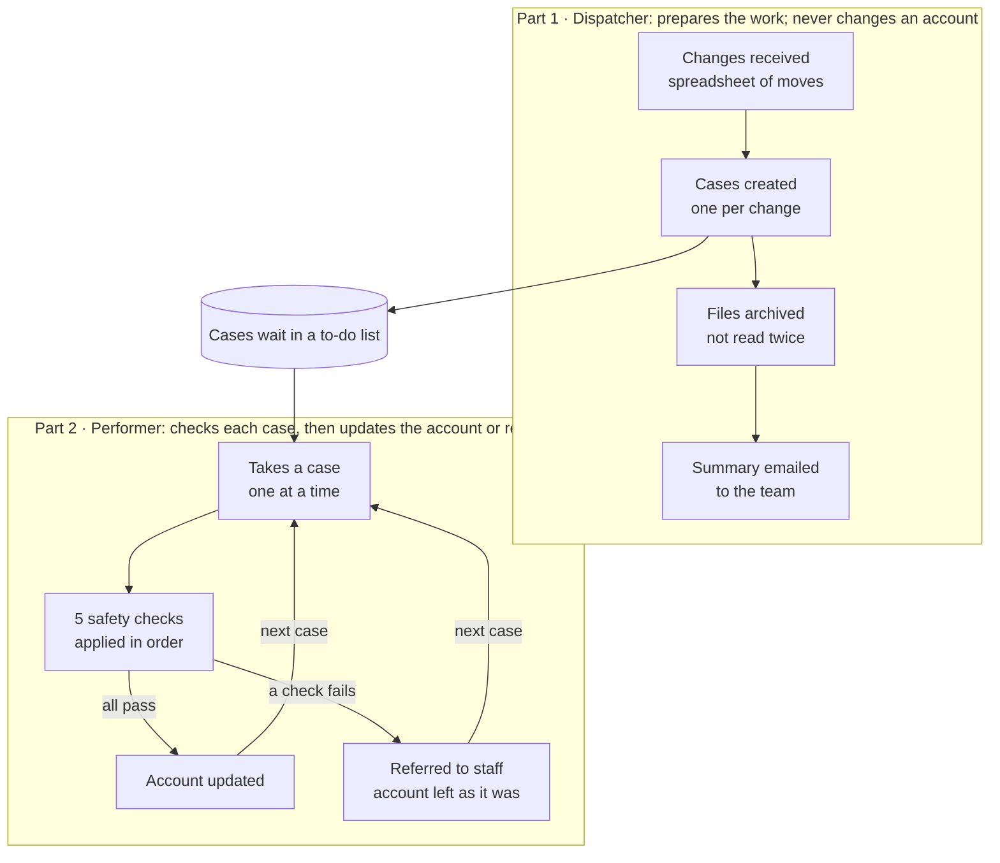

# HARSLL: keeping council tax accounts in step with tenancy changes

Business overview · 19 November 2026
Shared version: [Business overview tab](https://claude.ai/artifact/Kjx7dd8njphvDfwTq833cU#7d961d07-adad).
Technical detail: [HARSLL-uipath-process.md](../process/HARSLL-uipath-process.md).

HARSLL is an automated process that updates council tax accounts when a council tenancy starts or ends. The aim is that the right person is billed from the right date, without staff entering each change by hand. It changes an account only when five safety checks pass. Anything it is unsure about is passed to staff.

## Purpose

**Assumed purpose, to be confirmed by the process owner.** The process files show what the automation does, but not the business case behind it. The purpose below is our reading of those files.

### The business problem

When a council tenancy starts or ends, the housing team records the change. But the council tax account for that property does not update itself. Someone has to:

- find the right account,
- check it against the tenancy change,
- make the new tenant responsible for paying, or close the old tenant's liability,
- and record any forwarding address.

Done by hand, this is repetitive work, and delays or mistakes affect residents directly:

- **The wrong person is billed**, for example a tenant who has already left.
- **The new tenant is not billed** from the date they moved in, so income is collected late or lost.
- **Bills go to an empty property** or to someone who has died.
- **Errors take staff time to put right** and can lead to complaints.

### What HARSLL does about it

HARSLL takes each tenancy change and makes the council tax update automatically, applying the same rules every time. It is designed to be **cautious**. It changes an account only when it is sure the change is correct. Every other case goes to a member of staff with a clear reason.

## What it delivers

These are the expected benefits, based on how the process is designed. No figures are available yet; volumes and time saved are listed under Decisions needed.

| Benefit | How HARSLL delivers it |
| --- | --- |
| **Accurate bills** | The right person is made liable from the right date, and leavers stop being charged |
| **Faster updates** | Each new batch of tenancy changes is processed automatically, rather than waiting for staff time |
| **Consistent decisions** | The same rules are applied to every case, every time |
| **Staff focus on judgement cases** | Routine cases are handled automatically. Staff only see cases that need a decision |
| **A clear record** | Every case ends with a recorded outcome, and the team receives a summary of each batch |

## Scope

| Handled automatically | Left to staff |
| --- | --- |
| **New tenancy:** the new tenant, and any joint tenants, are made liable, and their contact details are added | Any case that fails a safety check (see below) |
| **Tenancy ended, forwarding address known:** the leaver's liability is closed and the new address recorded | Disputes, discounts and exemptions: the process files show no handling for these |
| **Tenancy ended, no forwarding address:** the leaver's liability is closed | Any special handling after a death (see below) |

The automation only acts on the tenancy changes it is given. It does not decide whether a tenancy has started or ended. That decision is made in the housing records.

## How it works

HARSLL has **two automated parts**. The first prepares cases and puts them on a to-do list, and the second works through that list.

| | Part 1 · Dispatcher | Part 2 · Performer |
| --- | --- | --- |
| **Its job** | Prepares the work | Checks each case and applies it |
| **What it does** | Reads the spreadsheet of tenancy changes, creates one case per change (linking joint tenants at the same address), files the spreadsheet away so it is not read twice, and emails the team a summary | Takes each case in turn, runs the five safety checks, then either updates the council tax account or refers the case to staff |
| **Does it change accounts?** | No | Yes, but only when all five checks pass |
| **How often it runs** | Once for each batch of tenancy changes | Once for each case, until the to-do list is empty |

Splitting the work this way means one difficult case never holds up the rest. Each case is checked and either applied or referred on its own.

## Safety checks

Before changing any account, HARSLL applies five business rules in order. **All five must pass.** If any rule fails, the account is left exactly as it was and the case goes to staff.

| # | Rule | Why it matters |
| --- | --- | --- |
| 1 | **The tenancy change is complete and of a type the automation handles** | Stops wrong or missing dates reaching a bill, and stops unfamiliar types of change being handled the wrong way |
| 2 | **The change has not already been made** | Stops a resident being billed twice or a duplicate account being created |
| 3 | **The correct council tax account has been found** | Stops the automation changing someone else's account by mistake |
| 4 | **The council tax account is in the state the change expects** | If the account already shows the change, or shows different dates, a person decides which record is right |
| 5 | **The account can be changed** | If the council tax system will not let the current liability be closed, there is usually a reason a person needs to understand first |

New tenancies have two extra rules, because they add people to an account:

- **Any joint tenants can be added** to the account.
- **Contact details are available** for the new tenant.

The [technical detail](../process/HARSLL-uipath-process.md) explains each check in more depth, including the exact names used in the process flowcharts.

## Cases referred to staff

A referred case is **not a system fault**. It is the automation recognising that it cannot be sure, and leaving the decision to a person. Other cases in the same batch carry on as normal.

| Why a case is referred | What staff would typically need to do |
| --- | --- |
| **Information is missing or wrong** (safety check 1) | Correct the dates or change type with the housing team |
| **The change has already been made** (check 2, or account already updated) | Confirm the account is correct; usually no further action |
| **The account cannot be found** (check 3) | Identify the right account, for example from the address |
| **The records disagree** (check 4) | Decide whether the housing record or the council tax record is right |
| **The account cannot be changed** (check 5) | Find out why the system is blocking the change |
| **A joint tenant or contact details cannot be added** (new tenancies) | Add the missing details by hand |

The staff actions above are what each reason implies. They are not documented in the process files. **Who reviews referred cases, and how quickly, is not yet defined.** It is listed under Decisions needed.

## Tenancies ending because the tenant has died

The process files do not mention deaths. A death is one way a tenancy ends, so these cases most likely pass through HARSLL as an ordinary ended tenancy, usually with no forwarding address.

That raises questions the business should answer before relying on the automation for these cases:

- Is a death one of the change types the automation accepts, or are these always handled by staff?
- Should the account move to an executor or a relative's address for the final bill?
- Do any special rules apply, such as an exempt period while the estate is settled, or more sensitive letters?

None of this handling appears in the process today.

## Decisions needed

The process owner needs to confirm the points below before this document can be treated as final.

| # | To confirm | Why it matters |
| --- | --- | --- |
| 1 | **The purpose and business case**, what "HARSLL" stands for, and who owns the process | The purpose in this document is assumed |
| 2 | **Who reviews referred cases**, and within what time | Referred cases are where problems are caught. Without an owner they can sit unresolved while bills are wrong |
| 3 | **Volumes:** changes per month, how often the automation runs, and how many cases are referred | Needed to measure the benefit and the staff time still required |
| 4 | **How deaths should be handled** | Sensitive cases. The current process shows no special handling |
| 5 | **Which types of tenancy change are accepted** | Defines exactly what is automated and what stays manual |
| 6 | **The exact rule for comparing the two records** (safety check 4) | The most complex rule; it decides when an account is changed or referred |
| 7 | **That RBIS is the council tax system and ABRITAS is the housing system** the changes come from | The systems are inferred from the process files |
| 9 | **Whether the landlord is liable for a property between tenancies**, and whether HARSLL refers to housing association or registered social landlord tenancies | Safety check 4 is built on this reading. If so, "council tenancy" in this document should read "social landlord tenancy" |
| 8 | **How the automation connects to the council tax system:** through its screens, or through a direct link | Affects how reliable the process is, and which tools could run it in future |

## Key terms

| Term | Meaning |
| --- | --- |
| **Tenancy** | A tenant's agreement to rent a council property, with a start date and, when it ends, an end date |
| **Liable person** | The person responsible for paying council tax on a property. Joint tenants are each liable |
| **Council tax account** | The record showing who must pay for a property, and from when |
| **Forwarding address** | Where a tenant who has left can be contacted, for example for a final bill |
| **Referred case** | A case the automation did not complete, passed to staff with a reason |
| **RBIS** | The system HARSLL updates. Most likely the council's revenues (council tax) system |
| **ABRITAS** | Housing software from Civica. Most likely the source of the tenancy changes |
| **HARSLL** | The name of this process. What it stands for is to be confirmed |
