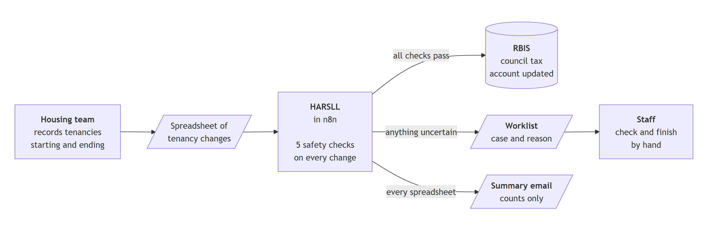

# HARSLL on n8n: one-page summary

19 November 2026

**A working prototype of HARSLL now runs on n8n.** The council tax update process that two UiPath robots do today has been rebuilt as six n8n workflows, documented and tested end to end. It runs against a pretend version of RBIS with made-up data only; it has not touched the real council tax system or real tenant data. Moving it to BCC's environment now depends on a few answers from the process owner and IT, above all how n8n can reach RBIS.

HARSLL updates council tax accounts when a council tenancy starts or ends, so the right person is billed from the right date. It is cautious by design: an account changes only when five safety checks pass, and anything uncertain goes to staff with the reason.

## How it works

Each row of the housing team's spreadsheet becomes a case. If all five checks pass, HARSLL updates the RBIS account; if any fails, RBIS is left untouched and the case goes on a worklist for staff, with the reason. Every spreadsheet ends with a counts-only summary email.

## What was built

The whole process works end to end on a laptop, with tooling to install it anywhere and proof that it behaves as designed.

| Deliverable | What it gives | Evidence |
| --- | --- | --- |
| **Six n8n workflows** | The full process: take in spreadsheets, run the five checks, update RBIS or refer, then a staff worklist and a summary email | All 37 end-to-end test scenarios pass, including RBIS failing mid-update, retries and the same file sent twice |
| **Pretend RBIS and test data** | Safe testing without the real system: 31 made-up accounts, each set up for one situation | Used by every test and demo |
| **Set-up script** | Installs or updates HARSLL in any n8n with one command, after a dry run | Installed on a fresh, separate n8n and processed a 31-row file; a second run changed nothing |
| **Install kit** | One zip to hand over: workflows, set-up script, guides, trial RBIS | Build refuses keys, passwords and confidential files |
| **Documentation** | Business overview, how it works, staff guide, set-up and hand-over guides, design | Written for business readers and developers separately |

Four design choices carry the safety: only one workflow ever talks to RBIS; every change is checked in RBIS first, so nothing is changed twice; unconfirmed business rules are settings, not code; and successful runs keep no personal data.

## See it working

A 10-row sample spreadsheet runs through HARSLL in about 70 seconds, and all 10 rows end as the design expects: 3 accounts updated, 6 cases referred to staff, 1 duplicate.

**Demo video:** *link to be added (about 3 minutes).* It follows one spreadsheet through:

1. The sample spreadsheet is dropped into the input folder.
2. n8n picks it up and runs the Dispatcher, then the Performer once per row.
3. The pretend RBIS shows the 3 accounts changed, and every change made.
4. The staff worklist lists the 6 referred cases, each with its reason.
5. The summary email arrives with counts only, no names.

Anyone with Docker can run the same demo live in about 15 minutes, following the repository's [README](../../README.md#run-it-on-your-computer).

## Assumptions made

The prototype was built from the UiPath process files alone, so each rule they don't settle was given a cautious default. Most are settings: a different answer changes a value, not the build.

| Assumption | How it is built in | If the answer differs |
| --- | --- | --- |
| The landlord is liable in RBIS between tenancies | Check 4 expects the landlord before a move-in | Check 4 changes; the most important to confirm |
| The landlord's liability ends on the tenant's start date, and restarts on the tenancy end date | Two date settings | Switch to the day before or the day after |
| Deaths go to staff, never processed automatically | A setting | Switch to treating a death as a move-out |
| On a joint tenancy, the first row adds every tenant | A setting | Switch to referring the later rows |
| Only move-ins and move-outs are automated | A setting | Add other change types |
| The spreadsheet's column names and layout | A setting, plus one tidy-up step | Map to the real column names |
| RBIS can be reached directly, for example through an API | One workflow, the RBIS adapter | If only through its screens, those steps need a robot alongside n8n |
| Spreadsheets arrive in a folder n8n can watch | n8n's file trigger | File intake is redesigned, for example around SharePoint |

## To clarify

The first two questions decide whether and how HARSLL can run at BCC; the rest fine-tune its rules.

| # | Question | Who can answer | Why it matters |
| --- | --- | --- | --- |
| 1 | How can n8n reach RBIS: an API, the database, or only its screens? | RBIS owners, IT | Decides whether n8n can make the RBIS changes itself |
| 2 | Will BCC's n8n allow the file-watching and file-moving steps that are off by default? | n8n administrators | Without them, file intake must be redesigned |
| 3 | Is the landlord liable between tenancies, and what exactly should check 4 compare? | Process owner | The rule that decides when an account is changed |
| 4 | How should deaths and joint tenancies be handled? | Process owner | Sensitive cases; today they go to staff |
| 5 | What does the real spreadsheet look like, and where will it arrive? | Housing team, IT | Column names, date formats, the folder |
| 6 | Who works the referred cases, and how quickly? | Process owner | Referred cases are where problems are caught |
| 7 | What are the monthly volumes, and how long may records be kept? | Process owner, data protection | Sizing the benefit; personal data |

The full list of 17 questions is in the [design document](../design/HARSLL-n8n-design.md#open-questions).

## Next steps

The build is done; what remains is connecting it to BCC's real systems and proving it on real data, in this order:

1. **Get the answers above**, starting with how RBIS can be reached.
2. **Build the real RBIS adapter.** Only this one workflow changes.
3. **Install in BCC's test environment** with the set-up script.
4. **Test** against test RBIS accounts and a real spreadsheet layout.
5. **Run alongside the UiPath robots** with HARSLL only reporting what it would do, and compare the results. This report-only mode is still to be built.
6. **Switch over** once the process owner and IT sign off.
