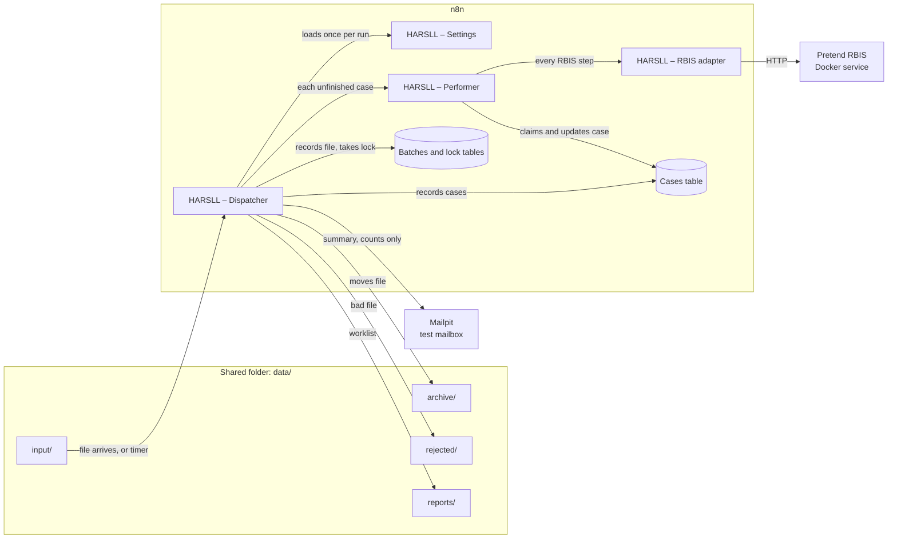
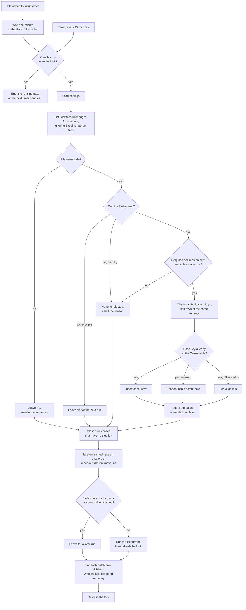
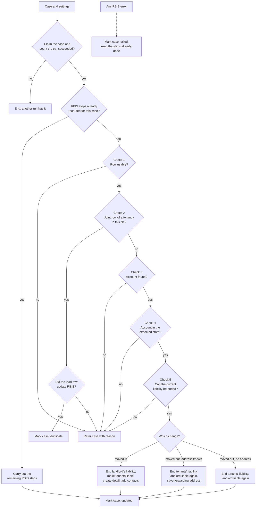
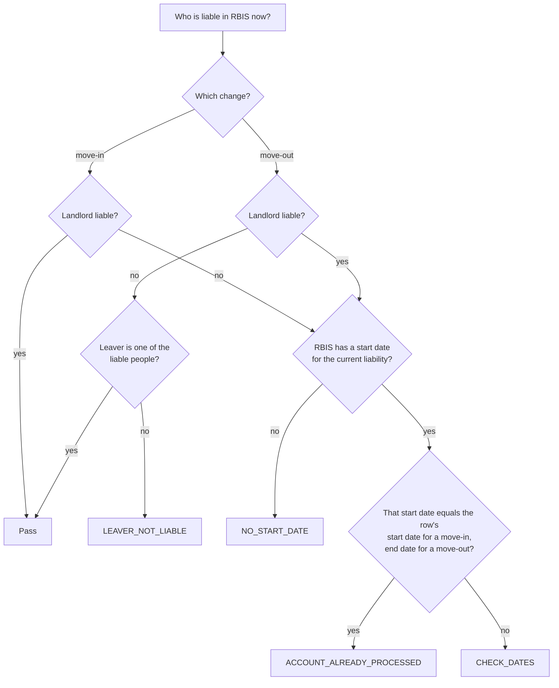
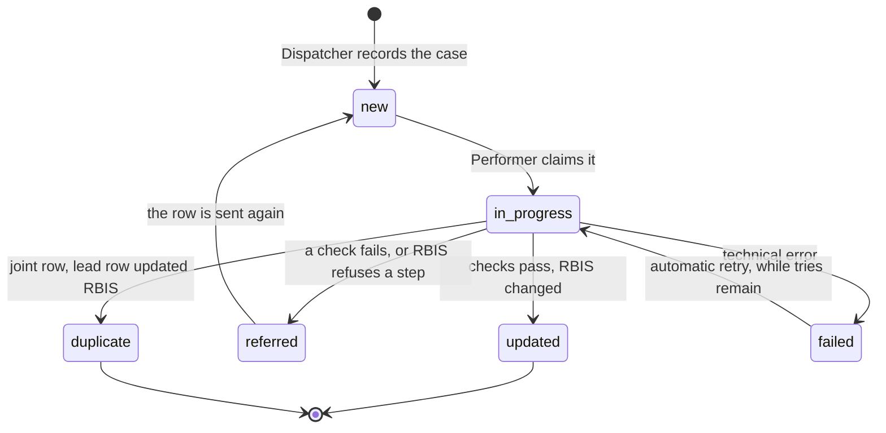

# HARSLL in n8n: design

**Status:** Revision 3, **approved** 19 November 2026
**Phase:** design (3 of 5) complete. The build (Phase 4) follows this document.
**Read first:** [Business overview](../business/HARSLL-business-overview.md) · [Current UiPath process](../process/HARSLL-uipath-process.md)

## Summary

HARSLL is rebuilt as **four n8n workflows**, a **Cases table** with two small helper tables, and a **pretend RBIS** that runs next to n8n in Docker.

- The **Dispatcher** records one case per spreadsheet row about a minute after a file arrives, archives the file, and then works through every unfinished case. A timer repeats this, so nothing waits on a person.
- The **Performer** takes one case, applies the five safety checks, then updates the account or refers the case with a reason.
- All RBIS work goes through **one RBIS adapter workflow**. Today it talks to the pretend RBIS; later only this workflow changes.
- **Unknown business rules are settings** with cautious defaults, listed in [Settings and assumptions](#settings-and-assumptions).

## Revision history

### What changed in revision 3

Revision 2 was checked line by line against the flowchart and for gaps in reliability. Check 4 and check 5 held up. These problems were found and fixed:

| # | Problem in revision 2 | Fix in revision 3 |
| --- | --- | --- |
| 1 | A move-out and a move-in at the same address in one file: the second row was marked `duplicate` and lost | Rows are linked only when they share the account, address, change type **and** date. Cases for one account run in date order, move-outs first |
| 2 | If the first row of a joint tenancy was referred, the other people were still marked `duplicate` and silently dropped | A later row takes its result from the first row: `duplicate` only if the first row updated RBIS, otherwise referred to staff. Check 1 runs before check 2 again, as in UiPath |
| 3 | A case that crashed the Performer could be retried forever | A try is counted every time processing starts. After 3 tries the case stays `failed` |
| 4 | A retry could repeat an RBIS change, for example if RBIS made the change but its reply was lost | Each RBIS call is recorded on its own, and every adapter write looks first and does nothing if the change is already there |
| 5 | Two runs starting at the same moment could both take the lock; the lock expired during a long run | Each case is claimed on its own, the lock is taken the same way, and the lock is refreshed after every case |
| 6 | Only two of the four workflows kept personal data out of n8n's run history; the clean-up period was given in days | All four workflows; clean-up is 168 hours, the unit n8n uses |
| 7 | The timer could pick up a file still being copied; Excel's temporary files caused warning emails | Files are left alone until unchanged for a minute; temporary files are ignored; an unreadable file is retried before it is rejected |
| 8 | A move-in could end the landlord's liability, fail to add the tenant, and leave nobody liable without warning | Any case that stops after RBIS was partly changed is marked **urgent** and listed first for staff |
| 9 | A death could be referred as "change reason not valid" | Deaths are recognised before the allowed-reasons test |
| 10 | A resubmitted row's result was never reported | A reopened case joins the new file's batch and its summary |
| 11 | Joint tenants' own contact details were lost | The first row carries each person's contact details |
| 12 | The timer interval was listed as a setting, but a trigger cannot read settings | The interval is set on the trigger. The stuck-case, lock and file-wait times are settings |
| 13 | Reason codes could not be compared with UiPath's results | Each reason code lists its UiPath equivalent |
| 14 | "The only reading that makes sense" overstated the landlord inference | Reworded: the most consistent reading found |

### Revision 2, in brief

Revision 2 rebuilt check 4 around who is liable in RBIS now, modelled the landlord as a liable party, replaced the misread move-in checks, and added automatic retries, resume of half-finished updates, reopening of referred rows, safe file moves, the staff worklist and trials before building.

## Key assumption: the landlord is liable between tenancies

**This is an inference from the flowchart. It is the most important thing to confirm.**

The flowchart asks "Liable Parties Match?" and then behaves in opposite ways:

| Change | Match | No match |
| --- | --- | --- |
| Move-in | Proceed to update | Go to date checks, which always stop |
| Move-out | Go to date checks, which always stop | Proceed to update |

It also checks "Can Terminate Account?" for **both** move-ins and move-outs.

The most consistent reading found is that the question means **"is the landlord the liable party in RBIS right now?"**

- **Move-in:** the landlord is liable for the empty property. The robot ends the landlord's liability and starts the tenant's. If the landlord is *not* liable, a tenant already is, so the change was already made or the dates are wrong.
- **Move-out:** the tenant is liable. The robot ends the tenant's liability, and the landlord becomes liable again. If the landlord is *already* liable, the change was already made or the dates are wrong.

The name fits: "HARSLL" plausibly contains **HA** (Housing Association) and **RSL** (Registered Social Landlord). That is a guess.

If this reading is wrong, check 4 and the update steps change; the rest of the design does not. Each comparison is a separate named step so it can be corrected.

## What stays the same, what changes

| Area | UiPath today | n8n design |
| --- | --- | --- |
| Start | Robot looks in a folder when it runs | Starts about a minute after a file arrives, with a timer as a safety net |
| Hand-over between robots | Orchestrator queue | **Cases table**, which also records every case's status and reason |
| Checks | Inside one long flowchart | Each check is its own named step |
| Unknown rules | Fixed in the robot | Settings with defaults |
| RBIS | Robot clicks through RBIS screens (inferred) | **RBIS adapter** calling the pretend RBIS |
| Results | Robot logs | Cases table, worklist file, summary email with counts |
| A case that crashes | May stop the robot | That case is retried up to 3 times; the rest carry on |
| Same file sent twice | Risk of doing work twice | Finished cases are skipped |
| Bad file | Not shown | Moved to a "rejected" folder and the team emailed |
| Email | Outlook | SMTP: test mailbox now, real mail server later |

## Architecture



### The four workflows

| Workflow | File | Starts when | Job |
| --- | --- | --- | --- |
| **HARSLL – Dispatcher** | `harsll-dispatcher.json` | A file is added to the input folder, or the timer fires | Take in files, then process every unfinished case, then report |
| **HARSLL – Performer** | `harsll-performer.json` | Called by the Dispatcher, once per case | Run the checks, update RBIS or refer the case, record the result |
| **HARSLL – RBIS adapter** | `harsll-rbis-adapter.json` | Called by the Performer, once per RBIS step | The only place that talks to RBIS |
| **HARSLL – Settings** | `harsll-settings.json` | Called by the Dispatcher, once per run | Returns every setting. The Dispatcher passes them on to the Performer and adapter |

Dispatcher and Performer match the two UiPath robots. Settings replaces UiPath's "Get Assets". The adapter isolates the RBIS steps so that moving to the real RBIS changes one workflow.

## Dispatcher

The Dispatcher has two parts. **Intake** turns files into cases. **Processing** works through unfinished cases. Both run on every start, whichever trigger fired.



| Step | n8n node | Notes |
| --- | --- | --- |
| File added | **Local File Trigger** | Event "File Added", polling on, wait until the file is fully written |
| Wait | **Wait** | `fileSettleSeconds`, default 60 |
| Timer | **Schedule Trigger** | Every 15 minutes. The interval is set on this node, because a trigger cannot read settings. Catches files that arrived while n8n was stopped, and retries |
| Take the lock | **Data table**: Update | Updates the lock row only if it is free or has not been refreshed for `lockStaleMinutes`. If no row was updated, another run holds it |
| Load settings | **Execute Sub-workflow** → Settings | Once per run |
| List files | **Execute Command** | One fixed command with **no file names in it**. It lists `.xlsx` files unchanged for a minute and skips names starting with `~$`. Checked: this works in the n8n container |
| File name safe? | **IF** | Only letters, numbers, spaces and `_ - . ( )` are allowed |
| Read file, extract rows | **Read/Write Files from Disk**, **Extract from File** (XLSX) | Header row on, **Include Empty Cells on** so an empty column is not mistaken for a missing one. A file that cannot be read is tried on up to `maxFileReadAttempts` runs before it is rejected |
| Check columns | **IF** | Against `requiredColumns`. A wrong layout is rejected at once |
| Tidy rows | **Edit Fields (Set)** | Trim text; accept real Excel dates (which arrive as date-time text), Excel date numbers and `dd/MM/yyyy` text; store dates as `yyyy-MM-dd` text so time zones cannot shift them |
| Link rows of the same tenancy | **Code** | *Why Code:* needs all rows at once to group them. See [Rows for the same tenancy](#rows-for-the-same-tenancy) |
| Case key lookup, insert, reopen | **Data table** | |
| Move file | **Execute Command** | `mv` with the file name in single quotes. Only reached for names that passed the safety check, so no name can inject a command |
| Run Performer | **Execute Sub-workflow** | Once per case, waits for each, continues if one errors |
| Worklist | **Convert to File** + **Read/Write Files from Disk** | `reports/<batch>_worklist.xlsx` |
| Summary | **Summarize** + **Send Email** | Counts only |

### Rows for the same tenancy

Rows with the same **account reference, address, change type and date** are one tenancy with several people, such as joint tenants moving in together.

- The first of them is the **lead row**. It carries the other people's names and contact details (`jointTenants`) and does the RBIS work for all of them.
- The others are **joint rows**. Each points to its lead row (`coveredByCaseKey`) and takes its result from it (check 2).

Rows at the same address with a **different change type or date** are separate cases. One tenant leaving and another moving in are two cases, each processed in full.

UiPath links neighbouring rows in its "look ahead" step, but the exact test is not visible in the screenshot. This design links matching rows wherever they are in the file.

### Case key

Built from the change type, account reference, normalised address, tenant name and the relevant date. It decides what happens when a row is seen again:

| Existing case status | A row with the same key arrives |
| --- | --- |
| `updated`, `duplicate` | Skipped. The work is done |
| `referred` | **Reopened** in the new file's batch and processed again from the start. Staff may have fixed the cause |
| `new`, `failed`, `in_progress` | Left alone. Processing will pick it up |

A reopened case keeps a note of its earlier result (`previousResult`). Its recorded RBIS steps are cleared, and every check runs again against RBIS as it is now.

### Order of processing

- Unfinished cases are taken in **date order**. On the same date, **move-outs run before move-ins**, then by row number.
- **A case waits while an earlier case for the same account is unfinished.** If a move-out hits a technical failure, the move-in for that account waits for the retry instead of being referred for the wrong reason. Joint rows wait for their lead row in the same way.
- "Unfinished" means `new`, `failed` with tries left, or `in_progress`.

### One run at a time

Two protections work together:

- **The lock.** A run starts only if it can take the lock. The lock is refreshed after every case, so a long run keeps it. A lock not refreshed for `lockStaleMinutes` belongs to a run that died, and can be taken over.
- **The claim.** The Performer claims each case before working on it (see below). Even if two runs were ever active together, a case can only be claimed by one.

A run that cannot take the lock ends at once. Its file is picked up by the running pass or the next timer.

## Performer

The Performer receives one case and the settings. Every stop goes through one **Refer case** step, so all referrals are recorded the same way.



**The claim.** One update changes the case to `in_progress`, adds one to `attempts` and sets `lastAttemptAt`, but only if the case's status and `attempts` are still what the Dispatcher saw. If nothing was updated, another run has the case and this one stops. Because the try is counted here, every start counts, including resumes and crashes.

### The checks

| Check | Rule | Reason codes | UiPath boxes |
| --- | --- | --- | --- |
| **1. Row usable** | Tested in this order: (a) the dates are real and the end date is not before the start date; (b) if the change reason is a death, follow `deathHandling`; (c) the change reason is allowed | `DATES_INVALID`, `DEATH_REFERRED`, `CHANGE_REASON_NOT_VALID` | Start or End Dates Valid?, Check Process is Valid, Valid? |
| **2. Joint row** | The row is a joint row of a tenancy in this file. It takes its result from the lead row (table below) | Status `duplicate` with `SAME_TENANCY_AS_EARLIER_ROW`, or `EARLIER_ROW_NOT_COMPLETED` | Duplicate Address? |
| **3. Account found** | The row has an account reference, and RBIS finds the account by reference and by address (flat or house format) | `NO_ACCOUNT_REF`, `ADDRESS_NOT_FOUND` | Account Ref Empty?, Address Search, Search By Account Ref, Address found?, Is a Flat? |
| **4. Account in the expected state** | See [Check 4 in detail](#check-4-in-detail) | `NO_START_DATE`, `CHECK_DATES`, `ACCOUNT_ALREADY_PROCESSED`, `LEAVER_NOT_LIABLE` | Check address and Liable party, Tenancy Start?, Liable Parties Match?, RBIS Start Date Present?, RBIS Start = Input Start / End? |
| **5. Can end the current liability** | RBIS offers the option to end the liability that is current: the landlord's for a move-in, the tenants' for a move-out | `NO_OPTION_TO_TERMINATE` | Select Account, Get Matched Address, Check if Terminate, Can Terminate Account? |

With `deathHandling` set to `processAsEnd`, a death is treated as a move-out from check 2 onwards.

**Check 2: what a joint row does.** By the time a joint row runs, its lead row is finished, because cases for one account run in order.

| Lead row's result | Joint row | Why |
| --- | --- | --- |
| `updated` | `duplicate`, `SAME_TENANCY_AS_EARLIER_ROW` | The lead row added this person. Nothing more to do |
| `referred`, or `failed` with no tries left | `referred`, `EARLIER_ROW_NOT_COMPLETED` | The person was not added, so staff must see this row too |

UiPath stops every later row with "Tenancy already processed", whatever happened to the first row. This design differs on purpose, so that nobody is dropped when the first row fails.

### Check 4 in detail

The Performer asks the adapter who is liable on the account now, and from what date. `landlordLiable` is true when that party's name is in the `landlordNames` setting.



| Situation | Result | Meaning |
| --- | --- | --- |
| Move-in, landlord liable | Pass | The property is empty in RBIS, as expected |
| Move-in, a tenant already liable from the row's start date | `ACCOUNT_ALREADY_PROCESSED` | The move-in is already in RBIS |
| Move-in, a tenant already liable from another date | `CHECK_DATES` | RBIS and the spreadsheet disagree |
| Move-out, the leaver is liable | Pass | As expected |
| Move-out, landlord already liable from the row's end date | `ACCOUNT_ALREADY_PROCESSED` | The move-out is already in RBIS |
| Move-out, landlord already liable from another date | `CHECK_DATES` | RBIS and the spreadsheet disagree |
| Move-out, someone else is liable, or nobody is | `LEAVER_NOT_LIABLE` | **Added safeguard, not in UiPath.** Stops the automation ending the wrong person's liability. Controlled by `confirmLeaverIsLiable` |
| Move-in with nobody liable, or the current liability has no start date | `NO_START_DATE` | Nothing to compare |

### The update paths

Each path is a fixed list of RBIS calls.

| Path | RBIS calls, in order | Outcome recorded |
| --- | --- | --- |
| **Moved in** | 1. `endLiability` for the landlord → 2. `addLiableParty`, one call per person: the lead tenant, then each joint tenant → 3. `createDetail` → 4. `setContactDetails`, one call per person who has contact details | `liability started` |
| **Moved out, forwarding address known** | 1. `endLiability` for the tenants → 2. `addLiableParty` for the landlord → 3. `setForwardingAddress` | `liability ended, address saved` |
| **Moved out, no forwarding address** | 1. `endLiability` for the tenants → 2. `addLiableParty` for the landlord | `liability ended` |

**How a path stays safe when something goes wrong:**

- **Every call is recorded on its own.** As soon as a call succeeds it is added to the case's `stepsDone`, for example `addLiableParty:jane test`.
- **Every write is safe to repeat.** The adapter looks at the account first. If the change is already there, it changes nothing and answers "already done". A lost reply from RBIS therefore cannot cause the same change twice.
- **A retry carries on, it does not start again.** It begins at the first call not in `stepsDone` and skips the checks, because RBIS has been partly changed and check 4 would misread it.
- **A case that stops part-way is urgent.** If a case ends as `referred`, or as `failed` with no tries left, after at least one RBIS call succeeded, it is marked `urgent`. Example: the landlord's liability was ended, but RBIS refused to add the new tenant, so nobody is liable. Urgent cases are listed first in the worklist, with the calls that were made.
- **RBIS refuses a person:** the case stops with `UNABLE_TO_ADD_PARTY`.
- **Nobody has contact details on a move-in:** call 4 is skipped. The case is `updated` with the follow-up reason `NO_CONTACT_DETAILS`, so staff add the details without redoing the update. UiPath stops at the same point, after RBIS has been changed.

Assumptions in these paths:

- **Move-in: the landlord's liability ends on the tenant's start date** (`landlordLiabilityEndsOn`). It could be the day before. Confirm.
- **Move-out: the landlord's liability starts on the tenancy end date** (`landlordLiableFrom`). The flowchart compares "RBIS Start = Input End", which suggests the same day. Confirm.
- **The lead row adds every person on the tenancy** (`jointTenantHandling`). The alternative, `referLaterRows`, has the lead row add only its own person and refers the joint rows to staff.
- **Joint move-out:** the lead row ends the liability for everyone on it. One forwarding address is saved, the lead row's.

### Adding a person to an existing tenancy (built, switched off)

The flowchart has a branch that is not connected to the main flow: "Tenancy Processed? → ABRITAS? → Same as previous tenancy? → Check if can add additional liability → Add additional liability → Create Detail → Contact Details". It appears to add a joint tenant to a tenancy that was set up in an earlier file. When it runs is not shown.

The design includes it behind the setting `addPersonToExistingTenancy`, **off by default**. When on, a move-in that would stop with `ACCOUNT_ALREADY_PROCESSED` is checked further: if the row's source system is `requiredSourceSystem`, and the row's person is not yet liable, the person is added (`addLiableParty` → `createDetail` → `setContactDetails`). Otherwise the case stops as before. When off, these cases go to staff.

## RBIS adapter and the pretend RBIS

The Performer never calls RBIS directly. It calls the **RBIS adapter** with an operation name and details, and gets back a simple, consistent answer.

| Adapter operation | What it does | Changes RBIS? | Pretend RBIS endpoint |
| --- | --- | --- | --- |
| `findAccount` | Find the account by reference; confirm the address matches | No | `GET /accounts/{ref}` |
| `getAccount` | Current liable parties, their type (landlord or tenant) and start date | No | `GET /accounts/{ref}` |
| `canTerminate` | Whether the current liability can be ended | No | `GET /accounts/{ref}/termination-options` |
| `endLiability` | End the current liability on a date | Yes | `POST /accounts/{ref}/terminate` |
| `addLiableParty` | Make a person or the landlord liable from a date | Yes | `POST /accounts/{ref}/liable-parties` |
| `createDetail` | Create the account detail record for the tenancy | Yes | `POST /accounts/{ref}/details` |
| `setContactDetails` | Save a person's contact details | Yes | `PUT /accounts/{ref}/contact` |
| `setForwardingAddress` | Save the leaver's new address | Yes | `PUT /accounts/{ref}/forwarding-address` |

**Rule for every operation that changes RBIS:** read the account first; if the change is already there, change nothing and answer "already done". The adapter for the real RBIS must keep this rule.

**The pretend RBIS** is a small web service in Docker (`mock-rbis` in `compose.yaml`, plain Node.js, no extra packages). It:

- loads **made-up accounts** from `test-data/rbis-accounts.json`. Each account has an address and a history of liabilities: who, landlord or tenant, from when, to when,
- records every change (`GET /changes`), so tests can check exactly what was done,
- can be reset between tests (`POST /reset`),
- can be told to fail on purpose (`POST /simulate-outage`): before a change, part-way through an update, or **after making a change but before replying**.

**Moving to the real RBIS** (Phase 5) means rewriting the adapter only: API calls, a database connection, or, if RBIS has screens only, a call out to a UiPath robot for those steps.

## Tables

### Cases table (`harsll_cases`)

One row per case.

| Column | Type | Purpose |
| --- | --- | --- |
| `caseKey` | text | Identifies the change; stops double work |
| `batchId` | text | The file the case came from. Changes when the row is sent again |
| `rowNumber` | number | Row in the spreadsheet |
| `changeReason` | text | As given in the spreadsheet |
| `accountRef`, `address`, `postcode` | text | |
| `isFlat` | boolean | Decides the address search format |
| `tenantName` | text | |
| `jointTenants` | text | Lead rows only: the other people on the tenancy, with their contact details |
| `coveredByCaseKey` | text | Joint rows only: the lead row |
| `startDate`, `endDate` | text | `yyyy-MM-dd` |
| `forwardingAddress`, `contactEmail`, `contactPhone` | text | |
| `sourceSystem` | text | |
| `status` | text | See below |
| `reasonCode`, `reasonText` | text | Why it was referred, failed or needs follow-up; code and plain English |
| `outcome` | text | What changed in RBIS |
| `urgent` | boolean | The case stopped after RBIS was partly changed |
| `stepsDone` | text | Each RBIS call that succeeded, for safe retries |
| `attempts` | number | Times processing has started since the row was last sent |
| `submissions` | number | How many times this row has been sent |
| `previousResult` | text | The result before the row was sent again |
| `lastAttemptAt` | date | Used to spot cases stuck `in_progress` |
| `errorDetail` | text | Technical error, for `failed` only |

### Batches table (`harsll_batches`)

One row per file seen.

| Column | Type | Purpose |
| --- | --- | --- |
| `batchId` | text | Date, time and file name |
| `fileName` | text | |
| `status` | text | `received`, `unreadable` (being retried), `needs_rename` (emailed once), `rejected` |
| `readAttempts` | number | Runs on which the file could not be read |
| `rowCount` | number | |
| `receivedAt` | date | |
| `summarySentAt` | date | Empty until every case in the batch is finished and the summary is sent |

### Lock table (`harsll_lock`)

One row.

| Column | Type | Purpose |
| --- | --- | --- |
| `name` | text | Always `dispatcher` |
| `lockedAt` | date | When the lock was taken or last refreshed. Empty when free |
| `lockedBy` | text | The run that holds it |

### Statuses



| Status | Meaning | Who acts |
| --- | --- | --- |
| `new` | Recorded, waiting | Nobody |
| `in_progress` | Being processed. If stuck for `stuckMinutes`, it is retried while tries remain, then set to `failed` | Nobody |
| `updated` | RBIS changed. May carry the follow-up `NO_CONTACT_DETAILS` | Staff, only for a follow-up |
| `referred` | Passed to staff. RBIS is unchanged unless the case is `urgent` | Staff |
| `duplicate` | Joint row whose lead row did the work | Nobody |
| `failed` | Technical problem. Retried until `maxAttempts`, then stays `failed` | IT, once tries run out |

### Reason codes

| Code | Plain English | From | UiPath equivalent |
| --- | --- | --- | --- |
| `DATES_INVALID` | The dates on the spreadsheet row are wrong or missing | Check 1 | END – Start and End invalid |
| `DEATH_REFERRED` | The tenancy ended because the tenant died; these are passed to staff | Check 1 | None. UiPath's handling of deaths is not known |
| `CHANGE_REASON_NOT_VALID` | The reason for the change is not one the automation handles | Check 1 | END – Change reason not valid |
| `SAME_TENANCY_AS_EARLIER_ROW` | Covered by an earlier row for the same tenancy | Check 2 | END – Tenancy already processed |
| `EARLIER_ROW_NOT_COMPLETED` | The earlier row for this tenancy was not completed, so this person was not added | Check 2 | END – Tenancy already processed (UiPath does not tell the two apart) |
| `NO_ACCOUNT_REF` | The row has no account reference | Check 3 | END – Address not found |
| `ADDRESS_NOT_FOUND` | The account could not be found in RBIS | Check 3 | END – Address not found |
| `NO_START_DATE` | RBIS has no start date to compare against | Check 4 | END – No Start Date |
| `CHECK_DATES` | The dates in RBIS do not match the spreadsheet | Check 4 | END – Check Dates |
| `ACCOUNT_ALREADY_PROCESSED` | RBIS already shows this change | Check 4 | END – Account already processed |
| `LEAVER_NOT_LIABLE` | The person leaving is not the liable person in RBIS | Check 4 | None. Added safeguard; UiPath would proceed |
| `NO_OPTION_TO_TERMINATE` | RBIS does not allow the current liability to be ended | Check 5 | END – No option to Terminate |
| `UNABLE_TO_ADD_PARTY` | A person could not be added to the account | Update | END after "Unable to add party?" |
| `NO_CONTACT_DETAILS` | Liability started, but there were no contact details to record | Follow-up | END – Contact Details do not exist |
| `RBIS_ERROR` | RBIS did not respond or returned an error | Technical | None. A robot error |
| `PROCESSING_STOPPED` | Processing stopped unexpectedly and the tries ran out | Technical | None. A robot error |

## Settings and assumptions

All settings live in **HARSLL – Settings**. Each default is an **assumption** until confirmed.

| Setting | Default | Assumption behind it |
| --- | --- | --- |
| `landlordNames` | `Example Housing Association` | The landlord appears in RBIS as a liable party under a known name. See [Key assumption](#key-assumption-the-landlord-is-liable-between-tenancies) |
| `landlordLiabilityEndsOn` | `startDate` | On a move-in, the landlord's liability ends on the tenant's start date. Alternative: `dayBefore` |
| `landlordLiableFrom` | `endDate` | On a move-out, the landlord's liability starts on the tenancy end date. Alternative: `dayAfter` |
| `confirmLeaverIsLiable` | `true` | Added safeguard. Set to `false` to match UiPath exactly |
| `jointTenantHandling` | `leadRowAddsAll` | The lead row adds everyone on the tenancy. Alternative: `referLaterRows` |
| `addPersonToExistingTenancy` | `false` | The unconnected flowchart branch is left to staff until its trigger is known |
| `requiredSourceSystem` | `ABRITAS` | Used only when the setting above is on |
| `allowedChangeReasons` | `TENANCY_START`, `TENANCY_END` | The flowchart's two flows are the only change types |
| `deathHandling` | `refer` | Deaths go to staff. Alternative: `processAsEnd` |
| `deathChangeReasons` | `DECEASED` | The spreadsheet value for a death |
| `nameMatch` | `normalised` | Names match ignoring capitals, spaces and punctuation |
| `requiredColumns` | See [Input spreadsheet](#input-spreadsheet) | The assumed template |
| `maxAttempts` | `3` | Times a case is tried before it stays `failed` |
| `stuckMinutes` | `15` | A case `in_progress` for longer than this is treated as stuck |
| `lockStaleMinutes` | `30` | A lock not refreshed for this long belongs to a run that died |
| `fileSettleSeconds` | `60` | A file must be unchanged for this long before it is read |
| `maxFileReadAttempts` | `3` | Runs on which an unreadable file is tried before it is rejected |
| `summaryEmailTo`, `summaryEmailFrom` | `harsll-team@example.test`, `harsll@example.test` | Test addresses |
| `inputFolder`, `archiveFolder`, `rejectedFolder`, `reportsFolder` | Under `/files` | |
| `rbisBaseUrl` | `http://mock-rbis:8080` | Pretend RBIS |

The timer interval (15 minutes) is not in this table. It is set on the Dispatcher's Schedule Trigger.

## Input spreadsheet

**Assumed template.** The real column names are not known. Columns are read by name, so matching the real file means changing the **Tidy rows** step and `requiredColumns`.

| Column | Required | Example (made up) | Notes |
| --- | --- | --- | --- |
| `ChangeReason` | Yes | `TENANCY_END` | |
| `AccountRef` | No | `AC100234` | Empty leads to `NO_ACCOUNT_REF` |
| `TenantName` | Yes | `Jane Test` | One person per row |
| `Address` | Yes | `Flat 2, 12 Example Street` | "Flat" at the start marks a flat |
| `Postcode` | Yes | `EX1 1AA` | |
| `StartDate` | For move-ins | `01/11/2026` | |
| `EndDate` | For move-outs | `31/10/2026` | |
| `ForwardingAddress` | No | `4 New Road, EX2 2BB` | Decides between the two move-out paths |
| `ContactEmail`, `ContactPhone` | No | `jane@example.test`, `07700 900123` | |
| `SourceSystem` | No | `ABRITAS` | |

## Personal data

| Where | What it holds | Control |
| --- | --- | --- |
| Summary email | Counts only | No names or addresses, by design |
| Cases table | Names, addresses, account references | Retention period to be agreed. A clean-up step is added once it is |
| Worklist files | The same, for cases that need a person | Stay in the `reports` folder; never emailed |
| n8n run history | Would hold spreadsheet rows and case details | **All four workflows** are set not to save data for successful runs. Failed runs are kept for diagnosis and removed after 168 hours, which is 7 days (`EXECUTIONS_DATA_MAX_AGE=168`) |
| Archive and rejected folders | The original spreadsheets | Retention to be agreed |

Local development uses made-up data only, so these controls matter from Phase 5.

## Errors, retries and re-runs

| Situation | What happens |
| --- | --- |
| Not an `.xlsx` file, or an Excel temporary file (`~$…`) | Ignored. No email |
| File still being copied | Left alone until it has been unchanged for a minute |
| Unsafe file name | Left in place; the team is emailed once to rename it |
| File cannot be read | Tried again on the next two runs, then moved to `rejected` and the team emailed |
| Missing columns, or no rows | Moved to `rejected` at once; the team is emailed the reason |
| RBIS error on a case | Case is `failed` and keeps its `stepsDone`. Retried automatically, from the first call not done |
| RBIS made a change but its reply was lost | The retry asks the adapter to repeat the call; the adapter sees the change is there and does nothing |
| A case fails on every try | After `maxAttempts` it stays `failed`, is listed for IT, and is marked `urgent` if RBIS was partly changed |
| n8n stops mid-run | Cases stuck `in_progress` are retried after `stuckMinutes`. The lock can be taken over after `lockStaleMinutes` |
| File arrives while n8n is stopped | The timer finds it in the input folder after restart |
| Same file dropped again | Finished cases are skipped; referred cases are reopened in the new batch |
| Two files arrive together, or two runs start together | One run takes the lock and processes both files. Each case is claimed once |
| A move-out fails and a move-in follows for the same account | The move-in waits until the move-out is finished |

## Staff worklist and summary email

When every case in a batch is finished, the Dispatcher writes `reports/<batch>_worklist.xlsx`. It lists, **urgent cases first**:

- each `referred` case,
- each `updated` case with a follow-up,
- each case that is `failed` with no tries left,

with the reason in plain English and, for urgent cases, the RBIS calls that were made. It then sends the summary:

```text
Subject: HARSLL batch 2026-11-19 09:14 – 18 cases: 11 updated, 5 referred, 1 failed, 1 duplicate

File: changes.xlsx (archived)

URGENT – RBIS partly changed, needs a person now: 1

Updated: 11
  Liability started: 5   (1 needs contact details added)
  Liability ended, address saved: 3
  Liability ended: 3

Referred to staff: 5
  The account could not be found in RBIS: 2
  The dates in RBIS do not match the spreadsheet: 1
  The tenancy ended because the tenant died: 1
  A person could not be added to the account: 1   (urgent)

Failed after 3 tries: 1
Covered by an earlier row for the same tenancy: 1

Worklist: reports/2026-11-19T09-14-03_changes_worklist.xlsx
```

## Test plan

All tests use made-up data in `test-data/`. Each scenario names the flowchart path it follows and its expected status, reason and RBIS changes. A test run resets the pretend RBIS and the tables, drops a spreadsheet, waits, then compares the Cases table and the pretend RBIS's change log with the expected results.

| # | Scenario | Expected |
| --- | --- | --- |
| | **Updates** | |
| 1 | Move-in, landlord liable, contact details | `updated`: landlord ended, tenant liable |
| 2 | Move-in, two joint tenants on two rows | Lead row `updated`, both people liable, both sets of contact details saved; joint row `duplicate` |
| 3 | Move-in, nobody has contact details | `updated`, follow-up `NO_CONTACT_DETAILS` |
| 4 | Move-out, forwarding address | `updated`: tenant ended, landlord liable, address saved |
| 5 | Move-out, no forwarding address | `updated`: tenant ended, landlord liable |
| 6 | Move-out and move-in at the same address in one file | Both `updated`, the move-out first |
| | **Check 1** | |
| 7 | Impossible date | `referred`, `DATES_INVALID` |
| 8 | End date before start date | `referred`, `DATES_INVALID` |
| 9 | Unknown change reason | `referred`, `CHANGE_REASON_NOT_VALID` |
| 10 | Death | `referred`, `DEATH_REFERRED`, not `CHANGE_REASON_NOT_VALID` |
| | **Check 2** | |
| 11 | Joint tenants, lead row referred | Joint row `referred`, `EARLIER_ROW_NOT_COMPLETED`, not `duplicate` |
| | **Check 3** | |
| 12 | No account reference | `referred`, `NO_ACCOUNT_REF` |
| 13 | Account not in RBIS | `referred`, `ADDRESS_NOT_FOUND` |
| | **Check 4** | |
| 14 | Move-in, tenant already liable from the same date | `referred`, `ACCOUNT_ALREADY_PROCESSED` |
| 15 | Move-in, tenant already liable from another date | `referred`, `CHECK_DATES` |
| 16 | Move-out, landlord already liable from the end date | `referred`, `ACCOUNT_ALREADY_PROCESSED` |
| 17 | Move-out, landlord already liable from another date | `referred`, `CHECK_DATES` |
| 18 | Current liability has no start date | `referred`, `NO_START_DATE` |
| 19 | Move-out, someone else is liable | `referred`, `LEAVER_NOT_LIABLE` |
| | **Check 5** | |
| 20 | RBIS will not allow ending the liability | `referred`, `NO_OPTION_TO_TERMINATE` |
| | **Updates that stop part-way** | |
| 21 | A joint tenant cannot be added | `referred`, `UNABLE_TO_ADD_PARTY`, `urgent`, earlier calls recorded |
| 22 | Landlord ended, then the lead tenant cannot be added | `referred`, `urgent`, first in the worklist, shown in the summary |
| | **Failures and retries** | |
| 23 | Outage before any RBIS call | `failed`, then `updated` on automatic retry |
| 24 | Outage after the first RBIS call | `failed`, then `updated` on retry, with no call made twice |
| 25 | RBIS makes a change but the reply is lost | `failed`, then `updated` on retry; the change exists once |
| 26 | A case that fails on every try | `failed` after 3 tries, not tried again, listed for IT |
| 27 | Move-out fails once; move-in for the same account in the same file | The move-in waits; both `updated` after the retry |
| | **Files and re-runs** | |
| 28 | Same file dropped twice | Nothing new on the second run |
| 29 | Referred row sent again after RBIS data is corrected | Reopened, `updated`, and counted in the new file's summary |
| 30 | File missing a required column; empty file | Moved to `rejected`, email sent |
| 31 | File that cannot be read | Tried on three runs, then `rejected`, one email |
| 32 | File with an unsafe name | Left in place, one email, no command run |
| 33 | File still being copied; Excel temporary file | Not read until unchanged for a minute; temporary file ignored, no email |
| 34 | Two files dropped together | Both processed, each case once |
| 35 | Two runs started at the same moment | One takes the lock; each case processed once |
| 36 | File dropped while n8n is stopped | Processed after restart |
| 37 | Dates as text, as Excel dates and as Excel numbers | All read as the same date |

**Limit of these tests.** The pretend RBIS and the expected results come from the same reading of the flowchart. Passing tests show the workflows do what this design says. They do not show the design matches the UiPath robot. That needs the UiPath project files, the process owner's answers, or a side-by-side run on the same data (Phase 5). The "UiPath equivalent" column in the reason codes is there for that comparison.

## Build order (Phase 4)

1. **Four short trials**, before anything else. **Done: all four passed.** See [Phase 4 trials: results](phase-4-trials.md).
   - the file trigger with Docker on Windows in a OneDrive folder,
   - how Extract from File returns Excel dates,
   - listing settled files and moving a file with a safe name,
   - the claim and the lock: when two updates race for the same row, only one wins, and the node reports which.

   The fallbacks planned for a failed trial (timer only; n8n's own limit of one run at a time) are not needed.
2. Test data: pretend RBIS accounts and the scenario list.
3. Pretend RBIS service, with its own checks.
4. Settings workflow and the three tables.
5. RBIS adapter, tested against the pretend RBIS.
6. Performer, tested one case at a time.
7. Dispatcher, tested with whole files.
8. Test runner, so the full suite runs with one command.
9. Export workflows, update the docs, write the testing guide.

Every workflow is checked with the n8n-mcp validator before it is saved.

## For your approval

1. **The landlord reading of check 4 and check 5**, as the working assumption.
2. **`confirmLeaverIsLiable` on by default**: a safeguard UiPath does not have, which may refer a few more cases.
3. **Joint tenants:** the lead row adds everyone on the tenancy. Joint rows are `duplicate` once it succeeds, and go to staff if it does not.
4. **Adding a person to an existing tenancy is built but switched off.**
5. **Deaths go to staff** by default.
6. **Reliability rules:** up to 3 tries, half-finished updates carry on, referred rows can be sent again, one run at a time, cases for one account in date order.
7. **Worklist file with urgent cases first, and a counts-only email**; run history not kept for successful runs.
8. **The assumed spreadsheet template.**

## Open questions

These add to the [business overview's decisions](../business/HARSLL-business-overview.md#decisions-needed).

| # | Question | Affects |
| --- | --- | --- |
| 1 | Is the landlord the liable party in RBIS between tenancies? Under what name? | Check 4, check 5, update paths |
| 2 | Does HARSLL stand for something with Housing Association / Registered Social Landlord? | Purpose wording |
| 3 | What does "Liable Parties Match?" compare, exactly? | Check 4 |
| 4 | On a move-in, does the landlord's liability end on the tenant's start date or the day before? | `landlordLiabilityEndsOn` |
| 5 | On a move-out, does the landlord's liability start on the end date or the next day? Does RBIS do it automatically? | `landlordLiableFrom`, move-out path |
| 6 | Which rows does UiPath treat as the same tenancy in its "Duplicate Address?" test? | Linking of rows, check 2 |
| 7 | Does the first row of a tenancy add every joint tenant? | `jointTenantHandling` |
| 8 | When does the "Tenancy Processed? → ABRITAS?" branch run? | `addPersonToExistingTenancy` |
| 9 | How long should case records, worklists and archived files be kept? | Personal data |
| 10 | Where will files arrive in production, and which mail server sends the summary? | Phase 5 |
| 11 | How can RBIS be reached: API, database or screens only? | Whether n8n can do the RBIS steps at all |
