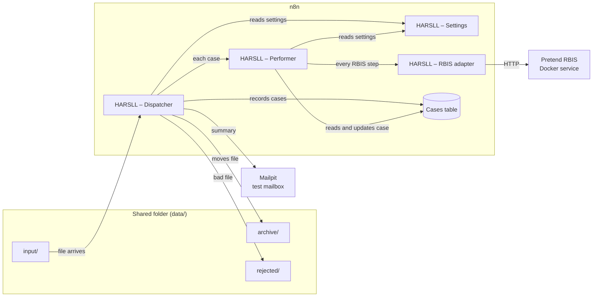
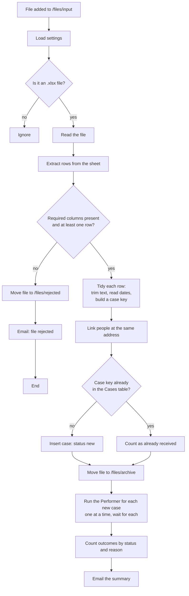
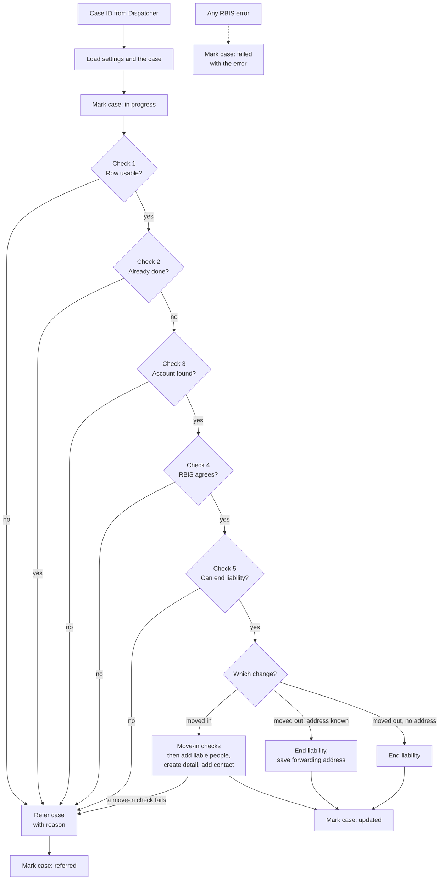
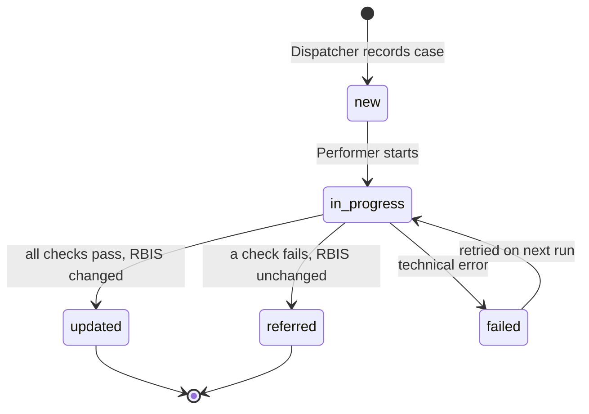

# HARSLL in n8n: design

**Status:** Draft for approval · 19 November 2026
**Phase:** 3 of 5. Nothing is built until this design is approved.
**Read first:** [Business overview](../business/HARSLL-business-overview.md) · [Current UiPath process](../process/HARSLL-uipath-process.md)

## Summary

HARSLL is rebuilt as **four n8n workflows**, a **Cases table** inside n8n, and a **pretend RBIS** that runs next to n8n in Docker.

- The **Dispatcher** starts when a spreadsheet lands in the input folder. It records one case per row, archives the file, hands every case to the Performer, then emails a summary with counts.
- The **Performer** takes one case, applies the five safety checks plus the move-in checks, then updates the account or refers the case with a reason.
- All RBIS work goes through **one RBIS adapter workflow**. Today it talks to the pretend RBIS; later only this workflow changes to talk to the real one.
- **Unknown business rules are settings**, with cautious defaults. Each is listed in [Settings and assumptions](#settings-and-assumptions).

The business behaviour matches UiPath: the same checks, the same three outcomes, the same "do nothing rather than guess" approach.

## What stays the same, what changes

| Area | UiPath today | n8n design | Why |
| --- | --- | --- | --- |
| Start | Robot looks in a folder when it runs | **Starts the moment a file arrives** | Changes are applied sooner |
| Hand-over between robots | Orchestrator queue | **Cases table** (n8n Data Table) | Also keeps the status and reason of every case: a built-in audit trail |
| Checks | Inside one long flowchart | **Each check is its own named step** | Easy to read, test and change |
| Unknown rules | Fixed in the robot | **Settings with defaults** | Change a setting, not the workflow, when a rule is confirmed |
| RBIS | Robot clicks through RBIS screens (inferred) | **RBIS adapter** calling the pretend RBIS | All of the logic can be built and tested now |
| Results | Robot logs | **Cases table + summary email with counts by outcome and reason** | Staff see what needs attention |
| A case that crashes | May stop the robot | **That case is marked "failed"; the rest carry on** | One bad case never holds up the batch |
| Same file sent twice | Risk of doing work twice | **Already-recorded cases are skipped** | Safe re-runs |
| Bad file (wrong columns) | Not shown | **File moved to a "rejected" folder and the team emailed** | Problems with the file itself are visible |
| Email | Outlook | **SMTP**: test mailbox now, council email later | Standard n8n node; any mail server works |

## Architecture



### The four workflows

| Workflow | File | Starts when | Job |
| --- | --- | --- | --- |
| **HARSLL – Dispatcher** | `harsll-dispatcher.json` | A file is added to `/files/input` | Read the file, record cases, archive, run the Performer for each case, send the summary |
| **HARSLL – Performer** | `harsll-performer.json` | Called by the Dispatcher, once per case | Run the checks, update RBIS or refer the case, record the result |
| **HARSLL – RBIS adapter** | `harsll-rbis-adapter.json` | Called by the Performer, once per RBIS step | The only place that talks to RBIS. Translates "find account", "end liability" and so on into RBIS calls |
| **HARSLL – Settings** | `harsll-settings.json` | Called by the other workflows | Returns every setting in one place, so rules change without editing the main workflows |

Why sub-workflows rather than one big workflow:

- The Performer can be tested on a single case without a file.
- Swapping the pretend RBIS for the real one touches **only** the RBIS adapter.
- Settings are in one place and are versioned in Git with the workflows.

## Dispatcher



| Step | n8n node | Notes |
| --- | --- | --- |
| File added | **Local File Trigger** | Folder `/files/input`, event "File Added", **Use Polling** on, **Await Write Finish** on, ignore files that are not `.xlsx` |
| Load settings | **Execute Sub-workflow** → HARSLL – Settings | |
| Read the file | **Read/Write Files from Disk** | |
| Extract rows | **Extract from File** (XLSX) | Header row on, first sheet unless a sheet name is set |
| Check columns | **IF** | Compares the column names with the required list in settings |
| Tidy rows | **Edit Fields (Set)** | Trims text, reads UK dates (dd/MM/yyyy) into real dates, builds the case key |
| Link people at the same address | **Code** | *Why Code:* grouping rows by address and writing the other names back onto each row needs all rows at once. Replaces UiPath's nested While loops |
| Already recorded? | **Data table**: If Row Does Not Exist | Match on case key |
| Insert case | **Data table**: Insert | Status `new` |
| Move file | **Execute Command** | `mv` to `/files/archive/<date-time>_<file name>`. n8n has no "move file" node |
| Run Performer | **Execute Sub-workflow** | Mode "Run once for each item", **wait for completion** on, **continue on error** so one failure does not stop the batch |
| Count outcomes | **Summarize** | Counts by status and reason |
| Email | **Send Email** (SMTP) | To the address list in settings |

**The case key** makes re-runs safe. It is built from the change type, account reference, normalised address, tenant name and the relevant date. If the same file is dropped again, its cases are already in the table and are not processed twice. A case that previously **failed** for a technical reason is retried.

**Order of steps.** As in UiPath, the file is archived once its cases are recorded, before they are processed. A file is therefore never read twice, even if processing is interrupted.

## Performer

The Performer receives one case ID. Every failed check sends the case to a single **Refer case** step with a reason code, so all referrals are recorded the same way.



### The checks in n8n

| Check | Business rule | n8n steps | Reason codes if it fails | UiPath boxes |
| --- | --- | --- | --- | --- |
| **1. Row usable** | Dates are real; end date not before start date; change reason is allowed; deaths follow the death setting | IF nodes using settings | `DATES_INVALID`, `CHANGE_REASON_NOT_VALID`, `DEATH_REFERRED` | Start or End Dates Valid?, Check Process is Valid, Valid? |
| **2. Already done** | Another row at the same address in this file has not already been handled | IF on the Dispatcher's same-address flag, plus a Cases table lookup | `TENANCY_ALREADY_PROCESSED` | Duplicate Address? |
| **3. Account found** | There is an account reference, and RBIS finds the account by reference and by address (flat or house format) | IF, then RBIS adapter `findAccount` | `NO_ACCOUNT_REF`, `ADDRESS_NOT_FOUND` | Account Ref Empty?, Address Search, Search By Account Ref, Address found?, Is a Flat? |
| **4. RBIS agrees** | The liable people and dates in RBIS fit the change; the change is not already in RBIS | RBIS adapter `getAccount`, then IF nodes; name matching follows the setting | `NO_START_DATE`, `CHECK_DATES`, `ACCOUNT_ALREADY_PROCESSED` | Check address and Liable party, Tenancy Start?, Liable Parties Match?, RBIS Start Date Present?, RBIS Start = Input Start/End? |
| **5. Can end liability** | RBIS offers the option to end the current liability | RBIS adapter `canTerminate`, then IF | `NO_OPTION_TO_TERMINATE` | Select Account, Get Matched Address, Check if Terminate, Can Terminate Account? |
| **Move-in checks** | Not already started; came from the expected source system; same tenant as the previous record; extra liable people can be added | IF nodes and RBIS adapter calls | `TENANCY_ALREADY_PROCESSED`, `NOT_FROM_SOURCE_SYSTEM`, `NOT_SAME_AS_PREVIOUS_TENANT`, `UNABLE_TO_ADD_PARTY` | Check if Tenancy has already been processed, ABRITAS?, Same as previous tenant?, Check if can add additional liability |

**Check 4 is the least certain.** The UiPath flowchart branches heavily here and does not show the exact rule. The design keeps each comparison as a separate, named IF node so it can be corrected easily once the rule is confirmed.

### The three update paths

| Path | RBIS adapter operations, in order | Result |
| --- | --- | --- |
| **Moved in** | `addLiableParty` (new tenant and each joint tenant) → `createDetail` → `setContactDetails` | Status `updated`, outcome "liability started" |
| **Moved out, forwarding address known** | `endLiability` → `setForwardingAddress` | Status `updated`, outcome "liability ended, address saved" |
| **Moved out, no forwarding address** | `endLiability` | Status `updated`, outcome "liability ended" |

**One difference from a simple "updated or referred" split.** In UiPath, the move-in path checks for contact details only **after** RBIS has been changed. If none exist, the case stops. The change in RBIS has already been made, so this is not a referral. The design records it as status `updated` with a follow-up reason `NO_CONTACT_DETAILS`, so staff can add the details without redoing the update.

## RBIS adapter and the pretend RBIS

The Performer never calls RBIS directly. It calls the **RBIS adapter** with an operation name and the case details. The adapter returns a simple, consistent answer.

| Adapter operation | What it does | Pretend RBIS endpoint | UiPath step it replaces |
| --- | --- | --- | --- |
| `findAccount` | Find the account by reference, confirm the address matches | `GET /accounts/{ref}`, `GET /accounts?address=&postcode=` | Address Search, Search By Account Ref |
| `getAccount` | Liable people, start and end dates, status | `GET /accounts/{ref}` | Check address and Liable party, Get Matched Address |
| `canTerminate` | Whether the current liability can be ended | `GET /accounts/{ref}/termination-options` | Check if Terminate |
| `endLiability` | End the current liability on a date | `POST /accounts/{ref}/terminate` | Process Account (Contact / No Contact) |
| `setForwardingAddress` | Save the leaver's new address | `PUT /accounts/{ref}/forwarding-address` | Process Account Contact Address |
| `addLiableParty` | Make a person liable from a date | `POST /accounts/{ref}/liable-parties` | Add additional liability, Process Tenancy Start |
| `createDetail` | Create the account detail record for the new tenancy | `POST /accounts/{ref}/details` | Create Detail |
| `setContactDetails` | Save the new tenant's contact details | `PUT /accounts/{ref}/contact` | Contact Details |

**The pretend RBIS** is a small web service in Docker (a new `mock-rbis` service in `compose.yaml`, written in plain Node.js with no extra packages). It:

- loads **made-up accounts** from `test-data/rbis-accounts.json` when it starts,
- answers the endpoints above,
- records every change, so tests can check exactly what was changed (`GET /changes`),
- can be reset to its starting data between test runs (`POST /reset`),
- can be told to fail on purpose (`POST /simulate-outage`), to test the "failed" path.

**Moving to the real RBIS** (Phase 5) means rewriting the RBIS adapter only: real API calls, a database connection, or, if RBIS has no API, a call out to a UiPath robot for those steps. The Performer, Dispatcher and Cases table stay as they are.

## Cases table

One n8n Data Table, `harsll_cases`. One row per case.

| Column | Type | Example (made up) | Purpose |
| --- | --- | --- | --- |
| `caseKey` | text | `END\|AC100234\|12 example street ex1 1aa\|jane test\|2026-11-01` | Stops the same change being recorded twice |
| `batchId` | text | `2026-11-19T09-14-03_changes.xlsx` | Which file the case came from |
| `rowNumber` | number | `7` | Row in the spreadsheet |
| `changeReason` | text | `TENANCY_END` | As given in the spreadsheet |
| `accountRef` | text | `AC100234` | |
| `address` | text | `Flat 2, 12 Example Street` | |
| `postcode` | text | `EX1 1AA` | |
| `isFlat` | boolean | `true` | Decides the address search format |
| `tenantName` | text | `Jane Test` | |
| `namesAtSameAddress` | text | `John Test` | Filled in by the Dispatcher |
| `sameAddressFlag` | boolean | `false` | True for the second and later rows at one address |
| `startDate` | date | | |
| `endDate` | date | `2026-11-01` | |
| `forwardingAddress` | text | | |
| `contactEmail` | text | | |
| `contactPhone` | text | | |
| `sourceSystem` | text | `ABRITAS` | |
| `status` | text | `referred` | See below |
| `reasonCode` | text | `ADDRESS_NOT_FOUND` | Why it was referred, failed or needs follow-up |
| `reasonText` | text | `The account could not be found in RBIS` | Plain-English version for staff |
| `outcome` | text | `liability ended` | What changed in RBIS, if anything |
| `attempts` | number | `1` | Retries after technical failures |
| `errorDetail` | text | | Technical error, for `failed` only |

n8n adds `id`, `createdAt` and `updatedAt` automatically.

### Statuses



| Status | Meaning | Who acts |
| --- | --- | --- |
| `new` | Recorded, not yet processed | Nobody |
| `in_progress` | The Performer is working on it | Nobody |
| `updated` | RBIS changed. May carry a follow-up reason (`NO_CONTACT_DETAILS`) | Staff, only if there is a follow-up |
| `referred` | A check failed; RBIS not changed | Staff |
| `failed` | Technical problem, such as RBIS not responding | IT, or automatic retry |

### Reason codes

| Code | Plain English (goes in `reasonText` and the email) | From |
| --- | --- | --- |
| `DATES_INVALID` | The dates on the spreadsheet row are wrong or missing | Check 1 |
| `CHANGE_REASON_NOT_VALID` | The reason for the change is not one the automation handles | Check 1 |
| `DEATH_REFERRED` | The tenancy ended because the tenant died; these are passed to staff | Check 1 (setting) |
| `TENANCY_ALREADY_PROCESSED` | This change has already been made | Check 2, move-in checks |
| `NO_ACCOUNT_REF` | The row has no account reference | Check 3 |
| `ADDRESS_NOT_FOUND` | The account could not be found in RBIS | Check 3 |
| `NO_START_DATE` | The RBIS account has no start date to compare against | Check 4 |
| `CHECK_DATES` | The dates in RBIS do not match the spreadsheet | Check 4 |
| `ACCOUNT_ALREADY_PROCESSED` | RBIS already shows this change | Check 4 |
| `NO_OPTION_TO_TERMINATE` | RBIS does not allow the current liability to be ended | Check 5 |
| `NOT_FROM_SOURCE_SYSTEM` | The change did not come from the expected housing system | Move-in checks |
| `NOT_SAME_AS_PREVIOUS_TENANT` | The tenant does not match the previous tenancy record | Move-in checks |
| `UNABLE_TO_ADD_PARTY` | A joint tenant could not be added to the account | Move-in checks |
| `NO_CONTACT_DETAILS` | Liability started, but there were no contact details to record | Follow-up after a move-in |
| `RBIS_ERROR` | RBIS did not respond or returned an error | Technical (`failed`) |

## Settings and assumptions

All settings live in **HARSLL – Settings**. Each default is an **assumption** until the process owner confirms it. The numbers in the last column refer to [Decisions needed](../business/HARSLL-business-overview.md#decisions-needed) in the business overview.

| Setting | Default | Assumption behind the default | Confirm via |
| --- | --- | --- | --- |
| `allowedChangeReasons` | `TENANCY_START`, `TENANCY_END` | The flowchart's two flows are the only change types | Decision 5 |
| `deathHandling` | `refer` | Deaths are sensitive and their handling is unknown, so all go to staff. Alternative: `processAsEnd` | Decision 4 |
| `deathChangeReasons` | `DECEASED` | The value used in the spreadsheet for a death | Decision 4 |
| `dateFormat` | `dd/MM/yyyy` | UK date format in the spreadsheet | Spreadsheet sample |
| `nameMatch` | `normalised` (ignore case, extra spaces, punctuation) | "Liable parties match" means the same full name. Alternative: `surnameOnly` | Decision 6 |
| `requiredSourceSystem` | `ABRITAS` | The "ABRITAS?" move-in check means the change must come from ABRITAS | Decision 7 |
| `requiredColumns` | See [Input spreadsheet](#input-spreadsheet) | The assumed template | Spreadsheet sample |
| `summaryEmailTo` | `harsll-team@example.test` | Test address; Mailpit catches it | Before Phase 5 |
| `summaryEmailFrom` | `harsll@example.test` | | Before Phase 5 |
| `inputFolder` / `archiveFolder` / `rejectedFolder` | `/files/input`, `/files/archive`, `/files/rejected` | | Phase 5 |
| `rbisBaseUrl` | `http://mock-rbis:8080` | Pretend RBIS | Phase 5 (decision 8) |
| `maxAttempts` | `3` | Technical failures are retried up to 3 times across runs | IT |

## Input spreadsheet

**Assumed template.** The real column names are not known yet (business overview, decision 5 and open questions). The design reads columns by name, so matching the real file means changing the mapping in one **Tidy rows** step and `requiredColumns`.

| Column | Required | Example (made up) | Notes |
| --- | --- | --- | --- |
| `ChangeReason` | Yes | `TENANCY_END` | `TENANCY_START`, `TENANCY_END`, or a death value |
| `AccountRef` | No | `AC100234` | Empty leads to `NO_ACCOUNT_REF` |
| `TenantName` | Yes | `Jane Test` | One person per row; joint tenants are separate rows at the same address |
| `Address` | Yes | `Flat 2, 12 Example Street` | "Flat" at the start marks a flat |
| `Postcode` | Yes | `EX1 1AA` | |
| `StartDate` | For moves in | `01/11/2026` | dd/MM/yyyy |
| `EndDate` | For moves out | `31/10/2026` | dd/MM/yyyy |
| `ForwardingAddress` | No | `4 New Road, EX2 2BB` | Decides between the two move-out paths |
| `ContactEmail` | No | `jane@example.test` | |
| `ContactPhone` | No | `07700 900123` | Ofcom drama-range number |
| `SourceSystem` | No | `ABRITAS` | |

## Errors, retries and re-runs

| Situation | What happens |
| --- | --- |
| Not an `.xlsx` file | Ignored. It stays in the input folder |
| File unreadable, missing required columns, or no rows | Moved to `/files/rejected`; the team is emailed with the reason |
| One case hits an RBIS error | That case is `failed` with `RBIS_ERROR` and the detail; the batch carries on |
| The same file is dropped again | Cases already recorded are skipped. `failed` cases are retried until `maxAttempts` is reached |
| n8n restarts mid-batch | Cases left `in_progress` are treated like `failed`: they are retried when the same file is dropped into the input folder again (it is in the archive) |
| An unexpected error in a workflow | n8n's run history keeps the full detail. A separate error workflow emailing IT is a Phase 5 item |

## Summary email

Sent at the end of every batch to `summaryEmailTo`. Example with made-up numbers:

```text
Subject: HARSLL batch 2026-11-19 09:14 – 18 cases: 12 updated, 5 referred, 1 failed

File: changes.xlsx (archived)

Updated: 12
  Liability started: 5   (1 needs contact details added)
  Liability ended, address saved: 4
  Liability ended: 3

Referred to staff: 5
  The account could not be found in RBIS: 2
  The dates in RBIS do not match the spreadsheet: 2
  The tenancy ended because the tenant died: 1

Failed (technical, will retry): 1

Already received in an earlier run: 0
Details: open the Cases table in n8n and filter by this batch.
```

The email contains **counts only**, no names or addresses, so it is safe to send to a team mailbox.

## Test plan

All tests use **made-up data** in `test-data/`: a set of pretend RBIS accounts and spreadsheets built from a list of scenarios. Each scenario states the expected status, reason and RBIS change. A test run:

1. resets the pretend RBIS and clears the Cases table,
2. drops the scenario spreadsheet into `data/input`,
3. waits for the Dispatcher to finish,
4. compares every case's status and reason, and the pretend RBIS's change log, with the expected results.

| # | Scenario | Expected |
| --- | --- | --- |
| 1 | Move in, single tenant, contact details | `updated`, liability started |
| 2 | Move in, joint tenants at one address | `updated` for the first; `TENANCY_ALREADY_PROCESSED` for the second (as UiPath) |
| 3 | Move in, no contact details | `updated` with follow-up `NO_CONTACT_DETAILS` |
| 4 | Move out, forwarding address | `updated`, address saved |
| 5 | Move out, no forwarding address | `updated`, liability ended |
| 6 | Impossible date (31/02/2026) | `referred`, `DATES_INVALID` |
| 7 | End date before start date | `referred`, `DATES_INVALID` |
| 8 | Unknown change reason | `referred`, `CHANGE_REASON_NOT_VALID` |
| 9 | Death | `referred`, `DEATH_REFERRED` (default setting) |
| 10 | No account reference | `referred`, `NO_ACCOUNT_REF` |
| 11 | Account not in RBIS | `referred`, `ADDRESS_NOT_FOUND` |
| 12 | RBIS has no start date | `referred`, `NO_START_DATE` |
| 13 | RBIS dates differ | `referred`, `CHECK_DATES` |
| 14 | RBIS already shows the change | `referred`, `ACCOUNT_ALREADY_PROCESSED` |
| 15 | RBIS will not allow ending liability | `referred`, `NO_OPTION_TO_TERMINATE` |
| 16 | Move in from another source system | `referred`, `NOT_FROM_SOURCE_SYSTEM` |
| 17 | Move in, tenant differs from previous record | `referred`, `NOT_SAME_AS_PREVIOUS_TENANT` |
| 18 | Joint tenant cannot be added | `referred`, `UNABLE_TO_ADD_PARTY` |
| 19 | Pretend RBIS outage | `failed`, `RBIS_ERROR`; succeeds on re-run |
| 20 | Same file dropped twice | Second run records nothing new |
| 21 | File missing a required column | Moved to `rejected`, rejection email |
| 22 | Empty spreadsheet | Moved to `rejected`, rejection email |
| 23 | A `.txt` file dropped in input | Ignored |

**Note on scenario 2.** UiPath's "Duplicate Address?" check stops the second person at an address. That seems to mean joint tenants after the first are referred, even though the move-in path has "add additional liability". The design copies UiPath's behaviour and flags it as an open question: the likely intent is that the first case adds all names at the address (`namesAtSameAddress`), and later rows are duplicates of that work.

## Build order (Phase 4)

1. Test data: pretend RBIS accounts and the scenario list.
2. Pretend RBIS service in Docker, with its own quick checks.
3. **HARSLL – Settings**.
4. Cases table.
5. **HARSLL – RBIS adapter**, tested against the pretend RBIS.
6. **HARSLL – Performer**, tested one case at a time (scenarios 1 to 19).
7. **HARSLL – Dispatcher**, tested with whole files (scenarios 20 to 23, then all).
8. Test runner script, so the full suite runs with one command.
9. Export all workflows to `workflows/`, update the docs, and write the testing guide.

Every workflow is checked with the n8n-mcp validator before it is saved.

## For your approval

1. **Four workflows**: Dispatcher, Performer, RBIS adapter, Settings.
2. **Cases table** as the to-do list and audit trail, with the statuses and reason codes above.
3. **Pretend RBIS** as a small Docker service, behind a single RBIS adapter.
4. **Defaults for unknown rules**, especially: deaths are **referred to staff** by default, and names match on the **normalised full name**.
5. **New behaviours** not in UiPath: rejected-file handling, safe re-runs, per-case failure handling, counts-only summary email.
6. **The assumed spreadsheet template**, to be replaced once a real (anonymised) sample is available.

## Open questions added by this design

These add to the [business overview's decisions](../business/HARSLL-business-overview.md#decisions-needed):

- **Joint tenants** (scenario 2): should the first case add every person at the address, with later rows treated as duplicates?
- **How long should case records be kept?** The Cases table holds personal data in production, so it needs a retention period.
- **Where will files arrive in production?** A shared folder, SharePoint, email or SFTP? Only the trigger changes.
- **Production email**: which mail server and sender address?
