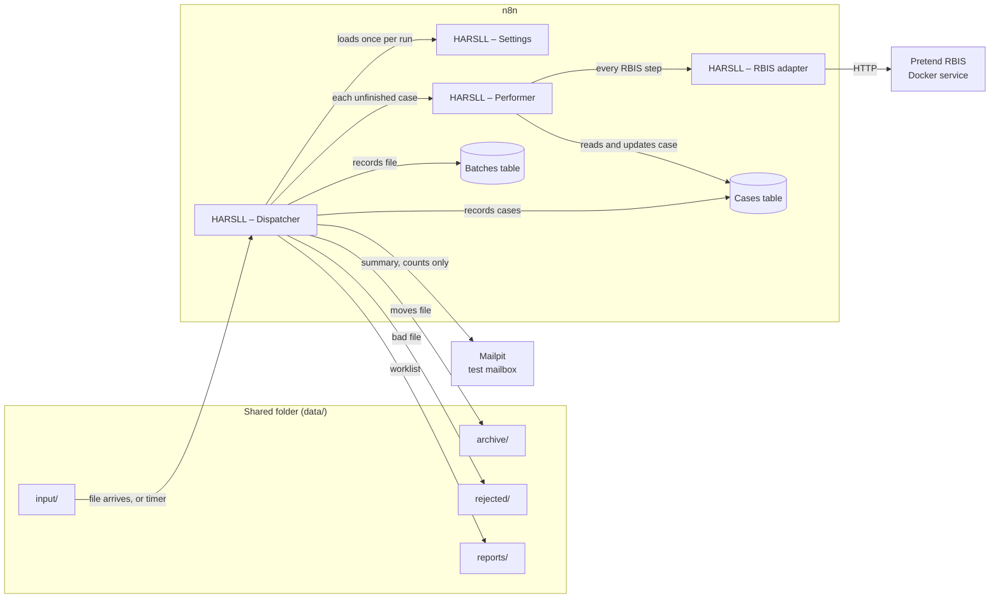
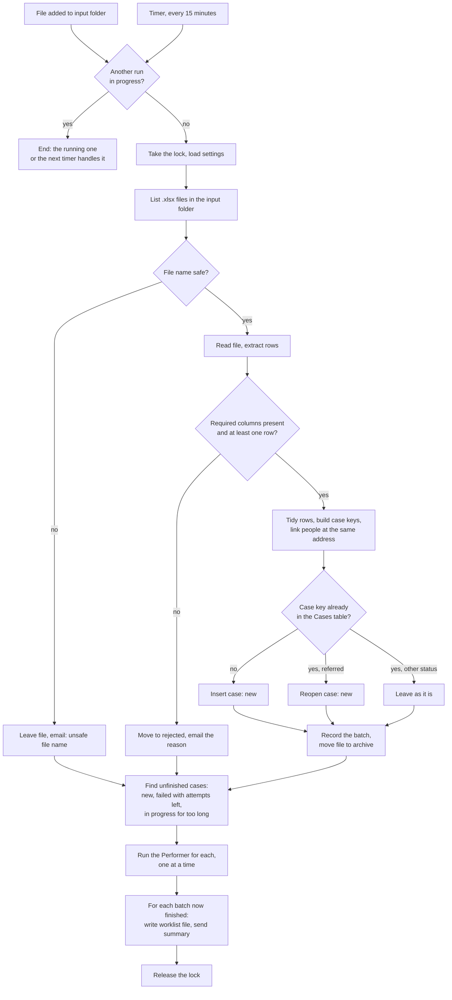
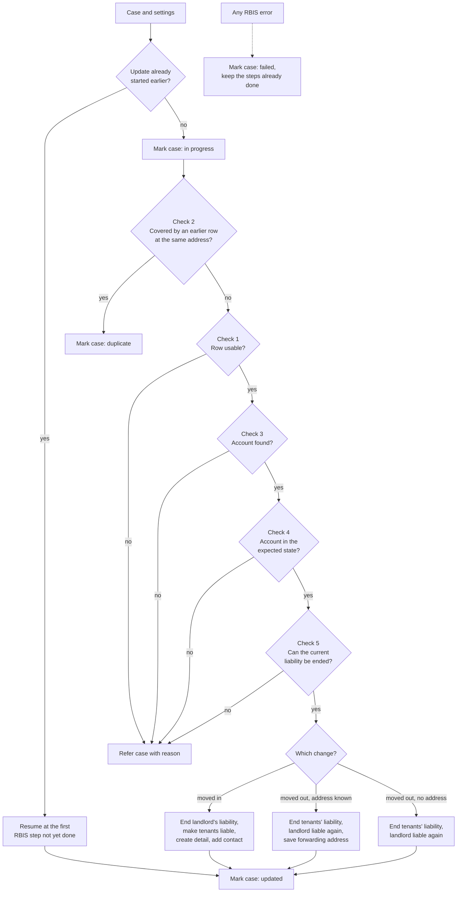
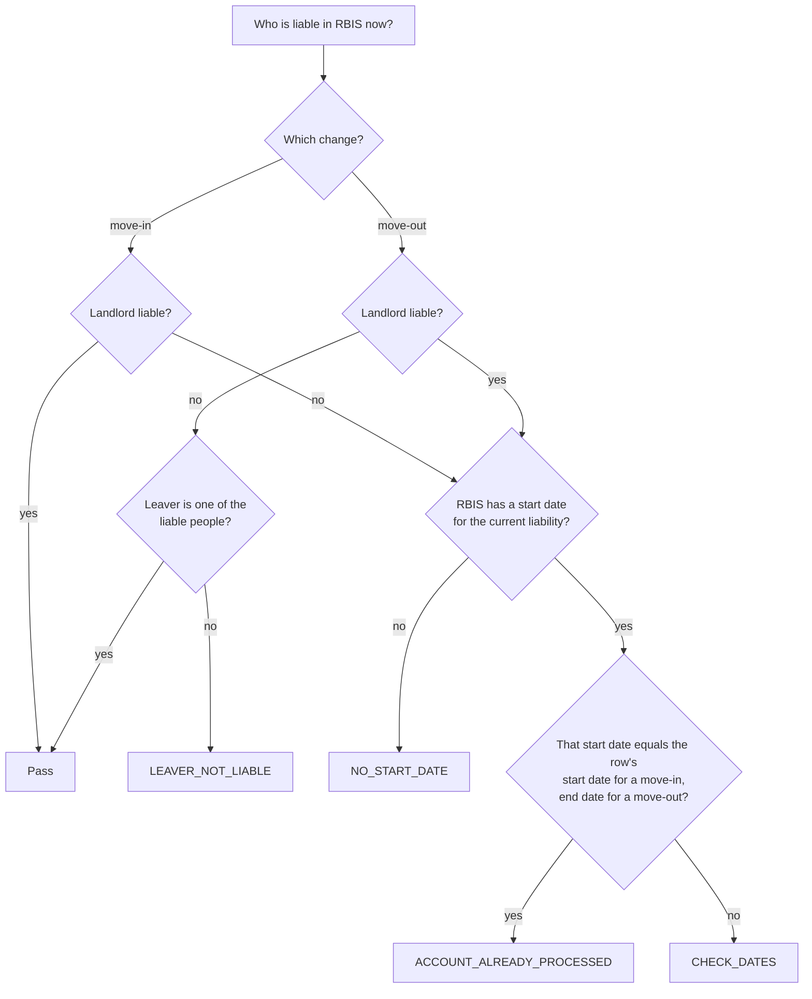
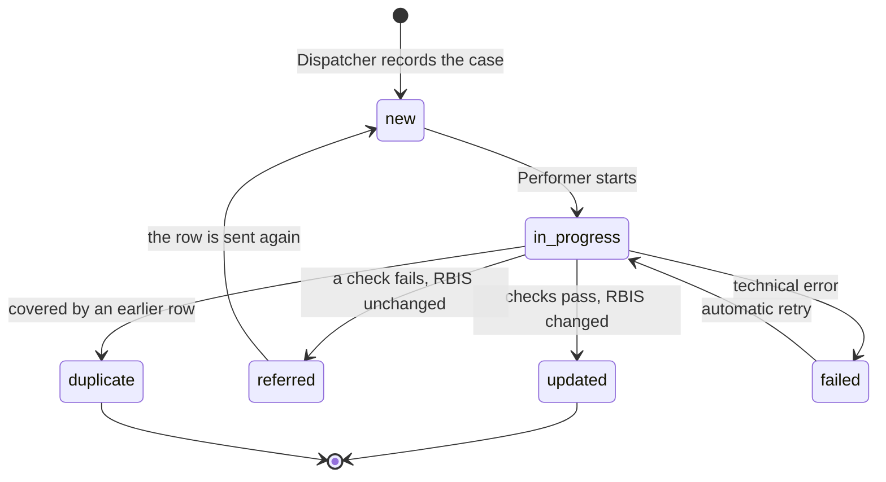

# HARSLL in n8n: design

**Status:** Revision 2, draft for approval · 19 November 2026
**Phase:** 3 of 5. Nothing is built until this design is approved.
**Read first:** [Business overview](../business/HARSLL-business-overview.md) · [Current UiPath process](../process/HARSLL-uipath-process.md)

## Summary

HARSLL is rebuilt as **four n8n workflows**, two small tables inside n8n, and a **pretend RBIS** that runs next to n8n in Docker.

- The **Dispatcher** records one case per spreadsheet row when a file arrives, archives the file, and then works through every unfinished case. A timer repeats this, so nothing waits on a person.
- The **Performer** takes one case, applies the five safety checks, then updates the account or refers the case with a reason.
- All RBIS work goes through **one RBIS adapter workflow**. Today it talks to the pretend RBIS; later only this workflow changes.
- **Unknown business rules are settings** with cautious defaults, listed in [Settings and assumptions](#settings-and-assumptions).

## What changed in revision 2

Revision 1 was reviewed against the original flowchart. Two parts of the Performer logic were wrong, and several gaps were found.

| # | Change | Why |
| --- | --- | --- |
| 1 | **Check 4 rebuilt** around "who is liable in RBIS now" | In the flowchart, the date comparisons never lead to an update; they only decide *which* stop reason applies. Revision 1 had this the wrong way round |
| 2 | **Move-in checks replaced** | The flowchart branch "Tenancy Processed? → ABRITAS? → Same as previous tenancy?" continues on *Yes*. It adds a person to an existing tenancy; it is not a set of gates |
| 3 | **The landlord is modelled as a liable party** | The only reading that makes check 4 and check 5 consistent (see [Key assumption](#key-assumption-the-landlord-is-liable-between-tenancies)) |
| 4 | **Automatic retries** | Unfinished cases are picked up on every run and on a timer, not only when a file is dropped again |
| 5 | **Resume half-finished updates** | Each case records which RBIS steps are done, so a retry never repeats one |
| 6 | **Referred cases can be resubmitted** | A row sent again after staff fix the cause is processed again |
| 7 | **Safe file moves** | Files with unusual names are never passed to a shell command |
| 8 | **Personal data kept out of n8n's run history** | Run data is not saved for successful runs and is pruned after 7 days |
| 9 | **A worklist file for staff** | Staff do not need access to n8n to see referred cases |
| 10 | **One run at a time** | Two files arriving together cannot change the same account at once |
| 11 | **Rows covered by another row get their own status** | Joint tenants no longer create needless referrals |
| 12 | **Three trials before building** | The file trigger, Excel date formats and file moves are tested first |

## Key assumption: the landlord is liable between tenancies

**This is an inference from the flowchart. It is the most important thing to confirm.**

The flowchart asks "Liable Parties Match?" and then behaves in opposite ways:

| Change | Match | No match |
| --- | --- | --- |
| Move-in | Proceed to update | Go to date checks, which always stop |
| Move-out | Go to date checks, which always stop | Proceed to update |

It also checks "Can Terminate Account?" for **both** move-ins and move-outs.

Both make sense if the question is **"is the landlord the liable party in RBIS right now?"**

- **Move-in:** the landlord is liable for the empty property. The robot ends the landlord's liability and starts the tenant's. If the landlord is *not* liable, a tenant already is, so the change was already made or the dates are wrong.
- **Move-out:** the tenant is liable. The robot ends the tenant's liability, and the landlord becomes liable again. If the landlord is *already* liable, the change was already made or the dates are wrong.

The name supports this: "HARSLL" plausibly contains **HA** (Housing Association) and **RSL** (Registered Social Landlord). That is a guess.

If this reading is wrong, check 4 changes; the rest of the design does not. Each comparison is a separate named step so it can be corrected.

## What stays the same, what changes

| Area | UiPath today | n8n design |
| --- | --- | --- |
| Start | Robot looks in a folder when it runs | Starts when a file arrives, with a timer as a safety net |
| Hand-over between robots | Orchestrator queue | **Cases table**, which also records every case's status and reason |
| Checks | Inside one long flowchart | Each check is its own named step |
| Unknown rules | Fixed in the robot | Settings with defaults |
| RBIS | Robot clicks through RBIS screens (inferred) | **RBIS adapter** calling the pretend RBIS |
| Results | Robot logs | Cases table, worklist file, summary email with counts |
| A case that crashes | May stop the robot | That case is marked `failed` and retried; the rest carry on |
| Same file sent twice | Risk of doing work twice | Finished cases are skipped |
| Bad file | Not shown | Moved to a "rejected" folder and the team emailed |
| Email | Outlook | SMTP: test mailbox now, real mail server later |

## Architecture



### The four workflows

| Workflow | File | Starts when | Job |
| --- | --- | --- | --- |
| **HARSLL – Dispatcher** | `harsll-dispatcher.json` | A file is added to the input folder, or the timer fires | Take in files, then process every unfinished case, then report |
| **HARSLL – Performer** | `harsll-performer.json` | Called by the Dispatcher, once per case | Run the checks, update RBIS or refer the case, record the result |
| **HARSLL – RBIS adapter** | `harsll-rbis-adapter.json` | Called by the Performer, once per RBIS step | The only place that talks to RBIS |
| **HARSLL – Settings** | `harsll-settings.json` | Called by the Dispatcher, **once per run** | Returns every setting. The Dispatcher passes them on to the Performer and adapter |

Dispatcher and Performer match the two UiPath robots. Settings replaces UiPath's "Get Assets". The adapter isolates the RBIS steps so that moving to the real RBIS changes one workflow.

## Dispatcher

The Dispatcher has two parts. **Intake** turns files into cases. **Processing** works through unfinished cases. Both run on every start, whichever trigger fired.



| Step | n8n node | Notes |
| --- | --- | --- |
| File added | **Local File Trigger** | Folder event "File Added", polling on, wait until the file is fully written |
| Timer | **Schedule Trigger** | Interval from settings. Catches files that arrived while n8n was stopped, and retries |
| Lock | **Data table** (`harsll_batches`, one lock row) | A lock older than 30 minutes is treated as abandoned |
| Load settings | **Execute Sub-workflow** → Settings | Once per run |
| List and read files | **Read/Write Files from Disk** | Pattern `*.xlsx` in the input folder |
| File name safe? | **IF** | Only letters, numbers, spaces and `_ - . ( )` are allowed |
| Extract rows | **Extract from File** (XLSX) | Header row on |
| Check columns | **IF** | Against `requiredColumns` |
| Tidy rows | **Edit Fields (Set)** | Trim text; accept real Excel dates, Excel date numbers and `dd/MM/yyyy` text; store dates as `yyyy-MM-dd` text so time zones cannot shift them |
| Link people at the same address | **Code** | *Why Code:* needs all rows at once to group by address. The first row at an address gets the other names; later rows are flagged |
| Case key lookup, insert, reopen | **Data table** | |
| Move file | **Execute Command** | `mv` with the file name in single quotes. Only reached for names that passed the safety check, so no name can inject a command |
| Run Performer | **Execute Sub-workflow** | Once per case, waits for each, continues if one errors |
| Worklist | **Convert to File** + **Read/Write Files from Disk** | `reports/<batch>_worklist.xlsx` |
| Summary | **Summarize** + **Send Email** | Counts only |

**Case key.** Built from the change type, account reference, normalised address, tenant name and the relevant date. It decides what happens when a row is seen again:

| Existing case status | A row with the same key arrives |
| --- | --- |
| `updated`, `duplicate` | Skipped. The work is done |
| `referred` | **Reopened** and processed again. Staff may have fixed the cause |
| `new`, `failed`, `in_progress` | Left alone. Processing will pick it up |

**One run at a time.** A second run that finds the lock taken ends at once. Any file it would have handled is picked up by the running pass or the next timer.

## Performer

The Performer receives one case and the settings. Every stop goes through one **Refer case** step, so all referrals are recorded the same way.



Check 2 runs before check 1 in n8n only to avoid wasted work. The outcome is the same as in UiPath.

### The checks

| Check | Rule | Reason codes | UiPath boxes |
| --- | --- | --- | --- |
| **1. Row usable** | Dates are real; end date is not before start date; the change reason is allowed; deaths follow `deathHandling` | `DATES_INVALID`, `CHANGE_REASON_NOT_VALID`, `DEATH_REFERRED` | Start or End Dates Valid?, Check Process is Valid, Valid? |
| **2. Covered by an earlier row** | The Dispatcher flagged this row as a later row at the same address in the same file | Status `duplicate`, reason `SAME_ADDRESS_AS_EARLIER_ROW` | Duplicate Address? |
| **3. Account found** | The row has an account reference, and RBIS finds the account by reference and by address (flat or house format) | `NO_ACCOUNT_REF`, `ADDRESS_NOT_FOUND` | Account Ref Empty?, Address Search, Search By Account Ref, Address found?, Is a Flat? |
| **4. Account in the expected state** | See [Check 4 in detail](#check-4-in-detail) | `NO_START_DATE`, `CHECK_DATES`, `ACCOUNT_ALREADY_PROCESSED`, `LEAVER_NOT_LIABLE` | Check address and Liable party, Tenancy Start?, Liable Parties Match?, RBIS Start Date Present?, RBIS Start = Input Start / End? |
| **5. Can end the current liability** | RBIS offers the option to end the liability that is current: the landlord's for a move-in, the tenants' for a move-out | `NO_OPTION_TO_TERMINATE` | Select Account, Get Matched Address, Check if Terminate, Can Terminate Account? |

### Check 4 in detail

The Performer asks the adapter who is liable on the account now, and from what date. `landlordLiable` is true when that party's name is in the `landlordNames` setting.



| Situation | Result | Meaning |
| --- | --- | --- |
| Move-in, landlord liable | Pass | The property is empty in RBIS, as expected |
| Move-in, a tenant already liable from the row's start date | `ACCOUNT_ALREADY_PROCESSED` | The move-in is already in RBIS |
| Move-in, a tenant already liable from another date | `CHECK_DATES` | RBIS and the spreadsheet disagree |
| Move-out, the leaver is liable | Pass | As expected |
| Move-out, landlord already liable from the row's end date | `ACCOUNT_ALREADY_PROCESSED` | The move-out is already in RBIS |
| Move-out, landlord already liable from another date | `CHECK_DATES` | RBIS and the spreadsheet disagree |
| Move-out, someone else is liable | `LEAVER_NOT_LIABLE` | **Added safeguard, not in UiPath.** Stops the automation ending the wrong person's liability. Controlled by `confirmLeaverIsLiable` |
| No start date in RBIS | `NO_START_DATE` | Nothing to compare |

### The update paths

Each path is a fixed list of RBIS steps. After each step the case's `stepsDone` is updated. If a step fails, the case is `failed`; the retry starts at the first step not in `stepsDone` and skips the checks, because RBIS has already been partly changed.

| Path | RBIS steps, in order | Outcome recorded |
| --- | --- | --- |
| **Moved in** | 1. `endLiability` (landlord, on the start date) → 2. `addLiableParty` for the tenant and each name in `namesAtSameAddress` → 3. `createDetail` → 4. `setContactDetails` | `liability started` |
| **Moved out, forwarding address known** | 1. `endLiability` (tenants, on the end date) → 2. `addLiableParty` (landlord, from the end date) → 3. `setForwardingAddress` | `liability ended, address saved` |
| **Moved out, no forwarding address** | 1. `endLiability` → 2. `addLiableParty` (landlord) | `liability ended` |

Assumptions in these paths:

- **The landlord's liability starts on the tenancy end date.** The flowchart compares "RBIS Start = Input End", which suggests the same day. Confirm.
- **The first row at an address adds every person at that address.** Later rows are marked `duplicate`. `jointTenantHandling` can switch this to refer later rows instead.
- **A joint tenant cannot be added** (RBIS refuses): the case stops with `UNABLE_TO_ADD_PARTY`. The earlier steps stay done and recorded.
- **No contact details on a move-in:** step 4 is skipped. The case is `updated` with the follow-up reason `NO_CONTACT_DETAILS`, so staff add the details without redoing the update. UiPath stops at the same point, after RBIS has been changed.

### Adding a person to an existing tenancy (built, switched off)

The flowchart has a branch that is not connected to the main flow: "Tenancy Processed? → ABRITAS? → Same as previous tenancy? → Check if can add additional liability → Add additional liability → Create Detail → Contact Details". It appears to add a joint tenant to a tenancy that was set up in an earlier file. When it runs is not shown.

The design includes it behind the setting `addPersonToExistingTenancy`, **off by default**. When on, a move-in that would stop with `ACCOUNT_ALREADY_PROCESSED` is checked further: if the row's source system is `requiredSourceSystem`, and the row's person is not yet liable, the person is added (`addLiableParty` → `createDetail` → `setContactDetails`). Otherwise the case stops as before. When off, these cases go to staff.

## RBIS adapter and the pretend RBIS

The Performer never calls RBIS directly. It calls the **RBIS adapter** with an operation name and details, and gets back a simple, consistent answer.

| Adapter operation | What it does | Pretend RBIS endpoint |
| --- | --- | --- |
| `findAccount` | Find the account by reference; confirm the address matches | `GET /accounts/{ref}` |
| `getAccount` | Current liable parties, their type (landlord or tenant) and start date | `GET /accounts/{ref}` |
| `canTerminate` | Whether the current liability can be ended | `GET /accounts/{ref}/termination-options` |
| `endLiability` | End the current liability on a date | `POST /accounts/{ref}/terminate` |
| `addLiableParty` | Make a person or the landlord liable from a date | `POST /accounts/{ref}/liable-parties` |
| `createDetail` | Create the account detail record for the tenancy | `POST /accounts/{ref}/details` |
| `setContactDetails` | Save contact details | `PUT /accounts/{ref}/contact` |
| `setForwardingAddress` | Save the leaver's new address | `PUT /accounts/{ref}/forwarding-address` |

**The pretend RBIS** is a small web service in Docker (`mock-rbis` in `compose.yaml`, plain Node.js, no extra packages). It:

- loads **made-up accounts** from `test-data/rbis-accounts.json`. Each account has an address and a history of liabilities: who, landlord or tenant, from when, to when,
- records every change (`GET /changes`), so tests can check exactly what was done,
- can be reset between tests (`POST /reset`),
- can be told to fail on purpose, including part-way through an update (`POST /simulate-outage`).

**Moving to the real RBIS** (Phase 5) means rewriting the adapter only: API calls, a database connection, or, if RBIS has screens only, a call out to a UiPath robot for those steps.

## Tables

### Cases table (`harsll_cases`)

One row per case.

| Column | Type | Purpose |
| --- | --- | --- |
| `caseKey` | text | Identifies the change; stops double work |
| `batchId` | text | The file the case came from |
| `rowNumber` | number | Row in the spreadsheet |
| `changeReason` | text | As given in the spreadsheet |
| `accountRef`, `address`, `postcode` | text | |
| `isFlat` | boolean | Decides the address search format |
| `tenantName` | text | |
| `namesAtSameAddress` | text | Other people at the address, on the first row only |
| `coveredByCaseKey` | text | For `duplicate` cases: the row that covers this one |
| `startDate`, `endDate` | text | `yyyy-MM-dd` |
| `forwardingAddress`, `contactEmail`, `contactPhone` | text | |
| `sourceSystem` | text | |
| `status` | text | See below |
| `reasonCode`, `reasonText` | text | Why it was referred, failed or needs follow-up; code and plain English |
| `outcome` | text | What changed in RBIS |
| `stepsDone` | text | RBIS steps completed, for safe retries |
| `attempts` | number | Tries after technical failures |
| `submissions` | number | How many times this row has been sent |
| `lastAttemptAt` | date | Used to spot cases stuck `in_progress` |
| `errorDetail` | text | Technical error, for `failed` only |

### Batches table (`harsll_batches`)

One row per file, plus one lock row.

| Column | Type | Purpose |
| --- | --- | --- |
| `batchId` | text | Date, time and file name |
| `fileName` | text | |
| `rowCount` | number | |
| `receivedAt` | date | |
| `summarySentAt` | date | Empty until every case in the batch is finished and the summary is sent |
| `lockedAt` | date | Only on the lock row |

### Statuses



| Status | Meaning | Who acts |
| --- | --- | --- |
| `new` | Recorded, waiting | Nobody |
| `in_progress` | Being processed. If stuck for 15 minutes, it is retried | Nobody |
| `updated` | RBIS changed. May carry the follow-up `NO_CONTACT_DETAILS` | Staff, only for a follow-up |
| `referred` | A check failed; RBIS unchanged, or changed only as far as `stepsDone` shows | Staff |
| `duplicate` | Covered by an earlier row at the same address | Nobody |
| `failed` | Technical problem. Retried until `maxAttempts`, then stays `failed` | IT, once retries run out |

### Reason codes

| Code | Plain English | From |
| --- | --- | --- |
| `DATES_INVALID` | The dates on the spreadsheet row are wrong or missing | Check 1 |
| `CHANGE_REASON_NOT_VALID` | The reason for the change is not one the automation handles | Check 1 |
| `DEATH_REFERRED` | The tenancy ended because the tenant died; these are passed to staff | Check 1 |
| `SAME_ADDRESS_AS_EARLIER_ROW` | Covered by an earlier row at the same address | Check 2 |
| `NO_ACCOUNT_REF` | The row has no account reference | Check 3 |
| `ADDRESS_NOT_FOUND` | The account could not be found in RBIS | Check 3 |
| `NO_START_DATE` | RBIS has no start date to compare against | Check 4 |
| `CHECK_DATES` | The dates in RBIS do not match the spreadsheet | Check 4 |
| `ACCOUNT_ALREADY_PROCESSED` | RBIS already shows this change | Check 4 |
| `LEAVER_NOT_LIABLE` | The person leaving is not the liable person in RBIS | Check 4 (added safeguard) |
| `NO_OPTION_TO_TERMINATE` | RBIS does not allow the current liability to be ended | Check 5 |
| `UNABLE_TO_ADD_PARTY` | A person could not be added to the account | Update |
| `NO_CONTACT_DETAILS` | Liability started, but there were no contact details to record | Follow-up |
| `RBIS_ERROR` | RBIS did not respond or returned an error | Technical |

## Settings and assumptions

All settings live in **HARSLL – Settings**. Each default is an **assumption** until confirmed.

| Setting | Default | Assumption behind it |
| --- | --- | --- |
| `landlordNames` | `Example Housing Association` | The landlord appears in RBIS as a liable party under a known name. See [Key assumption](#key-assumption-the-landlord-is-liable-between-tenancies) |
| `landlordLiableFrom` | `endDate` | The landlord's liability starts on the tenancy end date |
| `confirmLeaverIsLiable` | `true` | Added safeguard. Set to `false` to match UiPath exactly |
| `jointTenantHandling` | `firstRowAddsAll` | The first row at an address adds everyone there. Alternative: `referLaterRows` |
| `addPersonToExistingTenancy` | `false` | The unconnected flowchart branch is left to staff until its trigger is known |
| `requiredSourceSystem` | `ABRITAS` | Used only when the setting above is on |
| `allowedChangeReasons` | `TENANCY_START`, `TENANCY_END` | The flowchart's two flows are the only change types |
| `deathHandling` | `refer` | Deaths go to staff. Alternative: `processAsEnd` |
| `deathChangeReasons` | `DECEASED` | The spreadsheet value for a death |
| `nameMatch` | `normalised` | Names match ignoring capitals, spaces and punctuation |
| `requiredColumns` | See [Input spreadsheet](#input-spreadsheet) | The assumed template |
| `timerMinutes` | `15` | How often unfinished work is checked |
| `maxAttempts` | `3` | Tries after technical failures |
| `summaryEmailTo`, `summaryEmailFrom` | `harsll-team@example.test`, `harsll@example.test` | Test addresses |
| `inputFolder`, `archiveFolder`, `rejectedFolder`, `reportsFolder` | Under `/files` | |
| `rbisBaseUrl` | `http://mock-rbis:8080` | Pretend RBIS |

## Input spreadsheet

**Assumed template.** The real column names are not known. Columns are read by name, so matching the real file means changing the **Tidy rows** step and `requiredColumns`.

| Column | Required | Example (made up) | Notes |
| --- | --- | --- | --- |
| `ChangeReason` | Yes | `TENANCY_END` | |
| `AccountRef` | No | `AC100234` | Empty leads to `NO_ACCOUNT_REF` |
| `TenantName` | Yes | `Jane Test` | One person per row |
| `Address` | Yes | `Flat 2, 12 Example Street` | "Flat" at the start marks a flat |
| `Postcode` | Yes | `EX1 1AA` | |
| `StartDate` | For move-ins | `01/11/2026` | |
| `EndDate` | For move-outs | `31/10/2026` | |
| `ForwardingAddress` | No | `4 New Road, EX2 2BB` | Decides between the two move-out paths |
| `ContactEmail`, `ContactPhone` | No | `jane@example.test`, `07700 900123` | |
| `SourceSystem` | No | `ABRITAS` | |

## Personal data

| Where | What it holds | Control |
| --- | --- | --- |
| Summary email | Counts only | No names or addresses, by design |
| Cases table | Names, addresses, account references | Retention period to be agreed. A clean-up step is added once it is |
| Worklist files | The same, for referred and follow-up cases only | Stay in the `reports` folder; never emailed |
| n8n run history | Would hold every case's details | Performer and adapter do not save data for successful runs. Failed runs are kept for diagnosis and pruned after 7 days (`EXECUTIONS_DATA_MAX_AGE`) |
| Archive and rejected folders | The original spreadsheets | Retention to be agreed |

Local development uses made-up data only, so these controls matter from Phase 5.

## Errors, retries and re-runs

| Situation | What happens |
| --- | --- |
| Not an `.xlsx` file | Ignored |
| Unsafe file name | Left in place; the team is emailed to rename it |
| Unreadable file, missing columns, or no rows | Moved to `rejected`; the team is emailed the reason |
| RBIS error on a case | Case is `failed` with its `stepsDone`. Retried automatically on the next run, from the first step not done |
| n8n stops mid-run | Cases stuck `in_progress` are retried after 15 minutes. The lock expires after 30 minutes |
| File arrives while n8n is stopped | The timer finds it in the input folder after restart |
| Same file dropped again | Finished cases are skipped; referred cases are reopened |
| Two files arrive together | One run processes both; the second run ends at once |
| Retries run out | Case stays `failed` and is listed in the worklist and summary for IT |

## Staff worklist and summary email

When every case in a batch is finished, the Dispatcher writes `reports/<batch>_worklist.xlsx`, listing each `referred` case, each `updated` case with a follow-up, and each case that is `failed` with no retries left, with its reason in plain English. It then sends the summary:

```text
Subject: HARSLL batch 2026-11-19 09:14 – 18 cases: 11 updated, 5 referred, 1 failed, 1 duplicate

File: changes.xlsx (archived)

Updated: 11
  Liability started: 5   (1 needs contact details added)
  Liability ended, address saved: 3
  Liability ended: 3

Referred to staff: 5
  The account could not be found in RBIS: 2
  The dates in RBIS do not match the spreadsheet: 2
  The tenancy ended because the tenant died: 1

Failed after 3 tries: 1
Covered by another row at the same address: 1

Worklist: reports/2026-11-19T09-14-03_changes_worklist.xlsx
```

## Test plan

All tests use made-up data in `test-data/`. Each scenario names the flowchart path it follows and its expected status, reason and RBIS changes. A test run resets the pretend RBIS and the tables, drops a spreadsheet, waits, then compares the Cases table and the pretend RBIS's change log with the expected results.

| # | Scenario | Expected |
| --- | --- | --- |
| 1 | Move-in, landlord liable, contact details | `updated`: landlord ended, tenant liable |
| 2 | Move-in, two joint tenants at one address | First row `updated` with both people liable; second row `duplicate` |
| 3 | Move-in, no contact details | `updated`, follow-up `NO_CONTACT_DETAILS` |
| 4 | Move-out, forwarding address | `updated`: tenant ended, landlord liable, address saved |
| 5 | Move-out, no forwarding address | `updated`: tenant ended, landlord liable |
| 6 | Impossible date | `referred`, `DATES_INVALID` |
| 7 | End date before start date | `referred`, `DATES_INVALID` |
| 8 | Unknown change reason | `referred`, `CHANGE_REASON_NOT_VALID` |
| 9 | Death | `referred`, `DEATH_REFERRED` |
| 10 | No account reference | `referred`, `NO_ACCOUNT_REF` |
| 11 | Account not in RBIS | `referred`, `ADDRESS_NOT_FOUND` |
| 12 | Move-in, tenant already liable from the same date | `referred`, `ACCOUNT_ALREADY_PROCESSED` |
| 13 | Move-in, tenant already liable from another date | `referred`, `CHECK_DATES` |
| 14 | Move-out, landlord already liable from the end date | `referred`, `ACCOUNT_ALREADY_PROCESSED` |
| 15 | Move-out, landlord already liable from another date | `referred`, `CHECK_DATES` |
| 16 | Current liability has no start date | `referred`, `NO_START_DATE` |
| 17 | Move-out, someone else is liable | `referred`, `LEAVER_NOT_LIABLE` |
| 18 | RBIS will not allow ending the liability | `referred`, `NO_OPTION_TO_TERMINATE` |
| 19 | Joint tenant cannot be added | `referred`, `UNABLE_TO_ADD_PARTY`, earlier steps recorded |
| 20 | Outage before any RBIS step | `failed`, then `updated` on automatic retry |
| 21 | Outage after the first RBIS step | `failed`, then `updated` on retry, with **no step done twice** |
| 22 | Same file dropped twice | Nothing new on the second run |
| 23 | Referred row sent again after RBIS data is corrected | Reopened, then `updated` |
| 24 | File missing a required column; empty file | Moved to `rejected`, email sent |
| 25 | File with an unsafe name | Left in place, email sent, no command run |
| 26 | Two files dropped together | Both processed, by one run |
| 27 | File dropped while n8n is stopped | Processed after restart |
| 28 | Dates as text, as Excel dates and as Excel numbers | All read as the same date |

**Limit of these tests.** The pretend RBIS and the expected results come from the same reading of the flowchart. Passing tests show the workflows do what this design says. They do not show the design matches the UiPath robot. That needs the UiPath project files, the process owner's answers, or a side-by-side run on the same data (Phase 5).

## Build order (Phase 4)

1. **Three short trials**, before anything else:
   - the file trigger with Docker on Windows in a OneDrive folder,
   - how Extract from File returns Excel dates,
   - moving a file with a safe name.
   If the trigger is unreliable, the timer alone is used.
2. Test data: pretend RBIS accounts and the scenario list.
3. Pretend RBIS service, with its own checks.
4. Settings workflow and the two tables.
5. RBIS adapter, tested against the pretend RBIS.
6. Performer, tested one case at a time.
7. Dispatcher, tested with whole files.
8. Test runner, so the full suite runs with one command.
9. Export workflows, update the docs, write the testing guide.

Every workflow is checked with the n8n-mcp validator before it is saved.

## For your approval

1. **The landlord reading of check 4 and check 5**, as the working assumption.
2. **`confirmLeaverIsLiable` on by default**: a safeguard UiPath does not have, which may refer a few more cases.
3. **The first row at an address adds everyone there**; later rows are `duplicate`.
4. **Adding a person to an existing tenancy is built but switched off.**
5. **Deaths go to staff** by default.
6. **Automatic retries, resume of half-finished updates, reopening of referred rows, one run at a time.**
7. **Worklist file and counts-only email**; run history not kept for successful runs.
8. **The assumed spreadsheet template.**

## Open questions

These add to the [business overview's decisions](../business/HARSLL-business-overview.md#decisions-needed).

| # | Question | Affects |
| --- | --- | --- |
| 1 | Is the landlord the liable party in RBIS between tenancies? Under what name? | Check 4, check 5, update paths |
| 2 | Does HARSLL stand for something with Housing Association / Registered Social Landlord? | Purpose wording |
| 3 | What does "Liable Parties Match?" compare, exactly? | Check 4 |
| 4 | On a move-out, does the landlord's liability start on the end date or the next day? Does RBIS do it automatically? | Move-out path |
| 5 | When does the "Tenancy Processed? → ABRITAS?" branch run? | `addPersonToExistingTenancy` |
| 6 | Does the first row at an address add every joint tenant? | `jointTenantHandling` |
| 7 | How long should case records, worklists and archived files be kept? | Personal data |
| 8 | Where will files arrive in production, and which mail server sends the summary? | Phase 5 |
| 9 | How can RBIS be reached: API, database or screens only? | Whether n8n can do the RBIS steps at all |
