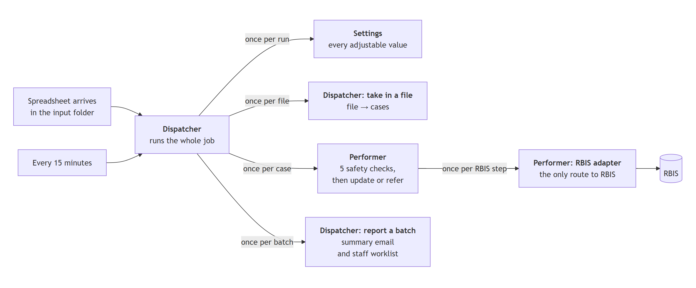

# How HARSLL works: the six workflows

**For:** anyone who needs to understand what HARSLL does inside n8n — the process owner, the team that uses it, IT support, and new developers. No n8n knowledge is needed. Exact technical detail is in the [design](../design/HARSLL-n8n-design.md) and [interfaces](../design/interfaces.md).

HARSLL reads spreadsheets of tenancy changes and updates council tax accounts in RBIS, the council tax system. It changes an account only when five safety checks pass; anything it is unsure about goes to staff with a reason. It is built as **six workflows** in n8n. A workflow is a chain of steps that n8n runs automatically.

## At a glance

<!-- Diagram source: ../diagrams/how-harsll-works-at-a-glance.mmd. Edit it, then redraw the image: see docs/diagrams/README.md -->

| Workflow | What it's for | Runs | Changes RBIS? |
| --- | --- | --- | --- |
| **HARSLL – Dispatcher** | Runs the whole job from start to finish, and makes sure only one run happens at a time | When a spreadsheet arrives, and every 15 minutes | No |
| **HARSLL – Dispatcher: take in a file** | Turns one spreadsheet into cases (one per row), then files the spreadsheet away | Once for each new spreadsheet | No |
| **HARSLL – Performer** | Decides what to do with one case: update the account, or refer it to staff | Once for each case waiting to be done | Yes, through the adapter |
| **HARSLL – Performer: RBIS adapter** | The only workflow that talks to RBIS. Looks before every change, so nothing is ever changed twice | Once for each read of or change to RBIS | Yes: it is the only one that does |
| **HARSLL – Dispatcher: report a batch** | Tells the team how a spreadsheet went: a summary email, and a worklist of cases that need a person | Once for each spreadsheet whose cases are all finished | No |
| **HARSLL – Settings** | Holds every adjustable value in one place: business rules, time limits, folders, email addresses, the RBIS address | At the start of every run | No |

The names follow one rule: **"HARSLL – who starts it: what it does"**. The Performer is started by the Dispatcher, and the RBIS adapter by the Performer. The Dispatcher and Performer keep the names of the two UiPath robots they replace.

## The journey of one spreadsheet

A worked example: the housing team saves `changes-november.xlsx`, with 20 rows, into the input folder at 10:00.

| Time | What happens | Which workflow |
| --- | --- | --- |
| 10:00 | n8n notices the new file and starts a run | Dispatcher |
| 10:00–10:01 | Waits a minute, so it never reads a file that is still being copied. Loads the settings. Puts up the "busy" sign (the **lock**), so no second run can start | Dispatcher, Settings |
| 10:01 | Checks the file: a safe name, readable, the right columns. Records 20 **cases** in the Cases table, links joint tenants, records the spreadsheet as a **batch**, and moves the file to the archive | Dispatcher: take in a file |
| 10:01–10:03 | Takes the waiting cases one at a time, oldest first, moves-out before moves-in. Each case goes through the five safety checks | Dispatcher, Performer |
| | 17 cases pass: the Performer updates the account in RBIS, step by step, through the adapter | Performer, RBIS adapter |
| | 3 cases fail a check: RBIS is left exactly as it was, and each is referred with a reason | Performer |
| 10:03 | All 20 cases are finished, so the team gets a summary email (counts only) and a worklist spreadsheet listing the 3 referred cases | Dispatcher: report a batch |
| 10:03 | Takes down the "busy" sign. The run ends | Dispatcher |

If RBIS had been unavailable for one case, that case would be marked **failed** and tried again automatically on the next run (up to 3 tries). The summary waits until every case has a final outcome.

## Each workflow in more detail

The same headings are used for each one. "Boxes" are the labelled areas you see when you open the workflow in n8n.

### HARSLL – Dispatcher

**For:** running the whole job, in the right order, one run at a time.

**Starts when:** a spreadsheet is added to the input folder; every 15 minutes (this catches anything missed, and retries failed cases); or the **Run now** web address is called (used by the tests).

**What it does, box by box:**

1. **Start.** Loads the settings and checks none is missing. If the run was started by a new file, waits a minute. Takes the lock: if another run already has it, this run stops at once and leaves the work to that run. Lists the spreadsheets in the input folder that have stopped changing, ignoring Excel's temporary `~$` files.
2. **Take in each file.** Calls **Dispatcher: take in a file** once for each spreadsheet.
3. **After intake**, in this order:
   - **3a. Close stuck cases.** A case left "in progress" for more than 15 minutes was interrupted, for example by n8n restarting. If it has had all 3 tries, it is closed as **failed** so a person is told. If it has tries left, step 3b tries it again.
   - **3b. Run the Performer on each case.** Puts the waiting cases in order (oldest date first, moves-out before moves-in), and skips a case for now if an earlier case on the same account is unfinished. Calls the **Performer** for each case and waits for it. Refreshes the lock after every case, to show it is still alive.
   - **3c. Report each finished batch.** Calls **Dispatcher: report a batch** for each spreadsheet whose summary has not been sent.
   - **3d. Release the lock**, last of all.

**Changes:** the Lock table. Everything else is done by the workflows it calls.

**When something goes wrong:** missing settings stop the run before it touches anything. If the lock is lost (another run took over), this run stops at once. A run that dies leaves its lock behind; after 30 minutes the next run treats it as abandoned and carries on.

**Settings it uses:** the three table IDs, the four workflow IDs, `fileSettleSeconds`, `maxAttempts`, `stuckMinutes`, `lockStaleMinutes`.

### HARSLL – Dispatcher: take in a file

**For:** turning one spreadsheet into cases, safely, exactly once.

**Starts when:** the Dispatcher calls it, once for each spreadsheet. It is given the file name and the settings.

**What it does:**

1. **Checks the file name** is safe: only letters, numbers, spaces and `_ - . ( )`. If not, it leaves the file where it is and emails staff, once, asking them to rename it. An unsafe name is never used in a command.
2. **Reads the spreadsheet.** If it can't be read (a damaged file), it leaves it and tries again on the next run. After 3 failed reads, it moves the file to **rejected** and emails staff.
3. **Checks the layout:** all required columns are present and there is at least one row. If not, the file goes straight to **rejected** with an email saying why.
4. **Tidies each row:** trims spaces, and understands dates typed as text, real Excel dates and Excel date numbers.
5. **Links rows of the same tenancy**, such as two joint tenants moving in together. The first row (the **lead row**) does the work for all of them.
6. **Records the cases.** Each row gets a **case key**, built from the change, account, address, name and date. A row whose key is already in the Cases table is not recorded again, so the same file dropped twice does nothing twice. A row that was **referred** before and is now sent again is **reopened**, with the new details.
7. **Records the batch** (one per spreadsheet) and **moves the file to the archive**, with the date and time added to its name.

**Changes:** the Cases and Batches tables; the input, archive and rejected folders; emails to staff about rejected files and unsafe names.

**When something goes wrong:** each problem file is handled on its own and the other files carry on.

**Settings it uses:** `requiredColumns`, `optionalColumns`, `maxFileReadAttempts`, the four folder names, the summary email addresses.

### HARSLL – Performer

**For:** deciding what to do with one case, and doing it. This is where the five safety checks live.

**Starts when:** the Dispatcher calls it, once for each case. It is given the case's ID and the settings, and returns one result.

**What it does, box by box:**

1. **Start: claim the case.** Marks the case "in progress", counts the try and notes the time, but only if no other run has claimed it first. If the case was interrupted earlier part-way through changing RBIS, it carries on from the recorded steps instead of starting again.
2. **Check 1: is the change complete and allowed?** The dates are real and in order. A death is referred to staff (a setting can change this). The type of change is one HARSLL handles.
3. **Check 2: has it already been done?** For joint tenants, only the lead row changes RBIS. A second row follows what the lead row did: if the lead row updated RBIS, this row is a **duplicate** with nothing to do; if the lead row was referred, so is this one.
4. **Check 3: can the account be found?** The row has an account reference, and RBIS finds the account at that address.
5. **Check 4: do RBIS and the housing record agree?** For a move-in, RBIS should show the landlord as liable (the property was empty). For a move-out, RBIS should show the person leaving. If RBIS already shows the change, or shows different dates, a person decides which record is right.
6. **Check 5: will RBIS allow the change?** RBIS is asked whether the current liability can be ended.
7. **Update RBIS, one step at a time.** For a move-in: end the landlord's liability, make each tenant liable, create the tenancy record, add contact details. For a move-out: end the tenant's liability, make the landlord liable again, and save the forwarding address if there is one. Each step is recorded as soon as it succeeds, so a retry never repeats one.
8. **Finish: record the outcome** on the case, then return the result to the Dispatcher.

**Outcomes:**

| Outcome | Meaning | RBIS |
| --- | --- | --- |
| **Updated** | All checks passed and every step was made | Changed |
| **Referred** | A check failed, or RBIS refused a step. The case carries a reason code and plain-English reason | Unchanged, unless the case is marked **urgent** (below) |
| **Duplicate** | A joint tenant's row whose lead row already did the work | Unchanged (the lead row changed it) |
| **Failed** | A technical problem, such as RBIS not answering. Tried again automatically, up to 3 times | May be part-changed: see urgent |

**Urgent** means the case stopped after RBIS had already been partly changed, for example the old tenant was ended but the new one could not be added. That account needs a person soon. Urgent cases are listed first on the worklist.

**Changes:** its own case in the Cases table; RBIS, through the adapter.

**When something goes wrong:** the Performer never fails silently. Every error ends with the case marked **failed**, with the technical detail saved, and the result is still returned to the Dispatcher.

**Settings it uses:** the business rules (`landlordNames`, `deathHandling`, `jointTenantHandling`, `allowedChangeReasons`, `confirmLeaverIsLiable`, and the others), `rbisBaseUrl`, `adapterWorkflowId`, `casesTableId`.

### HARSLL – Performer: RBIS adapter

**For:** being the **only** route to RBIS. When HARSLL moves from the pretend RBIS to the real one, this is the workflow that changes; the others stay as they are.

**Starts when:** the Performer calls it, once for each thing it needs from RBIS. It is given an operation name (such as "find the account" or "add a liable person"), the account reference and the details.

**What it does:**

1. **Checks the request** is complete and is one of the eight operations it knows: find an account, read an account, ask whether a liability can be ended, end a liability, add a liable person, create the tenancy record, set contact details, set a forwarding address.
2. **Reads the account from RBIS** and checks the answer makes sense.
3. For a **read**, returns what it found.
4. For a **change**, first **looks whether RBIS already shows that change**. If it does, it answers "already done" and changes nothing. This is what makes retries safe: if RBIS made a change but its reply was lost, the retry does not make it twice.
5. Otherwise **makes the change** and returns the result.

**Changes:** RBIS, nothing else.

**When something goes wrong:** it always answers, never fails. "RBIS could not be reached" is marked as temporary, so the Performer marks the case **failed** and it is retried later. A business answer, such as "this person cannot be added", is passed back so the Performer can refer the case with the right reason.

**Settings it uses:** `rbisBaseUrl`, passed in by the Performer.

### HARSLL – Dispatcher: report a batch

**For:** telling the team how one spreadsheet went, once every case in it is finished.

**Starts when:** the Dispatcher calls it, once for each spreadsheet whose summary has not been sent. It is given the batch and the settings.

**What it does:**

1. **Reads all the cases** from that spreadsheet. If any is still waiting or due another try, it stops; the batch is reported on a later run.
2. **Works out the counts**: updated, referred (by reason), duplicate, failed, urgent.
3. If any case needs a person, **saves the worklist**: a spreadsheet in the reports folder, named after the input file, with one row per case to look at, urgent cases first.
4. **Sends the summary email.** Counts only: no names or addresses, by design, because email is easily forwarded.
5. **Marks the summary as sent**, so it is never sent twice.

**Changes:** the Batches table; the reports folder; one email.

**When something goes wrong:** if the worklist can't be saved or the email can't be sent, the batch is not marked as sent, so a later run tries again.

**Settings it uses:** `summaryEmailTo`, `summaryEmailFrom`, `reportsFolder`, `maxAttempts`, `casesTableId`, `batchesTableId`.

### HARSLL – Settings

**For:** keeping every adjustable value in one place, so the other workflows contain no environment-specific values.

**Starts when:** the Dispatcher calls it, once at the start of every run. The Dispatcher passes the values on to every workflow it calls.

**What it holds:** business rules that are still assumptions until the process owner confirms them; time limits and numbers of tries; folder names; email addresses; the RBIS address; the IDs of the tables and of the other workflows. The full list, with each default and why, is in [Settings and assumptions](../design/HARSLL-n8n-design.md#settings-and-assumptions).

**It holds no secrets.** Passwords and logins are stored in n8n's encrypted **credentials**, never in Settings.

**To change a value:** open the workflow, open the **Settings** step, edit the value, save, and **publish**. The next run uses it.

## Where everything is recorded

| What | Where |
| --- | --- |
| Every case and its outcome | The **Cases** table (`harsll_cases`), in n8n under **Overview → Data tables** |
| Every spreadsheet received, and whether its summary was sent | The **Batches** table (`harsll_batches`) |
| Whether a run is in progress | The **Lock** table (`harsll_lock`): one row |
| Spreadsheets already processed | The archive folder |
| Spreadsheets that could not be used | The rejected folder |
| Cases that need a person | The worklist spreadsheets in the reports folder |
| How each batch went | The summary emails |
| Technical detail of failed runs | n8n **Executions**, kept 7 days. Successful runs are not kept, because they would hold personal data |

## How HARSLL stays safe

| Risk | What prevents it |
| --- | --- |
| Changing the wrong account | Check 3 matches the account by reference **and** address |
| Changing an account that doesn't look as expected | Check 4: any disagreement goes to a person |
| The same change made twice | Case keys (the same row is never recorded twice), the claim (one run per case), and the adapter looking before every change |
| Two runs at once | The lock, plus the per-case claim as a second safeguard |
| Reading a file still being copied | A one-minute wait, and only files unchanged for a minute are read |
| An account left half-changed | Each RBIS step is recorded; a retry carries on from where it stopped; if it can't, the case is marked **urgent** |
| A failure nobody notices | Every case ends as updated, referred, duplicate or failed; failed cases are retried, then reported; stuck cases are closed and reported |
| Personal data spread around | Summary emails hold counts only; successful runs are not kept in n8n's history; failed runs are deleted after 7 days |

## Words used in this guide

| Word | Meaning |
| --- | --- |
| **Workflow** | A chain of steps that n8n runs automatically |
| **Sub-workflow** | A workflow started by another workflow, like a helper. Five of the six are sub-workflows |
| **Publish** | Make the current version of a workflow the one that runs. A sub-workflow only ever runs its published version |
| **Case** | One spreadsheet row, as HARSLL tracks it until it has an outcome |
| **Batch** | One spreadsheet and all the cases from it |
| **Lead row** | The first row of a tenancy shared by several people. It does the RBIS work for all of them |
| **Lock** | A "busy" sign that stops two runs working at the same time |
| **Liable** | Responsible for paying the council tax on a property |
| **Referred** | Passed to staff with a reason, with the account left as it was |
| **Pretend RBIS** | A stand-in for RBIS with made-up accounts, used for building and testing until the real RBIS can be reached |
