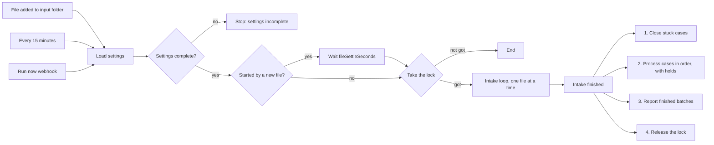

# Build notes: track B (Dispatcher)

**Track:** B of the parallel build (stage 2), 19 November 2026.
**Builds:** HARSLL – Dispatcher, and a stand-in Performer to test it with.
**Follows:** [design](../../design/HARSLL-n8n-design.md) (revision 3) and [interfaces](../../design/interfaces.md). Departures are listed in [Departures and questions](#departures-and-questions).

## What was built

| Workflow | ID | State | Export |
| --- | --- | --- | --- |
| **HARSLL – Dispatcher** | `ixS5Wg5EN0IZwAjX` | Published, wired to track B (see [Reconcile](#what-the-reconcile-stage-must-change)) | `workflows/harsll-dispatcher.json` |
| **HARSLL – Performer (stand-in, track B)** | `V6d1AbXAlOPwo9Uw` | Published | `workflows/harsll-performer-stand-in-track-b.json` |
| HARSLL – Settings (track B, dev) | `lI18cfcKFPSv2heB` | Published. Changed: `performerWorkflowId` = `V6d1AbXAlOPwo9Uw`; `summaryEmailTo` = `harsll-team-trackb@example.test` (see departure 13) | not exported (deleted at reconcile) |

Both workflows: `executionOrder: v1`, `timezone: Europe/London`, run-history settings at their defaults, "Available in MCP" on. Validated with the n8n-mcp validator before every save (0 errors; the only warnings are the intended "executeOnce is enabled" notices). After every save the published version was confirmed current (`versionId` = `activeVersionId`).

### Dispatcher, node by node

80 nodes. Every Data table node takes its table ID by expression from settings; the Performer is called by `settings.performerWorkflowId`.



The four branches after "Intake finished" run one after another, top to bottom (n8n's v1 execution order runs one branch to the end before starting the next, in canvas order). The same rule makes the intake of a good file record cases before it records the batch and archives the file. Both orders were confirmed in the execution data.

| Part | Nodes (in order) | Notes |
| --- | --- | --- |
| Triggers | **File added to input folder** (Local File Trigger, `/files/trackB/input`, File Added, Use Polling, Await Write Finish) · **Every 15 minutes** (Schedule) · **Run now** (Webhook `POST harsll-run-now`, responds at once with `{"started": true}`, `Content-Type: application/json`) | |
| Settings | **Load settings** (Execute Sub-workflow → `lI18cfcKFPSv2heB`, once) · **Settings complete?** → **Stop: settings incomplete** | The check fails the run loudly, before the lock, if a needed setting is missing or empty |
| Settle and lock | **Started by a new file?** → **Wait for the file to settle** (`fileSettleSeconds`) · **Take the lock** (conditional Update, any of: `lockedBy` empty, `lockedAt` empty, `lockedAt` older than `lockStaleMinutes`; sets `lockedBy = run-<execution id>`, `lockedAt = now`) · **Got the lock?** → **End: another run has the lock** | |
| List | **List settled spreadsheets** (Execute Command, one fixed command: `cd '<inputFolder>' && find . -maxdepth 1 -type f -name '*.xlsx' ! -name '~$*' -mmin +0 -print0`) · **One item per file** · **Any files to take in?** · **Split out file names** · **Loop over files** (batch size 1) | NUL-separated names, so no name can split into two |
| Per file | **Note file details** (`batchId = <yyyy-MM-ddTHH-mm-ss>_<name>`, local time; safe-name test `^[A-Za-z0-9 _.()-]+\.xlsx$`) · **File name safe?** | |
| Unsafe name | **Find earlier rename request** · **Already asked to rename it?** · **Email: please rename the file** · **Record that renaming was requested** (batch `needs_rename`) | No command ever sees the name |
| Read | **Find earlier failed reads** · **Read the spreadsheet** (literal brackets on) · **Extract the rows** (XLSX, header row on, Include Empty Cells on) · **Check the file** · **Could the file be read?** | Only a real read or extract error counts as unreadable |
| Unreadable | **Count the failed read** · **Tried enough times?** → **Record unreadable file** (batch `unreadable`, `readAttempts`) or the reject path | |
| Wrong layout | **Columns and rows as expected?** → **Reason: wrong layout** | Missing required column, or no rows: rejected at once |
| Reject | **Note the rejection** · **Move file to rejected** (`mv`, name in single quotes, to `<rejectedFolder>/<batchId>`) · **Record rejected file** (batch `rejected`) · **Email: file rejected** | |
| Good file | **Tidy rows** (Code) · **Link rows of the same tenancy** (Code) · then three branches in order: (1) **Keep only new case keys** → **Record new case**; (2) **Find the earlier case** → **Was it referred?** → **Combine with the new row** → **New row found?** → **Reopen case in this batch** (or **Stop: reopen data missing**); (3) **Record the batch** (batch `received`) → **Move file to archive** (`mv` to `<archiveFolder>/<batchId>`) | |
| Stuck cases | **Find stuck cases with no tries left** → **Close stuck case** (`failed`, `PROCESSING_STOPPED`, `urgent` if `stepsDone` is not empty) | Conditional update on `status` and `attempts` |
| Processing | **Find unfinished cases** · **Ready to process now?** (Filter) · **Note processing order** · **Put cases in order** (Sort: `relevantDate`, move-out before move-in, `batchId`, `rowNumber`) · **Loop over cases** · **This case** · **Get every case for this account** · **Check for an earlier unfinished case** (Code) · **Run this case now?** · **Case for the Performer** · **Run the Performer** (waits; carries on if it errors) · **Refresh the lock** · **Still hold the lock?** → loop, or **Stop: the lock was lost** | The hold is checked against the table just before each case, so a move-in runs in the same pass once its move-out has finished, and waits for the next run if the move-out failed |
| Report | **Check the lock before reporting** · **Still hold the lock for reporting?** · **Find batches waiting for a summary** (`received`, `summarySentAt` empty) · **Loop over batches** · **This batch** · **Get the batch's cases** · **Build the summary and worklist** (Code) · **Batch finished?** · **Worklist needed?** → **One row per worklist entry** → **Make the worklist spreadsheet** → **Save the worklist** · **Send the summary email** · **Mark summary sent** | |
| Release | **Release the lock** (only if `lockedBy` is still this run) | |

Code nodes (each note starts `Why Code:`): **Tidy rows**, **Link rows of the same tenancy**, **Check for an earlier unfinished case**, **Build the summary and worklist**.

## The stand-in Performer

Honours the Dispatcher → Performer contract: one item in (`caseId`, `expectedStatus`, `expectedAttempts`, `settings`), one item out (`caseId`, `caseKey`, `claimed`, `status`, `reasonCode`, `outcome`, `urgent`). It never touches RBIS. It never fails as a whole: every node carries on after an error.

1. **Claim the case**: one conditional Update (`id`, `status = expectedStatus`, `attempts = expectedAttempts`) → `in_progress`, `attempts + 1`, `lastAttemptAt = now`; Always Output Data. Not claimed → reads the case and answers `claimed: false` with its current values.
2. **Choose the pretend result** (Code), first matching rule wins. Name rules look at `tenantName`, ignoring case:

| Rule | Result written to the case |
| --- | --- |
| Name contains `Hang` | Nothing written: the case stays `in_progress` (a simulated crash). Answer `status: in_progress` |
| Name contains `FailAlways` | `failed`, `RBIS_ERROR` |
| Name contains `FailOnce` and this is try 1 | `failed`, `RBIS_ERROR` (later tries fall through to the rules below) |
| Name contains `Urgent` | `referred`, `UNABLE_TO_ADD_PARTY`, `urgent: true`, `stepsDone: ["endLiability"]` |
| Name contains `ReferOnce` and `submissions` is 1 | `referred`, `ADDRESS_NOT_FOUND` (when sent again it falls through, as if staff fixed RBIS) |
| Name contains `Refer` (not `ReferOnce`) | `referred`, `ADDRESS_NOT_FOUND` |
| Joint row (`coveredByCaseKey` set) | Lead `updated` → `duplicate`, `SAME_TENANCY_AS_EARLIER_ROW`; lead `referred`/`duplicate`/`failed` with no tries left → `referred`, `EARLIER_ROW_NOT_COMPLETED`; otherwise `failed`, `RBIS_ERROR` |
| `relevantDate` not a real `yyyy-MM-dd`, or end before start | `referred`, `DATES_INVALID` |
| Change reason in `deathChangeReasons` | `referred`, `DEATH_REFERRED` |
| Change reason not in `allowedChangeReasons` | `referred`, `CHANGE_REASON_NOT_VALID` |
| `TENANCY_START` | `updated`, `liability started`, plausible `stepsDone`; `NO_CONTACT_DETAILS` follow-up if nobody on the tenancy has an email or phone |
| Otherwise (move-out) | `updated`, `liability ended, address saved` if there is a forwarding address, else `liability ended` |

`reasonText` uses the design's plain-English text. Test names must avoid these words by accident (a test case called "…Afterhang" hung).

## How to run the tests

Needs the local stack running, `N8N_API_KEY` in `.env`, and both workflows published.

```bash
node tests/dispatcher/run-dispatcher-tests.mjs                 # t1–t9, about 15 minutes
node tests/dispatcher/run-dispatcher-tests.mjs t2 t4           # only some tests
node tests/dispatcher/run-dispatcher-tests.mjs --with-restart  # also t10 (can wait up to 15 minutes for the timer)
node tests/dispatcher/run-dispatcher-tests.mjs --list
```

Plain Node, no packages: `tests/dispatcher/lib/xlsx.mjs` writes and reads `.xlsx` files, `tests/dispatcher/lib/harness.mjs` talks to the n8n public API, the Data tables and Mailpit. It reads `.env` through `scripts/lib/env.mjs` and never prints it. Before each test it waits until no Dispatcher run is going, clears `trackB_cases` and `trackB_batches`, frees the lock, deletes **only** Mailpit messages to `harsll-team-trackb@example.test`, and empties `data/trackB/{input,archive,rejected,reports}`. If a test fails and a timer run happened during it (the timer can move cases on by one extra step), the test is run once more and only the second try counts; this is logged. Test spreadsheets are generated on the fly with made-up data. The exit code is 0 only if every check passed.

| Test | Covers |
| --- | --- |
| t1 | File trigger path end to end (settle wait, lock, intake, archive, summary, release); scenario 6 (move-out and move-in at one address and date: move-out first; earlier date first); keys; batch ID and archive name; summary without a worklist |
| t2 | Joint rows (lead and joint links, `jointTenants`), holds (joint row waits for its lead; scenario 27 move-in waits for the move-out's retry), retries via Run now, scenario 26 (fails on every try → `failed` after 3, not tried again), urgent, follow-up, death; the summary text line by line; the worklist (urgent first, plain-English reasons, steps for urgent only); no second summary |
| t3 | Scenario 28 (same file twice: nothing new), scenario 29 (referred row sent again: reopened in the new batch with `previousResult`, `submissions + 1`, counted in the new summary), a row repeated inside one file |
| t4 | Scenario 30 (missing column; header-only file: rejected at once, one email each), scenario 31 (unreadable on 3 runs, then rejected, one email), scenario 32 (unsafe name with a shell payload: left in place, one email ever, no command run – checked inside the container) |
| t5 | Scenario 33 (a file younger than a minute is not read; an Excel `~$` file is ignored with no email) |
| t6 | Scenario 34 (two files dropped together, names with brackets: one run takes both in, each case processed once, order across files) |
| t7 | Scenario 35 (two Run now calls at the same moment, three rounds: one takes the lock, the other ends at once, each case processed once, one summary) |
| t8 | Lock held by a live run (run ends, nothing touched), stale lock taken over, stuck cases closed as `PROCESSING_STOPPED` (urgent only if RBIS was partly changed), stuck cases with tries left retried, young `in_progress` left alone and holding later cases, failed cases with and without tries left, a Performer that crashes on every try |
| t9 | Scenario 37 (real Excel dates, date-times, a date-time just before midnight, `dd/MM/yyyy` and `d/M/yyyy` text, `yyyy-MM-dd` text, Excel day numbers, a summer date, an impossible date kept as text, an empty date); trimming, upper-casing, `isFlat`, keys, row numbers, optional columns |
| t10 (opt-in) | Scenario 36, approximated: the Dispatcher is switched off, a file arrives, it is switched on again; the file is processed by the file trigger on start or by the timer |

## Results

Final full run, 19 November 2026 (22:00–22:10 UK time), after the last change to either workflow: **158 checks passed, 0 failed, in tests t1–t9 (601 s).** No test needed a re-run for a timer overlap.

| Test | Checks passed |
| --- | --- |
| t1 file trigger, scenario 6 | 32 / 32 |
| t2 retries, holds, joint rows, urgent, 26, 27, summary, worklist | 36 / 36 |
| t3 case key, 28, 29, repeated row | 18 / 18 |
| t4 rejections 30, 31, unsafe name 32 | 23 / 23 |
| t5 still copying, `~$` file (33) | 7 / 7 |
| t6 two files together, bracket names (34) | 8 / 8 |
| t7 two Run now calls at once (35), three rounds | 6 / 6 |
| t8 lock, stale lock, stuck cases, crash and retry | 17 / 17 |
| t9 date forms (37), tidy rows | 11 / 11 |
| t10 (opt-in, run separately at 21:46) switched off and on, 36 approximated | 3 / 3 (the file was picked up by the timer 10 minutes later) |

What failed along the way, and the fixes:

- Test-data bug: a case named "Jay Afterhang" matched the stand-in's `Hang` rule. Renamed.
- Test bug: Mailpit returns email text with CRLF line endings; the line checks now split on `\r?\n`.
- Test assumption: the n8n public API's executions list leaves out running executions (a file-trigger run is "running" during its settle wait). The harness now also asks for `status=running`.
- Test assumption: files written with an old modified time did not reliably raise a file-trigger event (open issue 1). Tests no longer wait for a trigger run after such drops; they wait the minute out instead.
- No workflow defects were found by the suite after the first smoke run. Changes made to the workflows during testing were the JSON content type on Run now, stable node IDs, and the two guards from the coordinator's findings.

Not covered by these tests: the real Performer and RBIS adapter (track A), scenarios 1–25 (Performer and adapter behaviour), stopping n8n itself (36 is approximated), and the two stop paths added for bad data ("Stop: settings incomplete", "Stop: reopen data missing"), which were validated but not triggered, since that would mean breaking the shared settings copy.

## Departures and questions

Each is the most cautious reading found; none changes a shared document.

1. **Settings are loaded before the lock and before the settle wait.** The design's diagram waits, takes the lock, then loads settings. But the lock table's ID and `fileSettleSeconds` are settings, so they must be loaded first. Loading settings changes nothing, so this is safe.
2. **Settings check (added).** After loading, a check fails the run loudly if any needed setting is missing or empty (table IDs, `performerWorkflowId`, folders, email addresses, `requiredColumns`, the five numbers). Without it, n8n turns an expression error into `null` silently (finding 4 from track A). This also means the production Dispatcher will **stop with a clear error until `performerWorkflowId` is filled in**.
3. **Tidy rows is a Code node, not Edit Fields (Set).** Three date forms with validation and rounding need several statements; n8n-mcp's rule is to use Code for that.
4. **The summary is built in a Code node, not Summarize.** Conditional lines, plain-English wording and the worklist rows from all of a batch's cases at once. The email still holds counts only, using the Dispatcher's own fixed wording (never the Performer's `reasonText`).
5. **Holds are decided just before each case,** against the table as it is then (Code node). The design does not say when; deciding up front would make a move-in wait a whole timer interval even after its move-out succeeded in the same pass.
6. **A row repeated inside one file** (same case key) is recorded once. That is the design's case-key rule applied within the file (the first row's case is `new`, so the repeat is "left alone"). Counted in the summary's "left as they were" line.
7. **A reopened case takes the new row's details** (row number, address text, contacts, forwarding address, lead/joint links) as well as the reset fields listed in interfaces.md, because the row was sent again and its links depend on the new file. Its `lastAttemptAt` is kept.
8. **Zero-case batches still get a summary.** A file whose rows were all recorded before gets an email with zero counts, so the team knows it was received and archived.
9. **Extra summary line:** "Rows already recorded from an earlier file or repeated in this file, left as they were: N", shown only when N > 0. Counts only.
10. **No worklist file when nothing needs a person.** The email then says "Worklist: none needed, nothing for staff to do" instead of naming an empty file. The worklist path in the email is shown relative to the shared folder (`trackB/reports/…` here, `reports/…` in production).
11. **Rejected files are named `<yyyy-MM-ddTHH-mm-ss>_<name>`** like archived ones (the design does not say). For a file rejected after failed reads, the time is that of its first failed read, which is also its `batchId`.
12. **Batches table: one row per file.** A file that was `unreadable` and is later read or rejected has that same row updated (upsert on file name and status `unreadable`). A rename request is recorded once per file name; **a later file with the same unsafe name gets no new email** (question below).
13. **Track B's summary recipient is `harsll-team-trackb@example.test`** (only in the track B settings copy), so the tests can find and delete their own Mailpit messages without touching other tracks' mail. The brief said "empties Mailpit"; the tests delete only track B's messages instead.
14. **Lost lock (added).** If refreshing the lock finds another run has taken it over, processing stops and that run does not report. The design does not cover this; it prevents two runs working or emailing at once.
15. **Unreadable means a real read or extract error** (for example a cut-off or damaged zip). A header-only file, a zero-byte file and a text file renamed `.xlsx` come back from Extract from File with no rows (or no matching columns), so they are rejected at once, not retried (agrees with finding 2).
16. **Rename email before the record.** If the email fails, nothing is recorded and the next run tries again; if the email succeeds but the record fails, a second email is possible. The rejection email comes after the move and is not retried if it fails (the file has already moved).
17. **`isFlat` follows interfaces.md literally** (address starts with "Flat", any case). "Flatford Road" would count as a flat. Question for the process owner.
18. **Timer timing.** The Schedule Trigger is set to every 15 minutes as designed. Observed here, it does not fire on the quarter hour: Dispatcher timer runs were seen at 21:33:30 and 21:56:46 (not at :00/:15/:30/:45 plus the node's fixed second, which n8n's source suggests). It does fire, so it works as the safety net; the exact phase is n8n's.

## Findings from other tracks (coordinator), and how they were handled

| # | Finding | Handling |
| --- | --- | --- |
| 1 | Read/Write Files reads nothing for `(…)` names unless "Treat Brackets and Parentheses as Literal" is on | On in **Read the spreadsheet** (the only read by name). t6 now uses `t6 together (1).xlsx` / `(2).xlsx`; the first smoke test used `smoke (1).xlsx` |
| 2 | Text, `~$` and header-only files come back as zero rows | Zero rows → rejected at once as "no rows"; only an error item from Extract (damaged zip, missing file) counts as unreadable (t4) |
| 3 | `-mmin +0` lists a file once 60 s old; Windows copies keep old times | Nothing relies on the opposite. Also found: **files whose modified time is already old do not reliably raise the file trigger's "add" event** (in t4 four such files gave two runs; a later one gave none, while fresh files always did). The timer is the safety net for those; the tests no longer count on a trigger run for such files |
| 4 | Expression errors become `null` silently | Settings check (departure 2); **New row found?** guard before a reopen; the remaining expressions use `Number(…) \|\| 0`, `String(… ?? '')` or compare with `=== true`, so a missing value takes the cautious branch (for example "not got the lock"). JSON is parsed only in Code nodes, where errors stop the node; the summary shows unparseable `stepsDone`/`previousResult` text as written rather than hiding it |
| 5 | Track A's Performer releases a joint row whose lead is unfinished, answering `claimed: true` with status `new` or `failed` | The Dispatcher ignores the Performer's answer for counting: holds, "finished" and the summary all read statuses from the Cases table, where `new` and `failed` with tries left are unfinished. In practice the hold stops a joint row being sent while its lead is unfinished |

## Open issues

1. **Files copied with their old modified time may wait up to 15 minutes.** The file trigger did not raise an event for files whose modified time was already old (a Windows copy keeps it), neither when they arrived nor when the workflow was switched on with them in the folder. The timer picked such a file up (t10: switched on 21:46, processed by the timer at 21:56). Fresh files always triggered within about 3 seconds. If 15 minutes is too slow, options are a shorter timer interval, or the person dropping files using a tool that sets the time to now. The timer's phase is not on the quarter hour (departure 18).
2. **Row numbers drift after a blank row.** Extract from File skips completely empty rows, so a row after a blank one gets a `rowNumber` one lower than in Excel. No fix without reading the sheet differently.
3. **`.XLSX` (upper case) is ignored** by the listing like any non-spreadsheet file, with no email. Question: should such names get the rename email?
4. **An empty account reference** puts all such cases in one hold group (interfaces says hold on `accountRef`). They are referred at check 3 straight away, so this only matters if one fails technically.
5. **Run-history settings** were left at their defaults, as interfaces.md says. Successful runs currently keep spreadsheet data in n8n's history; set at the reconcile stage.
6. **Release on error:** most nodes carry on after an error so the run reaches "Release the lock". A crash in a Code node or a failed Data table write ends the run with the lock held; it is taken over after `lockStaleMinutes`.
7. **A second copy of the same file name arriving within the same second** would get the same `batchId`. Not realistic, noted for completeness.
8. **Scenario 36** is approximated by switching the workflow off and on; stopping n8n itself would affect the other tracks.

## What the reconcile stage must change

1. **Load settings**: workflow ID `lI18cfcKFPSv2heB` (track B settings) → `lq2vGGGRcILxjPpb` (HARSLL – Settings).
2. **File added to input folder**: folder `/files/trackB/input` → `/files/input`.
3. **HARSLL – Settings** (production): set `performerWorkflowId` to track A's Performer and `adapterWorkflowId` to the adapter. Until then the Dispatcher stops at "Settings complete?" by design.
4. Decide on the **Run now** webhook for production (local test aid; review before production, per interfaces.md).
5. Set run-history settings on all four workflows (design: do not save successful runs; failed runs kept 168 hours).
6. Republish the Dispatcher and confirm `versionId` = `activeVersionId`; export to `workflows/harsll-dispatcher.json`.
7. Delete **HARSLL – Performer (stand-in, track B)** and **HARSLL – Settings (track B, dev)** once the tests no longer need them (deactivate first), and the `trackB_*` tables and `data/trackB/` folders if wanted. To keep running these tests against production wiring, change the IDs at the top of `tests/dispatcher/lib/harness.mjs`.
8. Nothing in the Dispatcher names the track B tables or folders: they all come from settings.

## Proposals for shared files (not edited)

- **interfaces.md, Dispatcher triggers:** note that the file trigger may not fire for files whose modified time is old (Windows copies), so the timer is the only trigger for some files; and the timer's fixed second.
- **interfaces.md, Cases table:** say whether a reopened case should take the new row's details (departure 7).
- **Design, Errors table:** add "a file with the same unsafe name arrives again" (departure 12) and "a zero-byte or text file named .xlsx" (rejected at once, departure 15).
- **README status table:** Dispatcher built and tested against the stand-in (for the reconcile stage to update).
