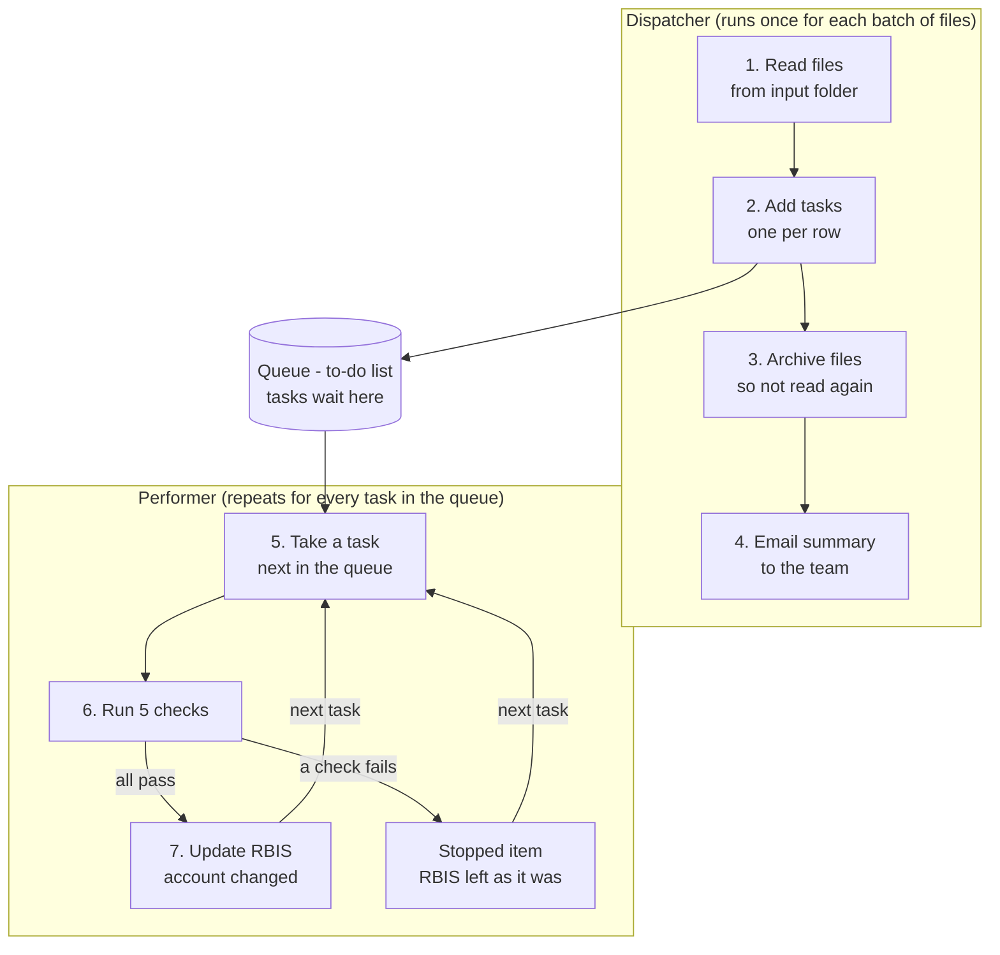
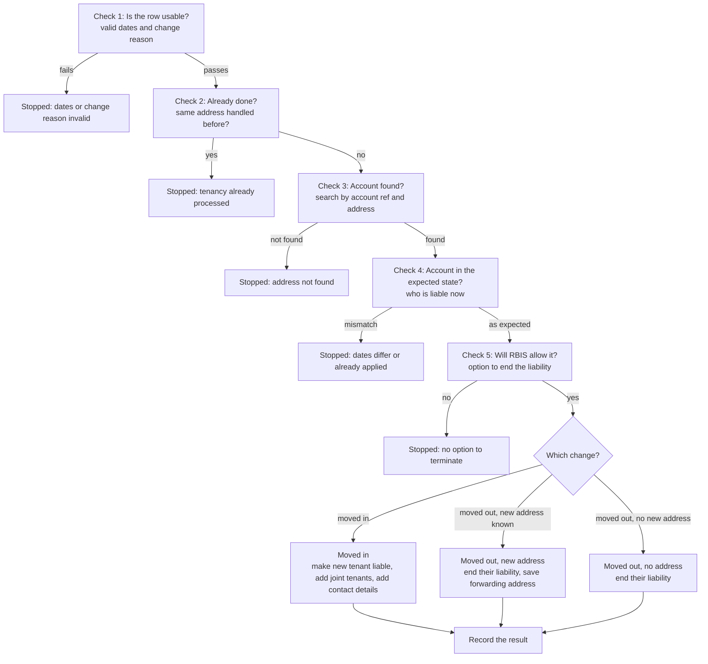

# HARSLL Process – What It Does

Last updated: 19 November 2026.
Based on two files: `RBIS_HARSLL_Dispatcher (2).jpg` and `HARSLL Process - Flowcharts (1).docx`.
Shared version: [HARSLL UiPath Process – Purpose and Flow Overview](https://claude.ai/artifact/Kjx7dd8njphvDfwTq833cU).

## In one minute

**What it does:** When someone moves into or out of a council property, the account that says who pays for that property has to be updated. This process makes that update automatically, using two UiPath robots.

**How it works, in four steps:**

1. A spreadsheet arrives listing who has moved in or out.
2. The first robot, the **Dispatcher**, turns each row into a separate task and puts it on a to-do list.
3. The second robot, the **Performer**, picks up each task, runs **5 safety checks**, and only then updates the account in RBIS.
4. If any check fails, the Performer leaves the account alone and writes down why, so a person can look at it.

**Why it is built this way:** a wrong change could put the wrong person on a bill or close the wrong account. So the robot is designed to do nothing rather than guess.

Where this document says "most likely" or "our reading", it is interpreting the flowcharts. Those points are listed under [Open questions](#open-questions-for-the-process-owner) for the process owner to confirm.

## Words used in this document

| Word | Plain meaning |
| --- | --- |
| **Tenancy** | A person's agreement to rent a property. It has a start date and, when they leave, an end date |
| **Moved in** (tenancy start) | A new tenancy has begun. The flowchart calls this TENANCY_START |
| **Moved out** (tenancy end) | A tenancy has finished. The flowchart calls this TENANCY_END |
| **Account** | The record in RBIS for a property, showing who must pay and from when |
| **Account reference** | The account's ID number |
| **Liable party** | A person responsible for paying on the account. Joint tenants are each a liable party |
| **Change reason** | The reason on the spreadsheet row for the change, such as moving in or out |
| **RBIS** | The system that holds the accounts (see the next section) |
| **ABRITAS** | The housing system the changes most likely come from |
| **UiPath** | Software for building robots that do computer tasks the way a person would |
| **Dispatcher** | The first robot. It prepares the work |
| **Performer** | The second robot. It does the work |
| **Queue** (to-do list) | Where tasks wait between the two robots |
| **Task** (work item) | One row from the spreadsheet: one change for one property |
| **Stopped item** | A task the robot deliberately did not finish because a check failed |
| **Archive** | The folder where finished spreadsheets are moved so they are not read twice |

## The systems involved

**RBIS is the system the robot updates.** It holds the accounts, the people liable to pay on each account, and the start and end dates of that liability.

The source files never spell out the name, and it is not the name of a public product. RBIS is most likely the council's **revenues and benefits system** (council tax and related accounts) under a local name. The setting name `RBIS_HARSLL_DataFolder` ties the whole process to it. The full name and the product behind it need confirming with the process owner.

| System | What it is | Its part in this process | How sure |
| --- | --- | --- | --- |
| **RBIS** | The council's accounts system for who pays for each property (most likely council tax) | The robot finds the account, checks it, and starts or ends a person's liability | Inferred from the steps; name not defined |
| **ABRITAS** | Civica housing software for housing registers, lettings and tenancies ([Civica](https://civica.com/en-gb/product-pages/housing-needs-solution)) | Most likely where the tenancy changes start. The move-in path checks "ABRITAS?" | Product confirmed; its role inferred |
| **Excel files** | Spreadsheets of tenancy changes, one row per change | The input that the Dispatcher reads | Shown in the Dispatcher |
| **UiPath Orchestrator** | UiPath's control centre for robots | Holds the settings and the queue of tasks between the two robots | Shown in the Dispatcher |
| **Outlook** | Email | Sends the summary email when the Dispatcher finishes | Shown in the Dispatcher |

## The big picture: how the two robots work together

The two robots never talk to each other directly. The **queue** sits between them: the Dispatcher puts tasks into it, and the Performer takes them out one at a time. This lets the two run separately. File archiving belongs to the Dispatcher; stopped items belong to the Performer.

| What | Which robot | When it happens | What it means |
| --- | --- | --- | --- |
| **Tasks added to the queue** | Dispatcher | While reading each file, one task per row | Every row becomes a separate piece of work for the Performer |
| **Files archived** | Dispatcher | Once, at the end of a run, after every row of every file is in the queue | The Excel files move from the input folder to the archive folder, so the next run does not read them again. Nothing is deleted and RBIS is not touched |
| **Summary email** | Dispatcher | Straight after archiving | The team is told which files were read, or that no files were found |
| **RBIS updated** | Performer | For each task, only when all 5 checks pass | The account in RBIS is changed: liability started or ended |
| **Stopped item** | Performer | For each task, as soon as any check fails | The robot leaves that RBIS account exactly as it was, records the reason (for example "Address not found") and moves on to the next task. A person needs to look at it. One stopped item does not stop the others |

## Part 1 – Dispatcher: gets the work ready

The Dispatcher only prepares the work. **It never changes anything in RBIS.**

1. **Loads its settings:** which folders to use and who gets the summary email.
2. **Looks for spreadsheets** in the input folder. If there are none, it jumps to step 7 and reports "no files".
3. **Reads each spreadsheet** row by row.
4. **Links people at the same address.** If several rows share an address (for example, joint tenants), it groups them so the Performer knows they belong together.
5. **Creates one task per row** and puts it on the to-do list (queue).
6. **Archives the spreadsheets:** moves them to the archive folder so they are not read again.
7. **Emails a summary** to the team, listing the files it read, or saying none were found.
8. **Records the total** number of tasks it created.

## Part 2 – Performer: checks first, then updates

The Performer handles **one task at a time**. Before it changes anything in RBIS, it asks **five questions** in a fixed order. It makes the change only if all five answers are right. If any answer is wrong, it stops that task, writes down the reason, and moves on to the next task.

### The 5 checks, one by one

Each check below explains what the robot asks, what it looks at, why the check exists, and what happens if it fails. The last row gives the box names in the original flowchart, so you can match them up.

#### Check 1 – Is the information in the row usable?

| | |
| --- | --- |
| **The question** | Are the dates real, and is the change reason one the robot knows how to handle? |
| **What it looks at** | The start date, end date and change reason on the spreadsheet row |
| **Why it matters** | Wrong or missing dates would put wrong dates on someone's account. A change reason the robot was not built for could be handled the wrong way |
| **If it fails** | The task stops with **"Start and End invalid"** or **"Change reason not valid"** |
| **In the flowchart** | "Start or End Dates Valid?", then "Check Process is Valid" and "Valid?" |

#### Check 2 – Has this already been done?

| | |
| --- | --- |
| **The question** | Has a task for this same address already been handled? |
| **What it looks at** | The address on the row, and whether the Dispatcher marked it as sharing an address with another row |
| **Why it matters** | Making the same change twice could create a duplicate account or bill someone twice |
| **If it fails** | The task stops with **"Tenancy already processed"** |
| **In the flowchart** | "Duplicate Address?" |

#### Check 3 – Can the right account be found?

| | |
| --- | --- |
| **The question** | Can the robot find the matching account in RBIS? |
| **What it looks at** | The account reference on the row. If there is one, the robot searches RBIS by the reference and by the address. It writes the address differently for a flat and for a house |
| **Why it matters** | The robot must never change an account it is not sure about. A guess could change a stranger's bill |
| **If it fails** | The task stops with **"Address not found"**. This also happens when the row has no account reference at all |
| **In the flowchart** | "Account Ref Empty?", "Address Search", "Search By Account Ref", "Address found?", and the "Is a Flat?" branch |

#### Check 4 – Is the account in the state the change expects?

| | |
| --- | --- |
| **The question** | Is the right party liable in RBIS at the moment, so that the change can be made? |
| **What it looks at** | Who is liable on the RBIS account now ("Liable Parties Match?"). For a move-in the robot carries on when they match; for a move-out it carries on when they do not. In the other cases it compares the RBIS start date with the row's date, and every result of that comparison is a stop |
| **Why it matters** | If RBIS already shows the change, it has been done before (perhaps by a person) and must not be done twice. If RBIS shows different dates, a person needs to decide which is right |
| **If it fails** | The task stops with **"Account already processed"** (RBIS already matches the row), **"Check Dates"** (RBIS dates differ from the row) or **"No Start Date"** (RBIS has no start date to compare) |
| **In the flowchart** | "Check address and Liable party", "Tenancy Start?", "Liable Parties Match?", "RBIS Start Date Present?", "RBIS Start = Input Start?" and "RBIS Start = Input End?" |

This is the most complicated part of the flowchart. Our reading (inferred): "match" means **the landlord is the liable party now**. On a move-in the landlord's liability is ended and the tenant's starts; on a move-out the tenant's is ended. An earlier version of this document described the check as "people and dates match, so proceed", which was wrong: the date comparisons only decide which stop reason applies. The [n8n design](../design/HARSLL-n8n-design.md#check-4-in-detail) sets this out in full. The exact rule is listed under Open questions.

#### Check 5 – Will RBIS allow the change?

| | |
| --- | --- |
| **The question** | Does RBIS offer the option to end (terminate) the current liability on this account? |
| **What it looks at** | The matched account, after the robot has selected it in RBIS |
| **Why it matters** | Every change needs the current liability ended first (our reading). If RBIS does not offer that option, something about the account needs a person's judgement, and the robot should not force it |
| **If it fails** | The task stops with **"No option to Terminate"** |
| **In the flowchart** | "Select Account", "Get Matched Address", "Check if Terminate", "Can Terminate Account?" |

### When all 5 checks pass: what the robot changes

The robot then follows one of three paths, depending on the change.

| Situation | What the robot does in RBIS | Why |
| --- | --- | --- |
| **Someone moved in** | Makes the new tenant liable, adds any joint tenants, creates the account detail and adds contact details | So the new tenant pays from the date they moved in |
| **Someone moved out, new address known** | Ends their liability and records their forwarding address | So they stop being charged, and any final bill can reach them |
| **Someone moved out, no new address** | Ends their liability | So they stop being charged |

Every path ends with the robot recording the result ("Log Status").

### Extra checks when someone moves in

The flowchart has a separate branch that is **not connected to the main flow**, so when it runs is not shown. It appears to add a person, such as a joint tenant, to a tenancy that already exists. An earlier version of this document described it as a set of gates on every move-in, which was wrong.

1. **Has this tenancy already been processed?** Only the "yes" route is drawn.
2. **Did the change come from ABRITAS?** If not, it stops with "Tenancy already processed".
3. **Is it the same as the previous tenancy?** If not, it stops.
4. **Can an additional liable party be added?** If not, it stops. If so, the robot adds the person and creates the detail record.
5. **Are there contact details to record?** If so, they are added. If not, it stops with "Contact details do not exist", after RBIS has already been changed.

## Why a task is stopped: quick lookup

A stopped task is **not a fault in the robot**. It means the robot found something it was not sure about and chose to leave the account alone. A person then needs to look at it. Use this table to look up a reason the robot recorded.

| Reason recorded | Which check | What it means in plain words |
| --- | --- | --- |
| Start and End invalid | Check 1 | The dates on the spreadsheet row are wrong or missing |
| Change reason not valid | Check 1 | The reason for the change is not one the robot handles |
| Tenancy already processed | Check 2, or move-in checks | This change has already been made |
| Address not found | Check 3 | The account could not be found in RBIS, or the row had no account reference |
| Account already processed | Check 4 | RBIS already shows this change |
| Check Dates | Check 4 | The dates in RBIS do not match the spreadsheet |
| No Start Date | Check 4 | The RBIS account has no start date to compare against |
| No option to Terminate | Check 5 | RBIS does not allow the current liability to be ended |
| Unable to add party | Move-in checks | A joint tenant could not be added to the account |
| Contact details do not exist | Move-in checks | There are no contact details to record |

The flowchart does not show where stopped tasks are reported or who reviews them. This is listed under Open questions.

## Open questions for the process owner

This document is based only on two pictures: the Dispatcher steps and the Performer flowchart. These points need confirming:

- [ ] What does HARSLL stand for, and who owns the process?
- [ ] What does RBIS stand for, and which product is it?
- [ ] Do the changes come from ABRITAS? Which system produces the spreadsheets, and what columns do they have?
- [ ] Which change reasons are allowed (Check 1)?
- [ ] What are the exact rules for comparing RBIS with the spreadsheet (Check 4)?
- [ ] When does the unconnected "Tenancy Processed? → ABRITAS? → Same as previous tenancy?" branch run, and what do those questions mean exactly?
- [ ] Is the landlord the liable party in RBIS between tenancies? Does HARSLL refer to Housing Association / Registered Social Landlord?
- [ ] Does the robot update RBIS by clicking through its screens, or through an API or database?
- [ ] Who looks at stopped tasks, and where are they reported?
- [ ] How often does it run, and how many rows does a spreadsheet usually have?
- [ ] Are joint tenants handled as one task or as separate linked tasks?
