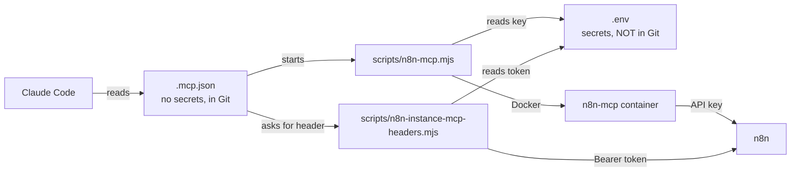

# Connect the n8n MCP servers to Claude Code

This guide connects Claude Code to your local n8n through two **MCP servers**. MCP (Model Context Protocol) is how Claude Code uses outside tools. Once connected, Claude Code can look up n8n nodes, check workflows for mistakes, and create, update and run workflows in your local n8n.

Do [Run n8n locally with Docker](01-run-n8n-locally.md) first. It takes about 10 minutes.

## The two servers

| Server | Name in Claude Code | What it is good at | How it connects |
| --- | --- | --- | --- |
| **n8n-mcp** (community, [czlonkowski/n8n-mcp](https://github.com/czlonkowski/n8n-mcp)) | `n8n-mcp` | Knows every n8n node and its settings, checks workflows **before** they are saved, searches templates, and manages workflows through the n8n API | Runs in Docker, uses your **n8n API key** |
| **n8n built-in MCP** | `n8n-instance` | n8n's own server. Builds, edits and runs workflows inside n8n, using n8n's own view of them | Talks to n8n directly, uses your **instance MCP token** |

They overlap a little, and that is fine: `n8n-mcp` is the main tool for designing and checking, while the built-in server is n8n's own route in.

## How secrets are kept safe



- [`.mcp.json`](../../.mcp.json) is committed and shared. It contains **no secrets**, only which scripts to run.
- The two scripts in [`scripts/`](../../scripts/) read the key and token from your `.env` when Claude Code connects.
- `.env` is ignored by Git, so your key and token never leave your machine.

## Step 1: Create the n8n API key (for `n8n-mcp`)

1. Open http://localhost:5678/settings/api (or **Settings → n8n API**).
2. Click **Create an API key**.
   - **Label:** `claude-code-mcp`
   - **Expiration:** 90 days is a sensible default.
3. Copy the key. **n8n shows it only once.**
4. In `.env`, paste it after `N8N_API_KEY=`, with no spaces or quotes. Save.

## Step 2: Turn on n8n's built-in MCP server (for `n8n-instance`)

1. Open **Settings → Instance-level MCP** in n8n (under **AI** in the settings menu).
2. Under **Connection details**, set **MCP status** to **Enabled**.
3. Next to **Connect your client**, click **Connect**.
4. In the **Connect a client** dialog, choose the **API key** tab, not "OAuth (recommended)". The API key option lets the token sit in `.env`; ignore the `claude mcp add` command and the config JSON shown in the dialog, because the repo's `.mcp.json` already does that job.
5. n8n generates a personal access token and shows a **Configuration JSON**. Copy only the token, the long value after `Bearer ` in the `Authorization` line. **It is shown only once.** Generating a new one cancels the old one.
6. In `.env`, paste it after `N8N_MCP_TOKEN=`. Save.

Then decide which workflows the built-in server may see. Each workflow must be switched on for MCP:

- under **Access**, open **Workflows enabled** to choose workflows, or turn on **Auto-expose new workflows** if offered there, or
- open the workflow → workflow menu → **Settings** → turn on **Available in MCP**.

For this project, exposing all HARSLL workflows is the simplest choice. It is a local n8n with test data only.

## Step 3: Load the servers in Claude Code

1. Make sure n8n is running: `docker compose ps` shows it as healthy.
2. Restart Claude Code so it reads `.mcp.json`:
   - **VS Code extension:** run **Developer: Reload Window** from the command palette (Ctrl+Shift+P), or close and reopen VS Code.
   - **Terminal:** exit Claude Code and start it again from the repo folder.
3. Claude Code asks whether to trust the project's MCP servers. **Approve both** `n8n-mcp` and `n8n-instance`.
4. Check they are connected: type `/mcp` in Claude Code. Both servers should show as **connected**.

The first time `n8n-mcp` starts, Docker downloads its image (about 1 GB).

## Checking it works

Ask Claude Code:

> Use the n8n-mcp health check to confirm you can reach n8n.

It should report status **ok**.

To test the command-line part on its own, without Claude Code:

```bash
node scripts/n8n-instance-mcp-headers.mjs
```

This prints `{"Authorization":"Bearer …"}` if the token is set, or a clear message saying what is missing. **Do not share its output.** It contains your token.

## Settings explained

| Setting | Where | Value | Why |
| --- | --- | --- | --- |
| `N8N_API_KEY` | `.env` | Your key | Lets `n8n-mcp` read and change workflows through the n8n API |
| `N8N_MCP_TOKEN` | `.env` | Your token | Lets Claude Code use n8n's built-in MCP server |
| `N8N_MCP_VERSION` | `.env` | `2.103.1` | Pins the `n8n-mcp` version so everyone runs the same one |
| Network | `scripts/n8n-mcp.mjs` | Shares the n8n container's network | `n8n-mcp` reaches n8n at `localhost`, so its protection against calling private addresses can stay at **moderate** (localhost only) |
| `N8N_MCP_TELEMETRY_DISABLED` | `scripts/n8n-mcp.mjs` | `true` | No usage data is sent to the `n8n-mcp` project |

## Troubleshooting

| Problem | What to do |
| --- | --- |
| `/mcp` shows `n8n-mcp` as failed | Check n8n is running (`docker compose ps`). The script needs the container `n8n-builder-n8n-1` to exist |
| `N8N_API_KEY is missing or empty in .env` | Do step 1, then restart Claude Code |
| `N8N_MCP_TOKEN is missing or empty in .env` | Do step 2, then restart Claude Code |
| `n8n-instance` shows 404 or not found | **Enable MCP access** is off. Do step 2 |
| `n8n-instance` shows 401 | The token is wrong or was replaced. Generate a new one (step 2) and update `.env` |
| `n8n-mcp` health check: "SSRF protection" | The script was changed to use a non-localhost address. Restore it from Git |
| An API key has expired | Create a new one (step 1) and update `.env` |
| Servers missing from `/mcp` | Claude Code was not restarted, or the servers were not approved. To be asked again, run `claude mcp reset-project-choices`, then restart |
