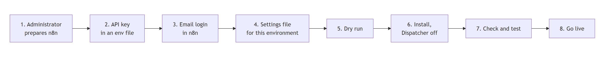

# Move HARSLL to another environment

**For:** whoever installs HARSLL on another n8n, such as a BCC test or live system. Usually an n8n administrator and a HARSLL developer, working together. Read [How HARSLL works](../guides/how-harsll-works.md) first if you're new to it.

**In short:** the target n8n's administrator prepares the environment. You then run one script, `scripts/setup-harsll.mjs`, from a copy of this repository. It creates the tables, installs the six workflows, writes that environment's settings and publishes everything in the right order. A few things are deliberately left to people: logins, the environment's own values, and the decision to go live.

The script was proved on a separate, freshly installed n8n 2.48.5. It installed HARSLL, processed a 31-row test spreadsheet end to end, and a second run changed nothing.



<!-- Diagram source: ../diagrams/setup-move-steps.mmd. Edit it, then redraw the image: see docs/diagrams/README.md -->

## What moves, and how

| Part | How it gets there | Notes |
| --- | --- | --- |
| The six workflows | **The script**, from `workflows/*.json` | Created, or updated in place if they already exist (matched by name) |
| The three Data tables | **The script** | Created empty, with the right columns. The lock row is added |
| Settings for this environment | **The script**, from your settings file | Folders, email addresses, RBIS address, confirmed business rules. The script fills in every table and workflow ID itself |
| Wiring between workflows | **The script** | Settings gets the new IDs; the Dispatcher's **Load settings** step points at the new Settings workflow; the file trigger watches the input folder from your settings |
| Email login (SMTP) | **By hand** in n8n | The script finds it by name and connects the email steps to it |
| RBIS login | **By hand**, later | Not needed until the real RBIS adapter exists (see [The RBIS adapter](#the-rbis-adapter)) |
| n8n's own configuration | **The administrator** | See [Before you start](#before-you-start) |
| Pretend RBIS, test mailbox, Run now | **Not moved** | Local testing tools. Run now is switched off with `--without-run-now` |
| Test data | **Never moved** to a live system | |

## Keys and secrets

Every secret stays out of Git and out of this repository's committed files. Here is each one, where it lives, and who handles it:

| Secret | What it's for | Where it lives | Who creates it | Notes |
| --- | --- | --- | --- | --- |
| **n8n encryption key** (`N8N_ENCRYPTION_KEY`) | n8n uses it to encrypt the logins it stores | The target n8n's own configuration | The administrator, once, when the n8n is set up | **Never copy the local one.** Each n8n has its own. Back it up: without it, stored logins can't be read |
| **n8n API key** | Lets the set-up script install HARSLL | An env file on the machine running the script, such as `.env.bcc-test`. Ignored by Git | Created in the target n8n: **Settings → n8n API**, by its owner or an admin | Give it an expiry. Revoke it when the install is done, and create a new one for the next update. The script never accepts it on the command line and never prints it |
| **Email login** | Sending the summary and rejection emails | An n8n **credential** of type SMTP, encrypted inside n8n | Whoever manages the council's mail accounts, typed straight into n8n | Never put it in a file. Use a dedicated, send-only mailbox if possible |
| **RBIS login** | Reading and changing RBIS | An n8n credential, when the real RBIS adapter is built | RBIS administrators | Not needed yet |

Your local `.env` is never copied anywhere. It holds the local encryption key and local API keys only.

## Before you start

### What the target n8n's administrator must provide

| # | Requirement | Why | How to check |
| --- | --- | --- | --- |
| 1 | **n8n 2.48 or later** | HARSLL was built and tested on 2.48.5 | **Settings → About** |
| 2 | **The Local File Trigger and Execute Command nodes allowed**, through the `NODES_EXCLUDE` setting | n8n 2.x switches both off by default. HARSLL uses the first to notice a new spreadsheet and the second to list, archive and reject files | Ask the administrator. **Check this first.** If the council won't allow them, file handling must be redesigned, for example around SharePoint or SFTP, before HARSLL can be installed |
| 3 | **Four folders** that n8n can read and write: input, archive, rejected, reports. Covered by `N8N_RESTRICT_FILE_ACCESS_TO` | Where spreadsheets arrive and go | The paths, as n8n sees them, go into your settings file |
| 4 | **Time zone** `Europe/London` (`GENERIC_TIMEZONE`) | Dates and the "stuck" timer depend on it | |
| 5 | **Run history clean-up**: `EXECUTIONS_DATA_PRUNE=true`, `EXECUTIONS_DATA_MAX_AGE=168` | Failed runs hold personal data; they must be deleted after 7 days. HARSLL's workflows already keep nothing from successful runs | |
| 6 | **The public API switched on**, and an owner or admin who can create an API key | The script works through it. Listing credentials needs owner or admin rights | **Settings → n8n API** is visible |
| 7 | **Network access** from the machine that runs the script to the n8n address | | Open the n8n address in a browser from that machine |
| 8 | **A mail server** n8n can send through | Summary and rejection emails | |

For reference, the local settings that meet these are in [`compose.yaml`](../../compose.yaml).

### What you need on your own machine

- **Either** a copy of this repository, at the commit you want to install, **or** the install kit built from it (below).
- **Node.js 20 or later.** Check with `node --version`.
- Nothing else: the script uses no extra packages.

### The install kit

For an installer who shouldn't need the whole repository, build one zip:

```bash
node scripts/make-install-kit.mjs            # from the last commit
node scripts/make-install-kit.mjs --ref v1.0 # from a tag or an earlier commit
```

It writes `dist/harsll-install-kit-<date>-<commit>.zip` (`dist/` is ignored by Git). The kit holds the six workflows, the set-up script, the settings template, all of `docs/`, and the pretend RBIS with its made-up accounts and the sample spreadsheet, in the repository's own layout, plus an `INSTALL.md` that summarises this guide. Every step below works the same from the unzipped kit folder.

The kit is built with `git archive` from a commit, so only committed files can go in. Before building, the script also refuses any env file, filled-in key or password, token, n8n owner block or original process document. Uncommitted changes are left out; the script says so.

n8n cannot import the zip itself, and importing the workflow files one by one in the editor leaves them unconnected. The set-up script is what installs it.

## Step 1: put the API key in an env file

Create a file in the repository (or kit) folder named after the environment, for example `.env.bcc-test`. Any file starting `.env.` is ignored by Git.

```ini
# Target n8n for the HARSLL set-up script. Never commit this file.
N8N_API_URL=https://n8n.bcc-test.example
N8N_API_KEY=paste-the-key-here
```

`N8N_API_URL` is the address you open n8n at, without `/api/v1`.

## Step 2: create the email login in n8n

In the target n8n: **Credentials → Add credential → SMTP**. Enter the mail server's details, and give the credential a clear name, such as `HARSLL mail (BCC test)`. You'll pass that exact name to the script.

## Step 3: write the settings file

Copy [`config/settings.example.json`](../../config/settings.example.json) to `config/bcc-test.local.json`. Files ending `.local.json` are ignored by Git. Change the values:

| Setting | What to put |
| --- | --- |
| `profile` | A name for this copy, such as `bcc-test` |
| `inputFolder`, `archiveFolder`, `rejectedFolder`, `reportsFolder` | The four folder paths **as n8n sees them** |
| `summaryEmailTo`, `summaryEmailFrom` | Who receives the summaries and rejection notices, and the sender address |
| `rbisBaseUrl` | The address of RBIS for this environment (see [The RBIS adapter](#the-rbis-adapter)) |
| `landlordNames` | The landlord's name as RBIS shows it |
| Business rules (`deathHandling`, `jointTenantHandling`, `allowedChangeReasons`, `requiredColumns`, …) | Only the ones the process owner has confirmed for this environment. Leave the rest out to keep the cautious defaults |

Give only the values that differ from the defaults in [`workflows/harsll-settings.json`](../../workflows/harsll-settings.json). The script refuses unknown names, values of the wrong type, and any table or workflow ID (it fills those in itself).

**`fileSettleSeconds` must be at least 60.** HARSLL only reads files that have been unchanged for a minute. A shorter wait means the run triggered by a new file finds nothing, and the file then waits for the 15-minute timer. The script refuses values under 60.

## Step 4: dry run

From the repository (or kit) folder:

```bash
node scripts/setup-harsll.mjs --env-file .env.bcc-test --settings config/bcc-test.local.json \
  --email-credential "HARSLL mail (BCC test)" --without-run-now --leave-dispatcher-off --dry-run
```

This checks everything before anything is written: the env file, the settings file, the six workflow files, the email login, and any tables that already exist. It lists every problem at once. If there are none, it prints the plan: each table and workflow, and whether it will be created, updated or left alone. **Nothing is changed.**

## Step 5: install

Run the same command without `--dry-run`:

```bash
node scripts/setup-harsll.mjs --env-file .env.bcc-test --settings config/bcc-test.local.json \
  --email-credential "HARSLL mail (BCC test)" --without-run-now --leave-dispatcher-off
```

In order, the script:

1. creates the three tables and the lock row;
2. creates the six workflows: Settings, Performer: RBIS adapter, Performer, Dispatcher: take in a file, Dispatcher: report a batch, Dispatcher;
3. writes the table and workflow IDs and your settings into **HARSLL – Settings**;
4. points the Dispatcher's **Load settings** step at Settings, and the file trigger at your input folder;
5. connects the email steps to your email login;
6. switches off the **Run now** webhook (`--without-run-now`);
7. publishes every workflow except the Dispatcher (`--leave-dispatcher-off`), so **nothing starts yet**.

It prints a summary with the new IDs. Keep it with the install record.

| Option | Use |
| --- | --- |
| `--env-file <path>` | Which n8n, through its env file. Default: the local `.env` |
| `--settings <path>` | This environment's settings file |
| `--email-credential <name>` | The name of the SMTP login created in step 2 |
| `--email-credential-id <id>` | Use a login by its ID instead, if the API key can't list credentials |
| `--without-run-now` | Switch off the test-only Run now webhook. Use it everywhere except local development |
| `--leave-dispatcher-off` | Install and publish everything except the Dispatcher, so no run can start |
| `--create-mailpit-credential` | Local development only: create the test-mailbox login |
| `--dry-run` | Check and show the plan; change nothing |

## Step 6: check the install

In the target n8n:

- [ ] **Workflows:** six HARSLL workflows. Five published; the Dispatcher not yet.
- [ ] **Overview → Data tables:** `harsll_cases` and `harsll_batches` empty; `harsll_lock` with one row, `dispatcher`.
- [ ] **HARSLL – Settings → Settings step:** your values, and the IDs filled in.
- [ ] **HARSLL – Dispatcher → File added to input folder:** watching your input folder.
- [ ] **HARSLL – Dispatcher → Run now:** shown as deactivated.
- [ ] **The email steps** (in take in a file and report a batch) use your email login.

## Step 7: test before going live

Test in a **test** environment first, never against live RBIS. [Testing in another environment](../guides/try-harsll-with-sample-data.md#testing-in-another-environment) explains what test data is needed.

1. Publish the Dispatcher: open it and click **Publish**, or re-run the command from step 5 without `--leave-dispatcher-off`.
2. Save a test spreadsheet into the input folder.
3. Within about two minutes: the file moves to the archive, the cases appear in `harsll_cases`, and the summary email arrives.
4. Check every outcome against what you expected, and check the worklist in the reports folder.
5. If anything fails, look in n8n **Executions**: failed runs are kept for 7 days.

## Step 8: go live

When the process owner and IT have signed off the test:

1. Install into the live n8n (steps 1 to 6) with the live settings file and email login.
2. Agree who reads the summary emails and works the worklist, and from when (see [Using HARSLL day to day](../guides/using-harsll.md)).
3. Publish the Dispatcher.
4. Watch the first few batches closely: summary emails, worklists, and n8n **Executions** for failures.
5. Revoke the API key used for the install.

**To stop HARSLL at any time,** unpublish the Dispatcher. Nothing else starts on its own.

## Updating an installed copy

Make every change in the repository first, never directly in the target n8n:

1. Change and test locally, export the workflows, and commit.
2. On the target: create a fresh API key, then run the **same command** with `--dry-run`. It shows exactly which workflows will change.
3. Run it for real. Workflows are updated in place, with no duplicates; tables keep their data; the lock is left alone. Your settings file is applied again, so keep it up to date.

A change made by hand in the target n8n is overwritten by the next update. To keep it, copy it into the repository first.

**To roll back,** check out the earlier commit and run the command again. To stop processing while you decide, unpublish the Dispatcher.

## The RBIS adapter

The adapter that is installed today talks to the **pretend RBIS's** web API (`rbisBaseUrl`). How the real RBIS can be reached (an API, a database, or its screens only) is still an [open question](../design/HARSLL-n8n-design.md#open-questions). Until it's answered:

- **A trial install** in another environment can use the pretend RBIS. Run the `mock-rbis` service (plain Node.js; see [mock-rbis/README.md](../../mock-rbis/README.md)) where that n8n can reach it, and set `rbisBaseUrl` to its address. This proves everything except the RBIS connection, using made-up accounts only.
- **A live install** needs a real RBIS adapter. The adapter is the only workflow that changes, and the Performer's hand-over to it is fixed ([interfaces](../design/interfaces.md#performer--rbis-adapter)). The RBIS login will then be an n8n credential.

## Another route: n8n packages

n8n 2.27 and later can export workflows as a package (`.n8np`) with its separate `n8n-cli` tool. It was tried during this work:

- it moved the six workflows, keeping their IDs, and created an empty placeholder for the email login;
- it did **not** create the tables, and did **not** publish anything;
- Settings still pointed at the original tables, which don't exist on the target.

So a package would still need the set-up script, or manual work, afterwards. The script alone is simpler, and is the supported route. Packages are also still a preview feature in n8n.

## Troubleshooting

| Problem | What to do |
| --- | --- |
| `N8N_API_KEY is missing or empty` | Check the env file name and contents (step 1) |
| HTTP 401 from n8n | The API key is wrong, expired or revoked. Create a new one |
| The email login is not found | Check its exact name in **Credentials** and pass it with `--email-credential`. If the API key can't list credentials, use `--email-credential-id` |
| "Column has a different type" | A table with that name exists with different columns. Check whether it's an old HARSLL table; the script won't change a column's type |
| A spreadsheet isn't picked up | Check the Dispatcher is published, the file trigger's folder matches `inputFolder`, `fileSettleSeconds` is at least 60, and the Local File Trigger and Execute Command nodes are allowed. The 15-minute timer picks up anything missed |
| Publishing fails with an unknown or unrecognised node type | The Local File Trigger or Execute Command node is switched off on that n8n (requirement 2) |
| No summary email | Check the email login, and n8n **Executions** for a failed run. Remember the email waits until every case in the spreadsheet is finished |
