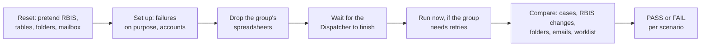

# Testing HARSLL

**Status:** in use. Written during the parallel build (track C), 19 November 2026; timings measured on the first full runs against the finished workflows.

This guide explains how the HARSLL workflows are tested: what the tests cover, how to run them, how long they take, how to read the results, and how to add a test. The tests follow the test plan in the [design](design/HARSLL-n8n-design.md#test-plan).

To see HARSLL work on a small sample first, without the full test set, see [Try HARSLL with sample data](guides/try-harsll-with-sample-data.md).

## What the tests cover

There are **37 scenarios**, one for each line of the design's test plan. Each one is a small story, for example "a tenant moves in and the landlord is liable" or "the same file is dropped twice". For each scenario the test kit holds:

- the **spreadsheet rows** it needs (made-up people, all named "… Sample" or "… Test", at made-up addresses on "Example Street"),
- anything to **set up first**, such as making the pretend RBIS fail on purpose, or adding an account part-way through,
- the **expected results**, worked out from the design with the default settings.

After a run, the tests compare the expected and the actual results in five places:

| Where | What is checked |
| --- | --- |
| **Cases table** | One case per row, with the right status, reason, outcome, urgent flag, number of tries, the RBIS steps recorded, and every field the Dispatcher fills in (dates, keys, lead and joint rows) |
| **Pretend RBIS** | Exactly the changes expected for each scenario's account, in order: who stopped being liable and when, who became liable and from when, the detail record, contact details, forwarding address. Nothing more |
| **Folders** | Each file ends up where it should: archive, rejected, or left in the input folder |
| **Emails** | One summary per file with the right counts and no names or addresses in it; one email for each rejected file and each file with an unsafe name; none for Excel's temporary files |
| **Worklist** | The staff worklist lists the cases that need a person, urgent cases first, and nothing else |

The scenarios run in **groups**. Most scenarios share one main spreadsheet, because each uses its own account and cannot disturb the others. Scenarios that need their own timing have a group of their own: retries after a failure, files dropped twice, a file still being copied, two runs at the same moment, and n8n being stopped.



| Group | Scenarios | What it tests |
| --- | --- | --- |
| `main` | 1–23, 30, 32, 34, 37 | Six files dropped together: the main file with every check and update path, two more files, two bad files and a file with an unsafe name |
| `retry-24` | 24 | RBIS fails after the first change; the retry carries on where it stopped |
| `retry-25` | 25 | RBIS makes a change but its reply is lost; the retry does not make it twice |
| `retry-27` | 27 | A move-out fails once; the move-in for the same account waits for it |
| `fails-and-unreadable` | 26, 31 | A case that fails on every try; a file that cannot be read |
| `re-runs` | 28, 29 | The same file dropped twice; a referred row sent again after RBIS is corrected |
| `copying` | 33 | A file that is still being copied; an Excel temporary file |
| `two-runs` | 35 | Two runs started at the same moment |
| `while-stopped` | 36 | A file dropped while n8n is stopped. **Slow**, run only on request |

## The files

| File | What it is |
| --- | --- |
| [`test-data/scenarios.json`](../test-data/scenarios.json) | The scenarios, their rows, set-up, groups and expected results |
| [`test-data/spreadsheets/`](../test-data/spreadsheets/) | The test spreadsheets, generated from the scenarios |
| [`scripts/make-test-spreadsheets.mjs`](../scripts/make-test-spreadsheets.mjs) | Generates the spreadsheets |
| [`scripts/run-tests.mjs`](../scripts/run-tests.mjs) | Runs the tests and prints the report |
| [`scripts/run-tests.test.mjs`](../scripts/run-tests.test.mjs) | Checks the test kit itself, without n8n |
| [`scripts/lib/scenario-kit.mjs`](../scripts/lib/scenario-kit.mjs), [`scripts/lib/xlsx.mjs`](../scripts/lib/xlsx.mjs) | Shared code: keys, comparisons, the spreadsheet writer and reader |

Everything is plain Node.js with no extra packages.

## Before you run the tests

1. The local stack is running: `docker compose up -d` (see [Run n8n locally](setup/01-run-n8n-locally.md)).
2. HARSLL is installed: `node scripts/setup-harsll.mjs --create-mailpit-credential` (see [step 6 of the setup guide](setup/01-run-n8n-locally.md#6-install-harsll)). It publishes the six workflows with the local settings and switches on the Dispatcher's **Run now** webhook, which the tests use.
3. `.env` has a working `N8N_API_KEY`. The runner reads it and never prints it.

> **The tests wipe the HARSLL data.** Each group empties the Cases and Batches tables, frees the lock, resets the pretend RBIS, empties the `input`, `archive`, `rejected` and `reports` folders under `data/`, and deletes every message in the test mailbox. Use them only on a local stack with made-up data.

## How to run them

| To | Run | Time |
| --- | --- | --- |
| See the groups and scenarios, without running anything | `node scripts/run-tests.mjs --list` | Seconds |
| Run every scenario except the slow one | `node scripts/run-tests.mjs` | About 10–11 minutes |
| Run all 37, including the slow one | `node scripts/run-tests.mjs --include-slow` | About 14–21 minutes |
| Run some scenarios | `node scripts/run-tests.mjs --only 1,2,6` | About 2–3 minutes per group |
| Also run scenario 36 (stops and starts n8n) | `node scripts/run-tests.mjs --include-slow` | 4 to 10 minutes more, depending on when the 15-minute timer next fires |
| Check the test kit itself, without n8n | `node --test scripts/` | Seconds |
| Check the runner itself against the pretend RBIS and the tables, without the workflows | `node scripts/run-tests.mjs --self-check` | About a minute |

**Why it takes this long.** The Dispatcher waits a minute after a file arrives, so that it never reads a file still being copied. Every time the tests drop a file, they wait that minute too. The groups keep the number of drops low.

**`--only`** runs the whole group a scenario belongs to, because the scenarios of a group share their files, but it reports only the scenarios you asked for. `--only 2` therefore takes as long as the main group.

**Scenario 36** stops the n8n container, drops a file, and starts n8n again. The Dispatcher's 15-minute timer then has to find the file. It runs only with `--include-slow`, and only with the production profile, because stopping n8n interrupts anyone else using it.

**After scenario 36, reconnect the n8n-mcp server** in Claude Code (`/mcp`, then reconnect `n8n-mcp`). It shares n8n's network, so an n8n restart cuts it off.

### Other options

| Option | Use |
| --- | --- |
| `--verbose` | Also list the checks that were skipped |
| `--run-now-url URL` | Use a different Run now webhook |
| `--dispatcher-name NAME` | The Dispatcher's workflow name, if it is not `HARSLL – Dispatcher`. The runner watches its runs to know when it has finished |

## Reading the report

The runner prints what it does as it goes, then a report:

```text
main (212s)
  PASS   1  Move-in, landlord liable, contact details
  FAIL   2  Move-in, two joint tenants on two rows
          - case bruno: status: expected "duplicate", got "referred"
          - RBIS AC100002: change 3 missing: expected addLiableParty {"name":"Bruno Sample","type":"tenant","startDate":"2026-11-02"}
  ...
retry-24 (81s)
  PASS  24  Outage after the first RBIS call

35 passed, 1 failed, 1 not run in 14m 05s.
```

- **PASS** means every check for that scenario matched.
- **FAIL** lists each difference: what was expected, and what was found. `case bruno` is the row with that id in `scenarios.json`.
- **`RBIS AC…: change N`** is the Nth change the pretend RBIS recorded for that account. "missing" means a change that should have happened did not; "not expected" means a change happened that should not have.
- **`[at checkpoint …]`** marks a check made part-way through a group, for example "after the first try, the case is failed and the landlord's liability has been ended".
- **GROUP** lines are problems with a whole group, such as the Dispatcher not finishing in time, or a case in the table that no scenario expected. Every scenario in that group then counts as failed.
- **Not run** lists scenarios that were left out, and why.

The runner ends with exit code **0** if everything passed, **1** if anything failed, and **2** if it could not start (for example, n8n is not running).

### When a group times out

The runner waits a set time for the Dispatcher; the main group waits up to 10 minutes. If a group times out, check in n8n whether the Dispatcher ran and whether it failed (Executions). Common causes: a workflow is not published, the Run now webhook is off, or a lock was left behind by a run that crashed (the runner frees it at the start of each group).

The Dispatcher's own 15-minute timer may fire during a test. That is harmless, except that a check part-way through a group may then see one try more than expected. Run the group again.

## Adding a scenario

1. Add the scenario to `test-data/scenarios.json`: its rows (with an account of its own), and its expected results. Work the expected results out **from the design**, not from what the workflows do.
2. Put it in a group. If it needs no special timing, add its rows to the main file (`harsll-main.xlsx`) and its number to the `main` group. Otherwise add a group with its own file and steps.
3. If it needs a new account, add it to `test-data/rbis-accounts.json`, with a note naming the scenario.
4. Regenerate the spreadsheets: `node scripts/make-test-spreadsheets.mjs`.
5. Run `node --test scripts/`. Among other things, it checks your expectations against a plain reading of the design (`referenceRun` in `scripts/lib/scenario-kit.mjs`). If they disagree, one of them is wrong: find out which before going on.
6. Run the new scenario: `node scripts/run-tests.mjs --only <number>`.

Use made-up data only: names ending in "Sample" or "Test", addresses on "Example Street", emails at `example.test`. The unit tests reject anything else.

## What the tests cannot tell you

The pretend RBIS and the expected results come from the **same reading** of the flowchart. Passing tests show that the workflows do what the design says. They do **not** show that the design matches what the UiPath robots do today. That needs the UiPath project files, the process owner's answers to the design's open questions, or a side-by-side run of both on the same data (Phase 5).

The tests also do not cover:

- the real RBIS, the real mail server or the real shared folder;
- n8n stopping **in the middle** of a run (cases left "in progress"). The design handles it, but the test plan has no scenario for it;
- how long records are kept, which is still to be agreed.
